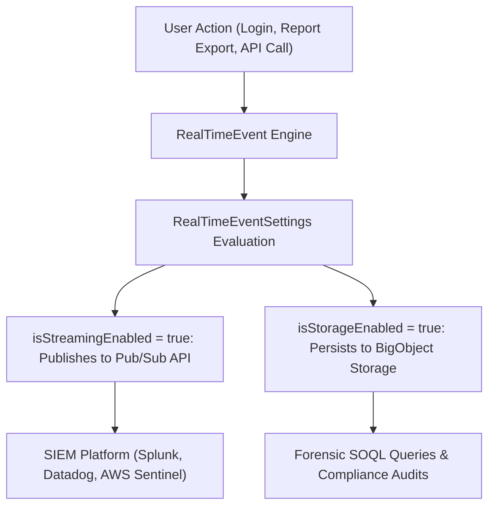

## Architectural Overview

In regulated enterprise environments, real-time threat detection and forensic audit trails are mandatory. Salesforce Shield Event Monitoring provides Real-Time Event Monitoring (RTEM) to detect credential compromises, unauthorized bulk data exfiltration, report exports, and suspicious API activity as it happens.

The `RealTimeEventSettings` metadata type manages real-time event streaming and storage policies across the tenant. It governs whether event streams—such as `ApiEventStream`, `LoginEventStream`, `ReportEventStream`, and `ListViewEventStream`—publish events to the Pub/Sub API for external Security Information and Event Management (SIEM) ingestion, and whether events are persisted to BigObjects for long-term forensic querying.



Managing real-time event configurations as code ensures security monitoring policies remain uniform and verifiable across all corporate Salesforce environments.

## Directory and File Conventions

In SFDX source projects, `RealTimeEventSettings` is organized as a singleton settings file:

| Property | Value |
| :--- | :--- |
| **Metadata Type Name** | `Settings` (member: `RealTimeEvent`) / `RealTimeEventSettings` |
| **SFDX Directory** | `force-app/main/default/settings/` |
| **File Suffix** | `.settings-meta.xml` |
| **Full File Path** | `force-app/main/default/settings/RealTimeEvent.settings-meta.xml` |
| **Scratch Org Setting Key** | `realTimeEventSettings` |

## Key Metadata Fields

The XML schema of `RealTimeEventSettings` controls streaming and storage per event stream:

| Field Name | Field Type | Required | Architectural Description |
| :--- | :--- | :--- | :--- |
| `realTimeEvents` | `RealTimeEvent[]` | Yes | List of real-time event stream configurations. |
| `entityName` | `string` | Yes | Event stream: `ApiEventStream`, `LoginEventStream`, `ReportEventStream`, etc. |
| `isEnrichmentEnabled` | `boolean` | No | Appends contextual user and session metadata to the event payload. |
| `isStorageEnabled` | `boolean` | No | Persists event records into native BigObjects for 6 months. |
| `isStreamingEnabled` | `boolean` | No | Publishes event messages to the enterprise streaming event bus. |

> [!NOTE]
> Stored events consume BigObject storage capacity; ensure your org has sufficient BigObject storage allocated before enabling storage on high-volume streams.

## Declarative XML and Package Manifest Examples

Below is an enterprise `RealTimeEvent.settings-meta.xml` configuration streaming and storing key security events:

```xml title="force-app/main/default/settings/RealTimeEvent.settings-meta.xml"
<?xml version="1.0" encoding="UTF-8"?>
<RealTimeEventSettings xmlns="http://soap.sforce.com/2006/04/metadata">
    <realTimeEvents>
        <entityName>ApiEventStream</entityName>
        <isEnrichmentEnabled>true</isEnrichmentEnabled>
        <isStorageEnabled>true</isStorageEnabled>
        <isStreamingEnabled>true</isStreamingEnabled>
    </realTimeEvents>
    <realTimeEvents>
        <entityName>LoginEventStream</entityName>
        <isEnrichmentEnabled>true</isEnrichmentEnabled>
        <isStorageEnabled>true</isStorageEnabled>
        <isStreamingEnabled>true</isStreamingEnabled>
    </realTimeEvents>
    <realTimeEvents>
        <entityName>ReportEventStream</entityName>
        <isEnrichmentEnabled>true</isEnrichmentEnabled>
        <isStorageEnabled>true</isStorageEnabled>
        <isStreamingEnabled>true</isStreamingEnabled>
    </realTimeEvents>
</RealTimeEventSettings>
```

### Scratch Org Definition Configuration

```json title="config/project-scratch-def.json"
{
  "orgName": "Shield Security Scratch Org",
  "edition": "Enterprise",
  "features": ["ShieldEventMonitoring"],
  "settings": {
    "realTimeEventSettings": {
      "realTimeEvents": [
        {
          "entityName": "LoginEventStream",
          "isStreamingEnabled": true,
          "isStorageEnabled": true
        }
      ]
    }
  }
}
```

### Package Manifest (`package.xml`)

```xml title="manifest/package.xml"
<?xml version="1.0" encoding="UTF-8"?>
<Package xmlns="http://soap.sforce.com/2006/04/metadata">
    <types>
        <members>RealTimeEvent</members>
        <name>Settings</name>
    </types>
    <version>68.0</version>
</Package>
```

## CLI Retrieval and Deployment Commands

Manage `RealTimeEventSettings` via the Salesforce CLI:

```bash
# Retrieve RealTimeEvent settings from the org
sf project retrieve start --metadata Settings:RealTimeEvent

# Deploy RealTimeEvent settings to target environment
sf project deploy start --metadata Settings:RealTimeEvent

# Validate deployment into sandbox
sf project deploy validate --metadata Settings:RealTimeEvent
```

## Architect Best Practices and Gotchas

- **Feature License Requirements:** Deploying `RealTimeEventSettings` into an environment lacking Salesforce Shield Event Monitoring feature licenses will fail with `Feature not supported`.
- **Pub/Sub API Streaming Subscription:** When `isStreamingEnabled` is true, use Salesforce Pub/Sub API (gRPC) rather than legacy CometD clients to ingest high-velocity event streams into enterprise SIEMs with reliable replay capabilities.
- **Transaction Security Integration:** Real-Time events feed directly into Transaction Security Policies. When configuring policies to block report exports or require MFA, ensure emergency administrator bypass exceptions are implemented to prevent administrative lockouts.

> [!TIP]
> Enable `isEnrichmentEnabled` on `LoginEventStream` and `ApiEventStream` to include geolocation, browser type, and client IP addresses directly in the payload.
