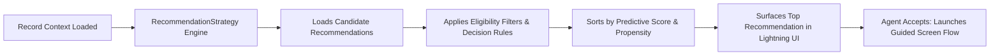

## Architectural Overview

Front-line customer service agents and sales representatives are frequently overwhelmed with competing priorities, policy manuals, and disconnected customer data. Einstein Next Best Action (NBA) addresses this challenge by delivering context-aware, prioritized recommendations directly inside Lightning record pages and Experience Cloud portals.

The `RecommendationStrategy` metadata type represents the declarative decision engine of Next Best Action. Strategies load candidate recommendations, evaluate business rules, incorporate machine learning predictions from Einstein Prediction Builder, filter out ineligible offers, and sort recommendations by business value.



By maintaining recommendation strategies in source control, enterprise architects guarantee that customer engagement logic, compliance guardrails, and cross-sell rules remain synchronized across all delivery pipelines.

## Directory and File Conventions

In SFDX source format, `RecommendationStrategy` metadata files reside in the `recommendationStrategies/` directory:

| Property | Value |
| :--- | :--- |
| **Metadata Type Name** | `RecommendationStrategy` |
| **SFDX Directory** | `force-app/main/default/recommendationStrategies/` |
| **File Suffix** | `.recommendationStrategy-meta.xml` |
| **Full File Path Example** | `force-app/main/default/recommendationStrategies/Retention_Offer_Strategy.recommendationStrategy-meta.xml` |
| **Execution Context** | Lightning Next Best Action component, Flow, Experience Cloud |

## Key Metadata Fields

The XML schema of `RecommendationStrategy` models the decision graph and strategy nodes:

| Field Name | Field Type | Required | Architectural Description |
| :--- | :--- | :--- | :--- |
| `masterLabel` | `string` | Yes | Human-readable name displayed in Strategy Builder. |
| `description` | `string` | No | Architectural description of decision logic, target audience, and business intent. |
| `action` | `string` | No | Associated action (such as a screen [Flow](/docs/metadata/flow-metadata-type/)) executed upon recommendation acceptance. |
| `strategyElement` | `StrategyElement[]` | Yes | Array of decision nodes: Load, Filter, Sort, Branch, Map, and Limit. |

> [!NOTE]
> Flow Builder now also supports building recommendation strategies via Flow; `RecommendationStrategy` remains the foundational metadata representation for Strategy Builder engines.

## Declarative XML and Package Manifest Examples

Below is a declarative XML definition of an enterprise customer retention strategy:

```xml title="force-app/main/default/recommendationStrategies/Retention_Offer_Strategy.recommendationStrategy-meta.xml"
<?xml version="1.0" encoding="UTF-8"?>
<RecommendationStrategy xmlns="http://soap.sforce.com/2006/04/metadata">
    <description>Evaluates churn propensity scores to surface proactive retention incentives.</description>
    <masterLabel>Retention Offer Strategy</masterLabel>
</RecommendationStrategy>
```

### Package Manifest (`package.xml`)

```xml title="manifest/package.xml"
<?xml version="1.0" encoding="UTF-8"?>
<Package xmlns="http://soap.sforce.com/2006/04/metadata">
    <types>
        <members>Retention_Offer_Strategy</members>
        <name>RecommendationStrategy</name>
    </types>
    <version>68.0</version>
</Package>
```

## CLI Retrieval and Deployment Commands

Manage `RecommendationStrategy` metadata using the Salesforce CLI:

```bash
# Retrieve all recommendation strategies
sf project retrieve start --metadata RecommendationStrategy

# Deploy a specific recommendation strategy
sf project deploy start --metadata "RecommendationStrategy:Retention_Offer_Strategy"

# Validate deployment into sandbox
sf project deploy validate --metadata RecommendationStrategy
```

## Architect Best Practices and Gotchas

- **Flow Dependency Management:** If a recommendation node triggers a screen [Flow](/docs/metadata/flow-metadata-type/), that flow must be deployed and active in the target org; otherwise, clicking the recommendation in the UI will throw a runtime execution exception.
- **Lightning Page Performance:** Strategies execute in real-time during Lightning page loading. Strategies with excessive external callouts or unindexed SOQL filters will introduce page load latency. Use `Limit` elements early in the strategy graph.
- **Fallback Offers:** Always include a fallback recommendation branch so front-line agents are never presented with an empty or broken component when advanced criteria are not met.

> [!TIP]
> Combine `RecommendationStrategy` with Einstein Prediction Builder score fields to dynamically boost high-propensity offers for customers with elevated churn probabilities.
