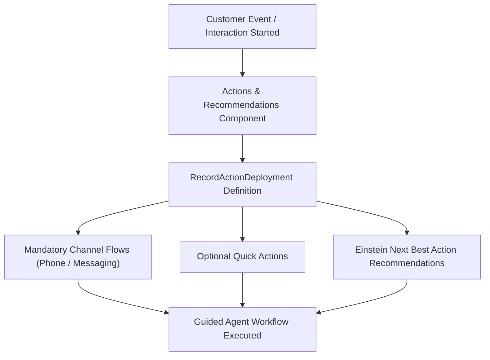

## Architectural Overview

`RecordActionDeployment` defines the configuration for the **Guided Action** and **Actions & Recommendations** component embedded in Lightning record pages. In complex Service Cloud and Financial Services implementations, service agents must follow rigorous, compliance-driven customer interaction steps based on channel (e.g., Phone, Web Chat, Omni-Channel Messaging) and record context.

Rather than hard-coding conditional buttons across disparate page layouts, `RecordActionDeployment` decouples the presentation engine from business logic. It establishes default flow sequences, unpinned recommendations, Einstein Next Best Action (NBA) integration strategies, and auto-launch behaviors directly within declarative metadata.



## Directory and File Conventions

`RecordActionDeployment` metadata components are stored as standalone XML files in the `recordActionDeployments` project directory.

| Property | Value |
| :--- | :--- |
| **Directory Path** | `force-app/main/default/recordActionDeployments/` |
| **File Suffix** | `.recordActionDeployment-meta.xml` |
| **XML Root Element** | `<RecordActionDeployment>` |
| **API Version** | `68.0` |

## Key Metadata Fields

The `RecordActionDeployment` type defines channel-level flow lists, recommendation settings, and record context bindings.

| Field Name | Type | Required | Description |
| :--- | :--- | :--- | :--- |
| `masterLabel` | `string` | Yes | Human-readable label displayed in Setup and App Builder. |
| `channelConfigurations` | `RecordActionDeploymentChannel[]` | No | List of channel bindings (e.g., `Phone`, `Chat`, `Other`). |
| `deploymentContexts` | `RecordActionDeploymentContext[]` | No | Specifies the target sObject context (e.g., `Case`, `Contact`). |
| `recommendationOption` | `RecordActionRecommendationOption` | No | Configures NBA recommendation visibility (`Display`, `Hide`). |
| `hasDefaultActions` | `boolean` | No | Indicates whether default pinned actions load automatically. |
| `isPassContextToLink` | `boolean` | No | Passes the current record context ID into launched action links. |

### Channel Configuration Sub-Properties

Within `channelConfigurations`:
- `channel`: Channel identifier (`Phone`, `Chat`, `Messaging`, `Default`).
- `channelItems`: Specific action instances configured for the channel.
- `actionType`: Type of action (`Flow`, `QuickAction`).
- `action`: API name of the target Flow or QuickAction.
- `isMandatory`: Whether the user must complete this action.
- `isPinned`: Whether the action remains docked at the top of the component.

## Declarative XML and Package Manifest Examples

The following example illustrates a Service Console deployment configuring mandatory customer identity verification and triage flows for Case records:

```xml title="force-app/main/default/recordActionDeployments/Case_Service_Deployment.recordActionDeployment-meta.xml"
<?xml version="1.0" encoding="UTF-8"?>
<RecordActionDeployment xmlns="http://soap.sforce.com/2006/04/metadata">
    <masterLabel>Case Service Deployment</masterLabel>
    <channelConfigurations>
        <channel>Phone</channel>
        <channelItems>
            <action>Verify_Caller_Identity</action>
            <actionType>Flow</actionType>
            <isMandatory>true</isMandatory>
            <isPinned>Top</isPinned>
            <position>0</position>
        </channelItems>
        <channelItems>
            <action>Case.UpdatePriority</action>
            <actionType>QuickAction</actionType>
            <isMandatory>false</isMandatory>
            <isPinned>None</isPinned>
            <position>1</position>
        </channelItems>
    </channelConfigurations>
    <deploymentContexts>
        <pageContext>Case</pageContext>
    </deploymentContexts>
    <hasDefaultActions>true</hasDefaultActions>
    <isPassContextToLink>true</isPassContextToLink>
    <recommendationOption>Display</recommendationOption>
</RecordActionDeployment>
```

### Package Manifest (`package.xml`)

```xml title="manifest/package.xml"
<?xml version="1.0" encoding="UTF-8"?>
<Package xmlns="http://soap.sforce.com/2006/04/metadata">
    <types>
        <members>Case_Service_Deployment</members>
        <name>RecordActionDeployment</name>
    </types>
    <types>
        <members>Verify_Caller_Identity</members>
        <name>Flow</name>
    </types>
    <version>68.0</version>
</Package>
```

## CLI Retrieval and Deployment Commands

Use the Salesforce CLI to retrieve and deploy `RecordActionDeployment` metadata:

```bash
# Retrieve all RecordActionDeployment definitions
sf project retrieve start --metadata RecordActionDeployment

# Deploy the deployment definition along with its referenced Flow
sf project deploy start --metadata "RecordActionDeployment:Case_Service_Deployment,Flow:Verify_Caller_Identity"

# Validate deployment without saving changes
sf project deploy validate --metadata RecordActionDeployment:Case_Service_Deployment
```

## Architect Best Practices and Gotchas

- **Strict Dependency Order:** `RecordActionDeployment` strictly depends on the underlying Flows and QuickActions. Always deploy target [Flow](/docs/metadata/flow-metadata-type/) metadata before or alongside the `RecordActionDeployment`. If a referenced flow version is inactive or deleted, deployment fails with `Action Not Found`.
- **FlexiPage Integration:** Adding `RecordActionDeployment` to an org has no runtime effect until you assign it inside a [FlexiPage](/docs/metadata/flexipage-metadata-type/) by placing the `runtime_sales_action:guidedAction` component on the record page and selecting your deployment name.
- **Channel Parity:** When building omni-channel contact centers, test both desktop voice calls and digital messaging channels. Unset channels fall back to `Default`, which might expose non-conversational flows to live chat agents.

> [!TIP]
> Use `isMandatory` judiciously. If a mandatory flow fails due to unhandled exceptions or fault paths, service agents may be blocked from progressing or closing out interactions.
