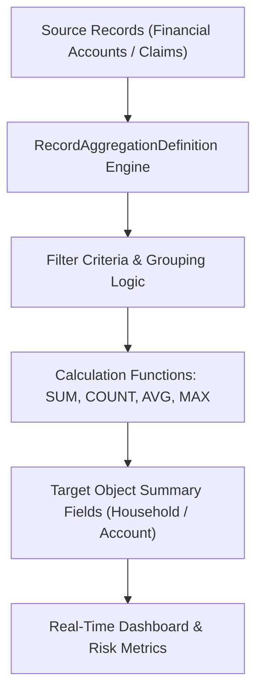

## Architectural Overview

`RecordAggregationDefinition` represents a declarative framework for rolling up, summing, and aggregating metrics across multi-tiered object relationships. Standard Salesforce Roll-Up Summary fields are strictly constrained to Master-Detail relationships on standard or custom objects, with hard org limits per object. In contrast, `RecordAggregationDefinition` empowers enterprise and industry solutions (such as Financial Services Cloud, Health Cloud, and Consumer Goods) to aggregate related transactions, financial holdings, or claims across lookup relationships and complex junction entities.

From an architectural standpoint, `RecordAggregationDefinition` abstracts the aggregation pipeline into metadata. It specifies source objects, aggregation criteria, target destination fields, and calculation frequencies (real-time, asynchronous, or scheduled batch), avoiding custom Apex triggers and high-risk trigger recursion.



## Directory and File Conventions

`RecordAggregationDefinition` instances are maintained as distinct XML artifacts inside the `recordAggregationDefinitions` directory.

| Property | Value |
| :--- | :--- |
| **Directory Path** | `force-app/main/default/recordAggregationDefinitions/` |
| **File Suffix** | `.recordAggregationDefinition-meta.xml` |
| **XML Root Element** | `<RecordAggregationDefinition>` |
| **API Version** | `68.0` |

## Key Metadata Fields

The definition encapsulates source entity mapping, filter conditions, and calculation target configurations.

| Field Name | Type | Required | Description |
| :--- | :--- | :--- | :--- |
| `masterLabel` | `string` | Yes | User-visible display label for the aggregation definition. |
| `developerName` | `string` | Yes | Unique programmatic identifier for the metadata component. |
| `sourceObject` | `string` | Yes | API name of the source entity containing records to aggregate. |
| `targetObject` | `string` | Yes | API name of the parent or destination entity receiving the aggregated value. |
| `aggregateField` | `string` | Yes | Field on the source object being evaluated (e.g., `Balance__c`, `Amount`). |
| `targetField` | `string` | Yes | Field on the target object that stores the final aggregate metric. |
| `operation` | `string` | Yes | Mathematical operation: `Sum`, `Count`, `Average`, `Min`, or `Max`. |
| `status` | `string` | Yes | Operational state of the aggregation (`Draft`, `Active`, `Inactive`). |
| `filterCriteria` | `string` | No | Logical condition filtering source records prior to aggregation. |

## Declarative XML and Package Manifest Examples

The following sample defines an aggregation rule rolling up total portfolio balances from individual financial accounts up to a client household profile:

```xml title="force-app/main/default/recordAggregationDefinitions/Household_Total_Balance.recordAggregationDefinition-meta.xml"
<?xml version="1.0" encoding="UTF-8"?>
<RecordAggregationDefinition xmlns="http://soap.sforce.com/2006/04/metadata">
    <masterLabel>Household Total Balance</masterLabel>
    <developerName>Household_Total_Balance</developerName>
    <sourceObject>FinServ__FinancialAccount__c</sourceObject>
    <targetObject>Account</targetObject>
    <aggregateField>FinServ__Balance__c</aggregateField>
    <targetField>Total_Portfolio_Balance__c</targetField>
    <operation>Sum</operation>
    <status>Active</status>
    <filterCriteria>FinServ__Status__c = 'Open' AND FinServ__RecordTypeName__c != 'Liability'</filterCriteria>
</RecordAggregationDefinition>
```

### Package Manifest (`package.xml`)

```xml title="manifest/package.xml"
<?xml version="1.0" encoding="UTF-8"?>
<Package xmlns="http://soap.sforce.com/2006/04/metadata">
    <types>
        <members>Household_Total_Balance</members>
        <name>RecordAggregationDefinition</name>
    </types>
    <types>
        <members>Account.Total_Portfolio_Balance__c</members>
        <name>CustomField</name>
    </types>
    <version>68.0</version>
</Package>
```

## CLI Retrieval and Deployment Commands

Retrieve and deploy aggregation definitions using Salesforce CLI:

```bash
# Retrieve all aggregation definitions
sf project retrieve start --metadata RecordAggregationDefinition

# Deploy a specific definition along with custom field dependencies
sf project deploy start --metadata "RecordAggregationDefinition:Household_Total_Balance,CustomField:Account.Total_Portfolio_Balance__c"

# Validate deployment against a sandbox
sf project deploy validate --metadata RecordAggregationDefinition:Household_Total_Balance
```

## Architect Best Practices and Gotchas

- **Dependency Sequencing:** The target custom field and source custom fields must exist in the target org before deploying `RecordAggregationDefinition`. Include both the [CustomField](/docs/metadata/custom-field-metadata-type/) components and the aggregation definition in the same deployment changeset.
- **Large Data Volumes (LDV):** When aggregating millions of records, evaluate whether recalculations run synchronously during DML or asynchronously via platform rollup services. Ensure source fields utilized in `filterCriteria` are indexed to prevent full-table table scans.
- **Status Gating:** Deploy definitions in `Draft` status first when introducing structural schema modifications, then toggle to `Active` after validating that batch calculation jobs finish without errors.

> [!NOTE]
> Review org-level rollup feature licenses and industry cloud permissions before deploying, as `RecordAggregationDefinition` requires enabled industry engines in the destination tenant.
