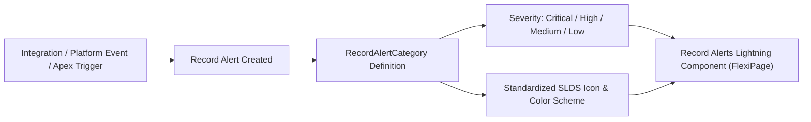

## Architectural Overview

`RecordAlertCategory` configures the classification taxonomy for **Record Alerts**—a core feature in Salesforce Industries (Financial Services Cloud, Health Cloud, and Public Sector Solutions). Record Alerts inform frontline representatives and case workers of critical, time-sensitive circumstances (e.g., fraudulent account activities, patient medical contraindications, impending loan defaults, or compliance sanctions) directly at the top of the record page.

Rather than managing alert types as ad-hoc custom picklist values or loose data records, `RecordAlertCategory` establishes metadata-driven categories that dictate visual severity, default icons, and operational routing. Architects use `RecordAlertCategory` to enforce consistent risk classifications across multi-cloud enterprise architectures.



## Directory and File Conventions

`RecordAlertCategory` metadata instances reside in the `recordAlertCategories` directory of your SFDX workspace.

| Property | Value |
| :--- | :--- |
| **Directory Path** | `force-app/main/default/recordAlertCategories/` |
| **File Suffix** | `.recordAlertCategory-meta.xml` |
| **XML Root Element** | `<RecordAlertCategory>` |
| **API Version** | `68.0` |

## Key Metadata Fields

The `RecordAlertCategory` type includes attributes controlling taxonomy naming, severity indicators, and lifecycle state.

| Field Name | Type | Required | Description |
| :--- | :--- | :--- | :--- |
| `masterLabel` | `string` | Yes | Human-readable category label displayed on record alert cards. |
| `developerName` | `string` | Yes | Programmatic API name used in Apex and Flow references. |
| `description` | `string` | No | Architectural description of the category and its intended business use case. |
| `severity` | `string` | No | Baseline severity indicator (e.g., `Critical`, `High`, `Medium`, `Low`, `Informational`). |
| `isActive` | `boolean` | No | Designates whether the category is currently available for new alert creation. |

## Declarative XML and Package Manifest Examples

The following metadata XML demonstrates an urgent financial compliance category alerting wealth advisors to anti-money laundering (AML) screening holds:

```xml title="force-app/main/default/recordAlertCategories/AML_Compliance_Hold.recordAlertCategory-meta.xml"
<?xml version="1.0" encoding="UTF-8"?>
<RecordAlertCategory xmlns="http://soap.sforce.com/2006/04/metadata">
    <masterLabel>AML Compliance Hold</masterLabel>
    <developerName>AML_Compliance_Hold</developerName>
    <description>Flags accounts subject to Anti-Money Laundering review or regulatory sanctions.</description>
    <severity>Critical</severity>
    <isActive>true</isActive>
</RecordAlertCategory>
```

### Package Manifest (`package.xml`)

```xml title="manifest/package.xml"
<?xml version="1.0" encoding="UTF-8"?>
<Package xmlns="http://soap.sforce.com/2006/04/metadata">
    <types>
        <members>AML_Compliance_Hold</members>
        <name>RecordAlertCategory</name>
    </types>
    <version>68.0</version>
</Package>
```

## CLI Retrieval and Deployment Commands

Manage `RecordAlertCategory` components using standard Salesforce CLI operations:

```bash
# Retrieve all Record Alert Categories
sf project retrieve start --metadata RecordAlertCategory

# Deploy a specific category definition
sf project deploy start --source-dir force-app/main/default/recordAlertCategories/AML_Compliance_Hold.recordAlertCategory-meta.xml

# Retrieve categories along with related Lightning FlexiPages
sf project retrieve start --metadata "RecordAlertCategory:AML_Compliance_Hold,FlexiPage:Wealth_Client_Record_Page"
```

## Architect Best Practices and Gotchas

- **Industry License Dependencies:** Record Alerts require Financial Services Cloud, Health Cloud, or OmniStudio/Record Alert platform permissions. Deploying `RecordAlertCategory` into a core Sales Cloud org without the prerequisite licenses results in an invalid metadata type deployment error.
- **Data vs Metadata Boundaries:** The category definition itself (`RecordAlertCategory`) is metadata, but the individual alerts created for records (`RecordAlert` records) are application data. Migrate categories through your CI/CD pipeline, and generate alerts dynamically using integration events or scheduled Flow batches.
- **Deactivation Strategy:** Never delete a `RecordAlertCategory` in production if historical `RecordAlert` records still reference it. Instead, set `<isActive>false</isActive>` to maintain historical data integrity while preventing new alerts from utilizing that category.

> [!TIP]
> Group related alert categories into centralized permission sets to ensure compliance officers and front-office staff have appropriate read and dismiss privileges.
