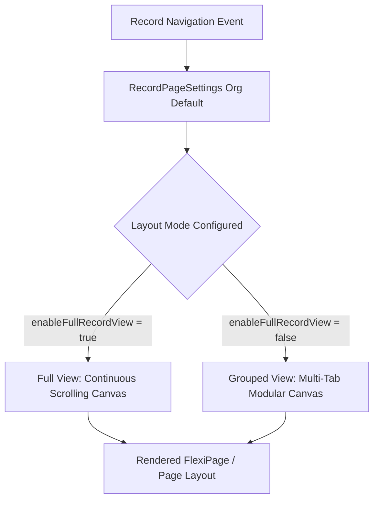

## Architectural Overview

`RecordPageSettings` defines org-level defaults for how standard and custom record pages render in Lightning Experience. When an organization transitions to Lightning or provisions new developer sandboxes, one of the foremost user experience decisions is determining the default page density and layout mode: **Full View** versus **Grouped View**.

- **Grouped View (Default):** Organizes record information across structured tabs (e.g., Details, Related, Activity) in multi-column layouts, optimizing screen real estate for modern high-resolution displays.
- **Full View:** Recreates a continuous, data-dense scrolling experience reminiscent of Salesforce Classic, positioning record fields and related lists sequentially down a single canvas.

Managing `RecordPageSettings` via source-tracked metadata ensures that enterprise UI standards and accessibility requirements are uniformly propagated across scratch orgs, staging environments, and production sandboxes without requiring manual Setup navigation.



## Directory and File Conventions

`RecordPageSettings` is a singleton settings metadata type residing in the `settings` directory.

| Property | Value |
| :--- | :--- |
| **Directory Path** | `force-app/main/default/settings/` |
| **File Name** | `RecordPage.settings-meta.xml` |
| **XML Root Element** | `<RecordPageSettings>` |
| **API Version** | `68.0` |

## Key Metadata Fields

The settings file exposes boolean switches governing record rendering modes.

| Field Name | Type | Required | Description |
| :--- | :--- | :--- | :--- |
| `enableActivityStoriesOnPage` | `boolean` | No | Enables next steps and past activity timelines on record detail views. |
| `enableFullRecordView` | `boolean` | No | When `true`, enables Full View as the default org-wide record display; when `false`, enables Grouped View. |

## Declarative XML and Package Manifest Examples

The following definition sets the org default to Grouped View while activating standard activity stories:

```xml title="force-app/main/default/settings/RecordPage.settings-meta.xml"
<?xml version="1.0" encoding="UTF-8"?>
<RecordPageSettings xmlns="http://soap.sforce.com/2006/04/metadata">
    <enableActivityStoriesOnPage>true</enableActivityStoriesOnPage>
    <enableFullRecordView>false</enableFullRecordView>
</RecordPageSettings>
```

### Package Manifest (`package.xml`)

```xml title="manifest/package.xml"
<?xml version="1.0" encoding="UTF-8"?>
<Package xmlns="http://soap.sforce.com/2006/04/metadata">
    <types>
        <members>RecordPage</members>
        <name>Settings</name>
    </types>
    <version>68.0</version>
</Package>
```

## CLI Retrieval and Deployment Commands

Retrieve and deploy `RecordPageSettings` using standard Salesforce CLI commands:

```bash
# Retrieve RecordPageSettings
sf project retrieve start --metadata "Settings:RecordPage"

# Deploy RecordPage settings to target org
sf project deploy start --metadata "Settings:RecordPage"

# Deploy via file path
sf project deploy start --source-dir force-app/main/default/settings/RecordPage.settings-meta.xml
```

## Architect Best Practices and Gotchas

- **Scratch Org Definitions:** In automated CI/CD pipelines, specify `recordPageSettings` within the `project-scratch-def.json` file under `settings` so newly spun scratch orgs immediately reflect the production layout archetype.
- **Custom FlexiPage Precedence:** If an object is assigned a custom [FlexiPage](/docs/metadata/flexipage-metadata-type/) (Lightning Record Page), the component template defined in the FlexiPage overrides the standard layout format regardless of `enableFullRecordView`.
- **User Preference Conflicts:** End users who customize their personal display density under **My Settings > Display & Layout > Record Page View** will retain their individual preference, which overrides the org-wide setting defined in metadata.

> [!NOTE]
> Full View is primarily recommended for organizations transitioning users accustomed to Classic layouts or organizations with objects having fewer than 50 fields.
