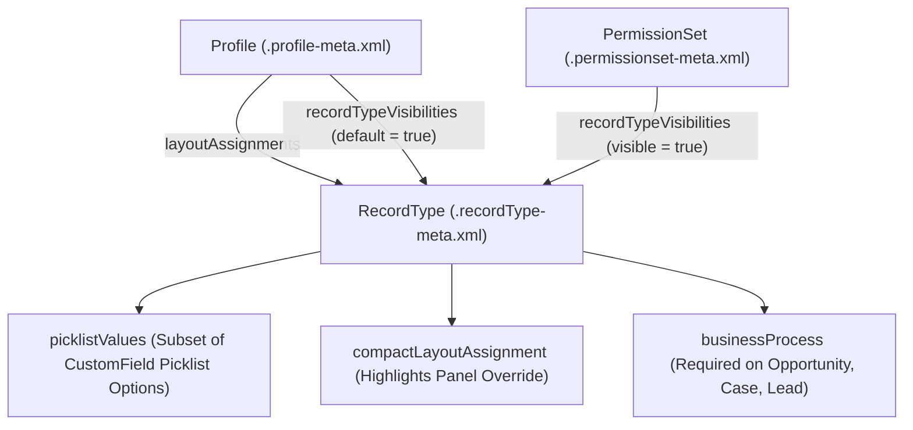

## Overview

The `RecordType` metadata type (`objects/<ObjectName>/recordTypes/<RecordTypeName>.recordType-meta.xml`) lets you segment a single Salesforce object into distinct business lifecycles. Each `RecordType` controls four UI and process layers: **available picklist values (`picklistValues`)**, **Page Layout assignments** (mapped in [Profile](/docs/metadata/profile-metadata-type/)), **Compact Layout overrides (`compactLayoutAssignment`)**, and **Stage/Status Business Processes (`businessProcess`)** on `Opportunity`, `Case`, `Lead`, and `Solution`.

A critical architectural rule: **Record Types are a UI and process segmentation tool, not a security boundary.** Removing a `RecordType` from a user's Profile or [PermissionSet](/docs/metadata/permission-set-metadata-type/) only prevents the user from creating new records with that record type; if Organization-Wide Defaults or Sharing Rules grant read access to the record, the user can still view and report on it.



As shown in the diagram above, the `.recordType-meta.xml` file owns the allowed `picklistValues`, `compactLayoutAssignment`, and `businessProcess`, while `Profile` and `PermissionSet` metadata govern which users can create records with that `RecordType` and which [Layout](/docs/metadata/layout-metadata-type/) renders.

## Prerequisites

- **Permissions:** "Customize Application" permission to deploy record types.
- **Picklist Values Must Exist First:** Every picklist option referenced inside `<picklistValues>` in a `RecordType` must exist on the corresponding [CustomField](/docs/metadata/custom-field-metadata-type/) or `StandardValueSet`.
- **API Version:** Verified against API version `68.0` (Winter '27).

## Key RecordType XML Elements

| XML Element | Type | Required | Description & Architectural Rules |
| :--- | :--- | :--- | :--- |
| `fullName` | `string` | ✅ Yes | Record type `DeveloperName` (`Enterprise_Invoice`). Qualified as `Invoice__c.Enterprise_Invoice` in `package.xml`. |
| `active` | `boolean` | ✅ Yes | Whether the record type is active (`true` or `false`). Inactive record types are ignored when retrieving Profiles/PermissionSets. |
| `label` | `string` | ✅ Yes | User-facing label displayed in the record type selection modal. |
| `businessProcess` | `string` | Conditional | **Required** on `Lead`, `Opportunity`, `Case`, and `Solution` (e.g., `<businessProcess>Enterprise Sales Process</businessProcess>`). Not allowed on custom objects. |
| `compactLayoutAssignment` | `string` | No | Overrides the object's default compact layout for this specific record type. |
| `picklistValues` | `RecordTypePicklistValue[]` | No | Lists every picklist field on the object and the subset of URL-encoded `<values>` enabled for this record type, including one `<default>true</default>` option. |

> [!WARNING]
> In `<picklistValues>`, Salesforce URL-encodes special characters inside `<fullName>` (for example, `Closed - Won` is stored as `Closed%20-%20Won` or `Net 30 / 60` as `Net%2030%20%2F%2060`). Hand-editing URL-encoded picklist values inaccurately causes `Picklist value: X not found` deployment errors.

## Querying RecordType via SOQL and Zero-SOQL Apex Schema

### 1. Zero-SOQL RecordTypeId Resolution in Apex (Best Practice)
Never run `[SELECT Id FROM RecordType WHERE DeveloperName = '...']` in Apex triggers or controllers. Use `Schema.SObjectType` methods, which execute in sub-millisecond time from memory and consume **0 SOQL queries**:

```apex
Id enterpriseRtId = Schema.SObjectType.Invoice__c
    .getRecordTypeInfosByDeveloperName()
    .get('Enterprise_Billing')
    .getRecordTypeId();
```

### 2. Query All Record Types and Business Processes via Standard SOQL
When auditing record types across objects via the CLI or integration scripts, query the standard `RecordType` object:

```soql
SELECT Id, SobjectType, DeveloperName, Name, IsActive,
       BusinessProcessId, Description, LastModifiedDate
FROM RecordType
WHERE SobjectType IN ('Account', 'Opportunity', 'Invoice__c')
ORDER BY SobjectType ASC, DeveloperName ASC
```

## Example

The following `Enterprise_Billing.recordType-meta.xml` file defines an active record type on `Invoice__c`, assigns a dedicated Compact Layout, and restricts the `Status__c` picklist values.

```xml title="force-app/main/default/objects/Invoice__c/recordTypes/Enterprise_Billing.recordType-meta.xml"
<?xml version="1.0" encoding="UTF-8"?>
<RecordType xmlns="http://soap.sforce.com/2006/04/metadata">
    <fullName>Enterprise_Billing</fullName>
    <active>true</active>
    <compactLayoutAssignment>Invoice_Highlight_Compact_Layout</compactLayoutAssignment>
    <description>Used for B2B enterprise contracts with milestone billing and Net-60 terms.</description>
    <label>Enterprise Billing</label>
    <picklistValues>
        <picklist>Status__c</picklist>
        <values>
            <fullName>Draft</fullName>
            <default>true</default>
        </values>
        <values>
            <fullName>Pending%20Approval</fullName>
            <default>false</default>
        </values>
        <values>
            <fullName>Issued</fullName>
            <default>false</default>
        </values>
        <values>
            <fullName>Paid</fullName>
            <default>false</default>
        </values>
    </picklistValues>
</RecordType>
```

Deploy the record type along with its picklist field and permission set visibility:

```bash
sf project deploy start \
  --metadata "CustomField:Invoice__c.Status__c" "RecordType:Invoice__c.Enterprise_Billing" \
  --target-org UATSandbox
```

## Limits and Gotchas

- **Active Record Types Recommendation:** Salesforce recommends no more than **200 active record types** per object to avoid UI rendering and metadata serialization bottlenecks.
- **Deleting or Deactivating a RecordType:** You cannot deactivate or delete a `RecordType` that is currently set as the `<default>true</default>` record type on any [Profile](/docs/metadata/profile-metadata-type/). First update the Profile's `recordTypeVisibilities` to change the default, then deactivate the `RecordType`.
- **Master RecordType (`Master`):** Every object has a built-in `Master` record type used when no custom record types are assigned. You cannot assign both `Master` and a custom `RecordType` on the same object in a single Profile.

## Related Official Documentation

- [RecordType Metadata API Reference](https://developer.salesforce.com/docs/atlas.en-us.api_meta.meta/api_meta/meta_recordtype.htm): XML elements, `RecordTypePicklistValue`, and `BusinessProcess` links.
- [RecordType Object Reference](https://developer.salesforce.com/docs/atlas.en-us.object_reference.meta/object_reference/sforce_api_objects_recordtype.htm): Standard SOQL fields for querying `RecordType`.
- [Schema.RecordTypeInfo Apex Class](https://developer.salesforce.com/docs/atlas.en-us.apexref.meta/apexref/apex_class_Schema_RecordTypeInfo.htm): Zero-SOQL Apex methods for resolving RecordType IDs and names.
