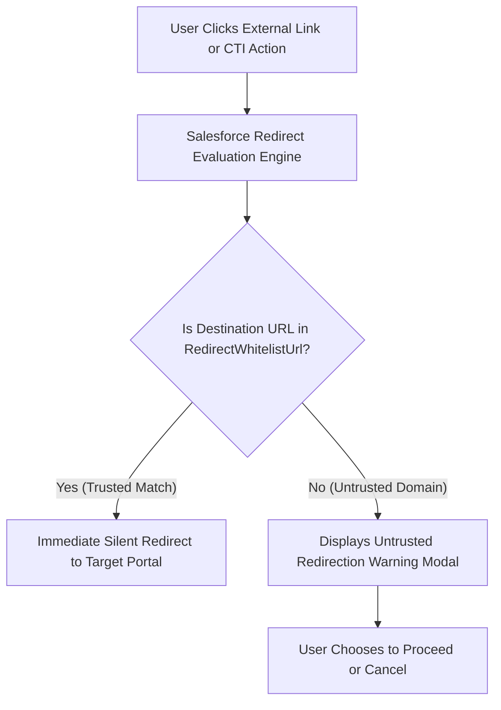

## Architectural Overview

`RedirectWhitelistUrl` manages the domain allowlist governing external outbound web redirections from Salesforce applications. To protect enterprise users against phishing attacks, credential harvesting, and Open Redirect exploits (OWASP Top 10 A01:2021), Salesforce intercepts outbound navigation triggered by custom buttons, Open CTI softphones, and Lightning Web Components.

By default, unlisted destination domains trigger an interstitial warning prompt: *"You are now leaving Salesforce..."*. While vital for security, these prompts disrupt user flow across tightly integrated enterprise intranets, ERP portals, and single-sign-on (SSO) partner systems. Defining `RedirectWhitelistUrl` metadata enables Technical Architects to declaratively certify corporate endpoints as trusted, providing seamless, unprompted transitions while maintaining strict perimeter security.



## Directory and File Conventions

`RedirectWhitelistUrl` records are managed as separate XML files inside the `redirectWhitelistUrls` directory.

| Property | Value |
| :--- | :--- |
| **Directory Path** | `force-app/main/default/redirectWhitelistUrls/` |
| **File Suffix** | `.redirectWhitelistUrl-meta.xml` |
| **XML Root Element** | `<RedirectWhitelistUrl>` |
| **API Version** | `68.0` |

## Key Metadata Fields

The `RedirectWhitelistUrl` metadata component includes attributes for defining the target URL and its operational status.

| Field Name | Type | Required | Description |
| :--- | :--- | :--- | :--- |
| `masterLabel` | `string` | Yes | Human-readable label for administrative display in Setup. |
| `url` | `string` | Yes | Fully qualified URL or hostname of the trusted destination endpoint. |
| `description` | `string` | No | Architectural rationale detailing why the endpoint is whitelisted. |
| `isActive` | `boolean` | No | Indicates whether this redirect whitelist rule is actively enforced. |

## Declarative XML and Package Manifest Examples

The following example configures an approved corporate SAP billing portal as an authorized redirect endpoint:

```xml title="force-app/main/default/redirectWhitelistUrls/SAP_Billing_Portal.redirectWhitelistUrl-meta.xml"
<?xml version="1.0" encoding="UTF-8"?>
<RedirectWhitelistUrl xmlns="http://soap.sforce.com/2006/04/metadata">
    <masterLabel>SAP Billing Portal</masterLabel>
    <url>https://billing.internal.corp.example.com</url>
    <description>Authorized corporate SAP financial billing portal for automated invoice downloads.</description>
    <isActive>true</isActive>
</RedirectWhitelistUrl>
```

### Package Manifest (`package.xml`)

```xml title="manifest/package.xml"
<?xml version="1.0" encoding="UTF-8"?>
<Package xmlns="http://soap.sforce.com/2006/04/metadata">
    <types>
        <members>SAP_Billing_Portal</members>
        <name>RedirectWhitelistUrl</name>
    </types>
    <version>68.0</version>
</Package>
```

## CLI Retrieval and Deployment Commands

Retrieve and deploy redirect whitelist definitions with the Salesforce CLI:

```bash
# Retrieve all Redirect Whitelist URLs
sf project retrieve start --metadata RedirectWhitelistUrl

# Deploy a specific whitelist endpoint
sf project deploy start --metadata RedirectWhitelistUrl:SAP_Billing_Portal

# Validate deployment against production
sf project deploy validate --metadata RedirectWhitelistUrl:SAP_Billing_Portal
```

## Architect Best Practices and Gotchas

- **Exact Protocol and Port Matching:** The `url` attribute requires explicit protocol declarations (`https://`). Omitting the protocol or misconfiguring the port will cause redirection evaluation to fail, resulting in unexpected warning dialogs.
- **Environment Parity across Sandboxes:** QA, UAT, and Production often point to different external endpoint domains (e.g., `test.corp.example.com` vs `corp.example.com`). Maintain environment-specific configuration branches or use tokenized CI/CD variable replacement to inject environment-appropriate URLs during deployment.
- **CSP and CORS Distinctness:** `RedirectWhitelistUrl` only governs full-page browser redirects. It does **not** grant permissions for cross-origin XHR/fetch calls (CORS) or client-side script loading (CSP Trusted Sites). Those require distinct security metadata.

> [!WARNING]
> Never whitelist broad public domains (e.g., `https://google.com` or generic URL shorteners) in `RedirectWhitelistUrl`, as this creates a severe open-redirect loophole that attackers can abuse in phishing campaigns.
