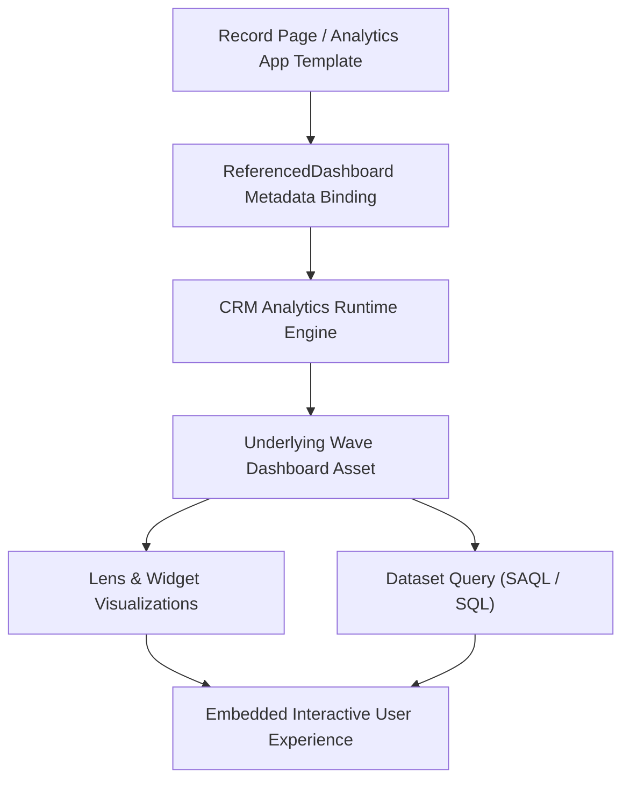

## Architectural Overview

`ReferencedDashboard` encapsulates references to CRM Analytics (formerly Tableau CRM / Einstein Analytics) dashboards when they are packaged, modularized, or embedded within broader Salesforce architectural components. Enterprise implementations frequently distribute pre-built analytics experiences inside templated applications, industry solutions (such as Financial Services Cloud or Manufacturing Cloud), and customized Lightning record pages.

Architecturally, `ReferencedDashboard` decouples the consumption layer from the underlying dashboard definition. By maintaining explicit metadata pointers to target dashboards, it enables cross-package dependency tracking, dynamic dataset filtering, and smooth environment promotions through CI/CD pipelines.



## Directory and File Conventions

`ReferencedDashboard` components are maintained within the `referencedDashboards` folder or referenced as sub-elements within CRM Analytics template configurations.

| Property | Value |
| :--- | :--- |
| **Directory Path** | `force-app/main/default/referencedDashboards/` |
| **File Suffix** | `.referencedDashboard-meta.xml` |
| **XML Root Element** | `<ReferencedDashboard>` |
| **API Version** | `68.0` |

## Key Metadata Fields

The `ReferencedDashboard` metadata type contains parameters linking external components to dashboard assets.

| Field Name | Type | Required | Description |
| :--- | :--- | :--- | :--- |
| `masterLabel` | `string` | Yes | Human-readable label for the referenced dashboard component. |
| `developerName` | `string` | Yes | Programmatic API name representing this reference in metadata. |
| `dashboard` | `string` | Yes | API name of the target CRM Analytics dashboard (WaveDashboard). |
| `description` | `string` | No | Architectural description of the referenced dashboard and its target persona. |
| `filter` | `string` | No | JSON string defining contextual runtime filter bindings passed to the dashboard. |

## Declarative XML and Package Manifest Examples

The following example configures an embedded sales performance dashboard reference intended for executive account reviews:

```xml title="force-app/main/default/referencedDashboards/Executive_Sales_Overview.referencedDashboard-meta.xml"
<?xml version="1.0" encoding="UTF-8"?>
<ReferencedDashboard xmlns="http://soap.sforce.com/2006/04/metadata">
    <masterLabel>Executive Sales Overview</masterLabel>
    <developerName>Executive_Sales_Overview</developerName>
    <dashboard>Sales_Executive_Performance_Dashboard</dashboard>
    <description>Referenced CRM Analytics dashboard displaying account-level pipeline and ARR metrics.</description>
    <filter>{"datasets":{"AccountPipeline":[{"fields":["AccountId"],"filter":{"operator":"in","values":["$Id"]}}]}}</filter>
</ReferencedDashboard>
```

### Package Manifest (`package.xml`)

```xml title="manifest/package.xml"
<?xml version="1.0" encoding="UTF-8"?>
<Package xmlns="http://soap.sforce.com/2006/04/metadata">
    <types>
        <members>Executive_Sales_Overview</members>
        <name>ReferencedDashboard</name>
    </types>
    <types>
        <members>Sales_Executive_Performance_Dashboard</members>
        <name>WaveDashboard</name>
    </types>
    <version>68.0</version>
</Package>
```

## CLI Retrieval and Deployment Commands

Retrieve and deploy `ReferencedDashboard` definitions using Salesforce CLI:

```bash
# Retrieve all referenced dashboard definitions
sf project retrieve start --metadata ReferencedDashboard

# Retrieve the reference alongside the underlying WaveDashboard
sf project retrieve start --metadata "ReferencedDashboard:Executive_Sales_Overview,WaveDashboard:Sales_Executive_Performance_Dashboard"

# Deploy to target scratch org or sandbox
sf project deploy start --metadata ReferencedDashboard:Executive_Sales_Overview
```

## Architect Best Practices and Gotchas

- **Strict Asset Co-Deployment:** A `ReferencedDashboard` fails to deploy if the referenced `WaveDashboard` does not already exist in the target org or is not included in the same deployment manifest. Always bundle the dashboard, dataset recipe, and reference together.
- **Dynamic Filter Syntax:** When supplying contextual filters inside the `filter` element, ensure the JSON string is valid and properly escaped. Invalid field mappings or mismatched dataset alias names will cause the dashboard to render blank or throw runtime binding errors.
- **Folder and Asset Security:** Ensure end users have Viewer access to the underlying CRM Analytics folder containing the dashboard. A user with page access who lacks CRM Analytics folder permissions will see an access-denied error within the embedded frame.

> [!TIP]
> Use [FlexiPage](/docs/metadata/flexipage-metadata-type/) conditional visibility rules on the dashboard container to dynamically suppress embedded analytics for mobile or low-bandwidth users.
