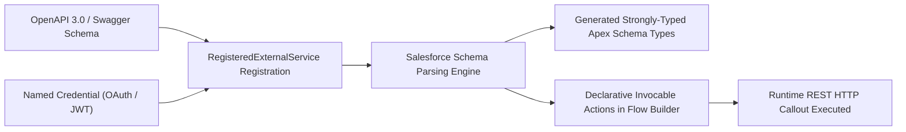

## Architectural Overview

`RegisteredExternalService` (commonly known as **External Services**) represents the declarative integration bridge between external REST APIs and the Salesforce platform. In traditional enterprise architectures, connecting Salesforce to third-party microservices (e.g., credit bureau ratings, ERP inventory lookups, payment gateways) required writing extensive Apex HTTP callouts, JSON deserialization wrappers, and custom invocable methods.

With `RegisteredExternalService`, Technical Architects ingest an **OpenAPI 2.0 or 3.0** (Swagger) schema or MuleSoft API specification. The Salesforce metadata engine parses the schema, validates data contracts, and automatically generates strongly typed invocable actions available directly within [Flow](/docs/metadata/flow-metadata-type/), Einstein Bots, and Agentforce agents. This significantly shrinks custom code surface area, standardizes exception handling, and accelerates API delivery across enterprise pipelines.



## Directory and File Conventions

`RegisteredExternalService` components are stored as XML files within the `registeredExternalServices` directory.

| Property | Value |
| :--- | :--- |
| **Directory Path** | `force-app/main/default/registeredExternalServices/` |
| **File Suffix** | `.registeredExternalService-meta.xml` |
| **XML Root Element** | `<RegisteredExternalService>` |
| **API Version** | `68.0` |

## Key Metadata Fields

The metadata definition links the external schema specification to endpoint security credentials and defines operational status.

| Field Name | Type | Required | Description |
| :--- | :--- | :--- | :--- |
| `masterLabel` | `string` | Yes | Display name of the external service in Setup and Flow Builder. |
| `developerName` | `string` | Yes | Unique programmatic identifier used in source metadata. |
| `namedCredential` | `string` | Yes | API name of the Named Credential managing authentication and endpoint URLs. |
| `serviceType` | `string` | Yes | Type of API schema definition (e.g., `OpenApi`, `OpenApi3`, `MuleSoft`). |
| `schema` | `string` | Yes | The JSON or YAML schema string specifying endpoints, operations, and schemas. |
| `description` | `string` | No | Architectural description of the external service capabilities. |
| `status` | `string` | No | Registration state (`Complete`, `Draft`, `InReview`). |

## Declarative XML and Package Manifest Examples

The following example registers an external payment processing API bound to a secure Named Credential:

```xml title="force-app/main/default/registeredExternalServices/PaymentGatewayService.registeredExternalService-meta.xml"
<?xml version="1.0" encoding="UTF-8"?>
<RegisteredExternalService xmlns="http://soap.sforce.com/2006/04/metadata">
    <masterLabel>Payment Gateway Service</masterLabel>
    <developerName>PaymentGatewayService</developerName>
    <namedCredential>Payment_Gateway_Endpoint</namedCredential>
    <serviceType>OpenApi3</serviceType>
    <description>External payment gateway for processing real-time credit card authorizations.</description>
    <schema>{"openapi":"3.0.0","info":{"title":"Payment API","version":"1.0"},"paths":{"/charge":{"post":{"operationId":"createCharge","requestBody":{"content":{"application/json":{"schema":{"type":"object","properties":{"amount":{"type":"number"},"currency":{"type":"string"}}}}}},"responses":{"200":{"description":"Success","content":{"application/json":{"schema":{"type":"object","properties":{"transactionId":{"type":"string"},"status":{"type":"string"}}}}}}}}}}}</schema>
    <status>Complete</status>
</RegisteredExternalService>
```

### Package Manifest (`package.xml`)

```xml title="manifest/package.xml"
<?xml version="1.0" encoding="UTF-8"?>
<Package xmlns="http://soap.sforce.com/2006/04/metadata">
    <types>
        <members>PaymentGatewayService</members>
        <name>RegisteredExternalService</name>
    </types>
    <types>
        <members>Payment_Gateway_Endpoint</members>
        <name>NamedCredential</name>
    </types>
    <version>68.0</version>
</Package>
```

## CLI Retrieval and Deployment Commands

Manage `RegisteredExternalService` metadata using Salesforce CLI:

```bash
# Retrieve all External Services
sf project retrieve start --metadata RegisteredExternalService

# Deploy the external service along with its Named Credential
sf project deploy start --metadata "RegisteredExternalService:PaymentGatewayService,NamedCredential:Payment_Gateway_Endpoint"

# Validate deployment into a target environment
sf project deploy validate --metadata RegisteredExternalService:PaymentGatewayService
```

## Architect Best Practices and Gotchas

- **Strict Named Credential Dependency:** `RegisteredExternalService` cannot deploy if the referenced `namedCredential` does not exist in the target org. Ensure the `NamedCredential` and its associated `ExternalCredential` are committed and deployed together.
- **OpenAPI Schema Size Limits:** Salesforce enforces schema character limits and complexity ceilings (such as maximum number of operations and schema nesting depth). Minify JSON schemas and strip unused endpoints before embedding them into metadata.
- **Flow Invocable Action Regeneration:** Modifying or re-deploying a `RegisteredExternalService` changes the underlying generated Apex types. Always perform impact analysis on dependent [Flow](/docs/metadata/flow-metadata-type/) components to verify that updated schema models do not break active flow element mappings.

> [!WARNING]
> If a Flow is actively running or referenced in production, deleting or drastically renaming operations in `RegisteredExternalService` will fail deployment due to active flow dependencies.
