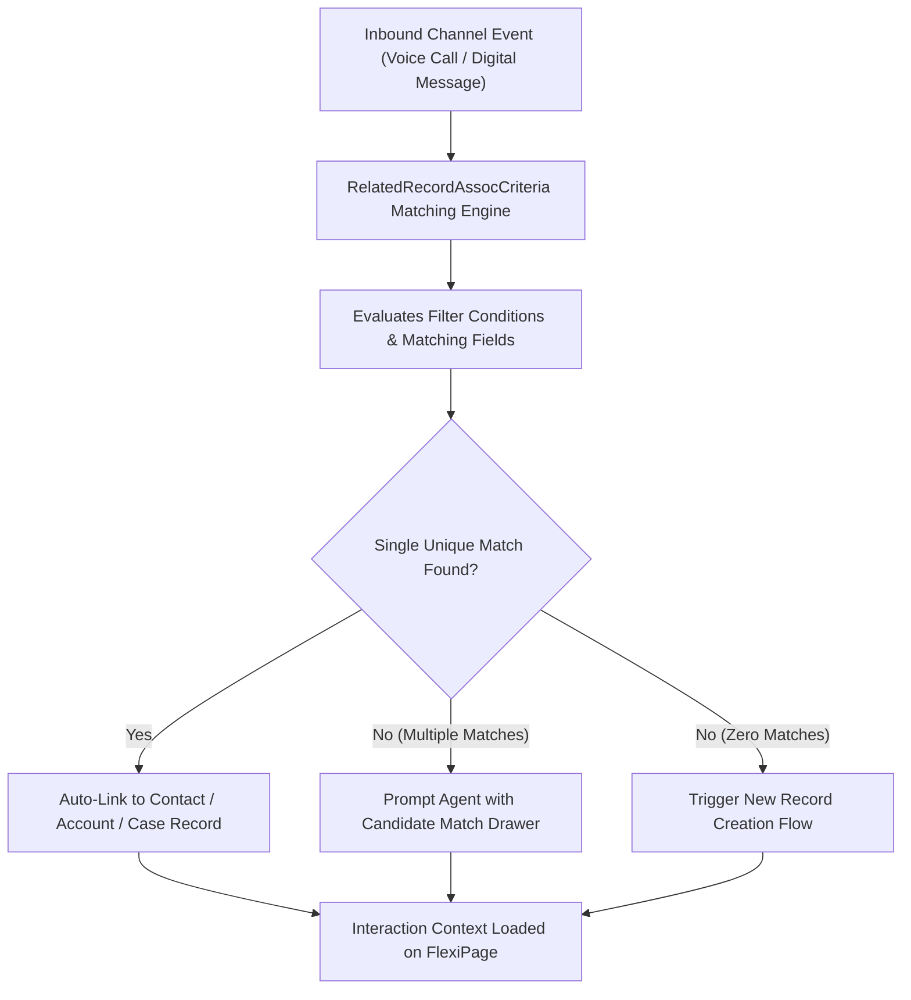

## Architectural Overview

`RelatedRecordAssocCriteria` governs the declarative intelligence engine responsible for automatically associating inbound records and digital interactions (such as Service Cloud Voice calls, digital messaging sessions, and inbound document intake) with existing core CRM entities (such as Contacts, Accounts, or Cases).

In high-volume omnichannel contact centers, manual record lookup introduces cognitive friction, inflates Average Handle Time (AHT), and leads to duplicate record creation. `RelatedRecordAssocCriteria` establishes deterministic matching logic that evaluates attributes from the incoming interaction payload (such as caller phone number, customer email, or policy identifier) against CRM database records, establishing relationship links instantly as the interaction initiates.



## Directory and File Conventions

`RelatedRecordAssocCriteria` components are maintained within the `relatedRecordAssocCriteria` directory.

| Property | Value |
| :--- | :--- |
| **Directory Path** | `force-app/main/default/relatedRecordAssocCriteria/` |
| **File Suffix** | `.relatedRecordAssocCriteria-meta.xml` |
| **XML Root Element** | `<RelatedRecordAssocCriteria>` |
| **API Version** | `68.0` |

## Key Metadata Fields

The definition outlines source and target object types, matching expressions, and fallback strategies.

| Field Name | Type | Required | Description |
| :--- | :--- | :--- | :--- |
| `masterLabel` | `string` | Yes | Administrative label displayed in matching criteria setup. |
| `developerName` | `string` | Yes | Unique programmatic identifier in metadata operations. |
| `sourceObject` | `string` | Yes | Inbound interaction entity (e.g., `VoiceCall`, `MessagingSession`). |
| `targetObject` | `string` | Yes | Target CRM entity to associate with (e.g., `Contact`, `Account`). |
| `matchingCriteria` | `string` | Yes | Boolean expression or filter string specifying field equality rules. |
| `status` | `string` | Yes | Status of the matching definition (`Active`, `Draft`, `Archived`). |
| `description` | `string` | No | Architectural description of the matching rule rationale. |

## Declarative XML and Package Manifest Examples

The following example configures an automated matching rule linking inbound voice calls to Contacts based on matching mobile phone numbers:

```xml title="force-app/main/default/relatedRecordAssocCriteria/VoiceCall_Contact_Match.relatedRecordAssocCriteria-meta.xml"
<?xml version="1.0" encoding="UTF-8"?>
<RelatedRecordAssocCriteria xmlns="http://soap.sforce.com/2006/04/metadata">
    <masterLabel>VoiceCall Contact Match</masterLabel>
    <developerName>VoiceCall_Contact_Match</developerName>
    <sourceObject>VoiceCall</sourceObject>
    <targetObject>Contact</targetObject>
    <matchingCriteria>VoiceCall.FromPhoneNumber = Contact.MobilePhone OR VoiceCall.FromPhoneNumber = Contact.Phone</matchingCriteria>
    <status>Active</status>
    <description>Automatically associates inbound voice calls with matching Contact records via caller ID.</description>
</RelatedRecordAssocCriteria>
```

### Package Manifest (`package.xml`)

```xml title="manifest/package.xml"
<?xml version="1.0" encoding="UTF-8"?>
<Package xmlns="http://soap.sforce.com/2006/04/metadata">
    <types>
        <members>VoiceCall_Contact_Match</members>
        <name>RelatedRecordAssocCriteria</name>
    </types>
    <version>68.0</version>
</Package>
```

## CLI Retrieval and Deployment Commands

Manage `RelatedRecordAssocCriteria` definitions using the Salesforce CLI:

```bash
# Retrieve all RelatedRecordAssocCriteria definitions
sf project retrieve start --metadata RelatedRecordAssocCriteria

# Deploy a specific matching criteria component
sf project deploy start --source-dir force-app/main/default/relatedRecordAssocCriteria/VoiceCall_Contact_Match.relatedRecordAssocCriteria-meta.xml

# Validate the deployment in a target scratch org
sf project deploy validate --metadata RelatedRecordAssocCriteria:VoiceCall_Contact_Match
```

## Architect Best Practices and Gotchas

- **Indexed Matching Fields:** Ensure fields referenced in `matchingCriteria` (e.g., `Phone`, `Email`, `ExternalId__c`) are indexed in the target object schema. High-volume call centers performing unindexed queries on large Contact tables will suffer latency bottlenecks.
- **Handling Ambiguity:** If phone numbers are shared across multiple family members (e.g., a shared home landline), automated linking could attach calls to the wrong person. Pair declarative criteria with an agent confirmation screen in [Flow](/docs/metadata/flow-metadata-type/) to resolve ambiguous matches.
- **Object Availability:** `VoiceCall` and `MessagingSession` objects require Service Cloud Voice or Digital Engagement licenses. Verify that target sandboxes have corresponding features enabled prior to deploying criteria files.

> [!TIP]
> Combine `RelatedRecordAssocCriteria` with Omni-Channel routing flows to pre-populate record context before the agent even accepts the work item.
