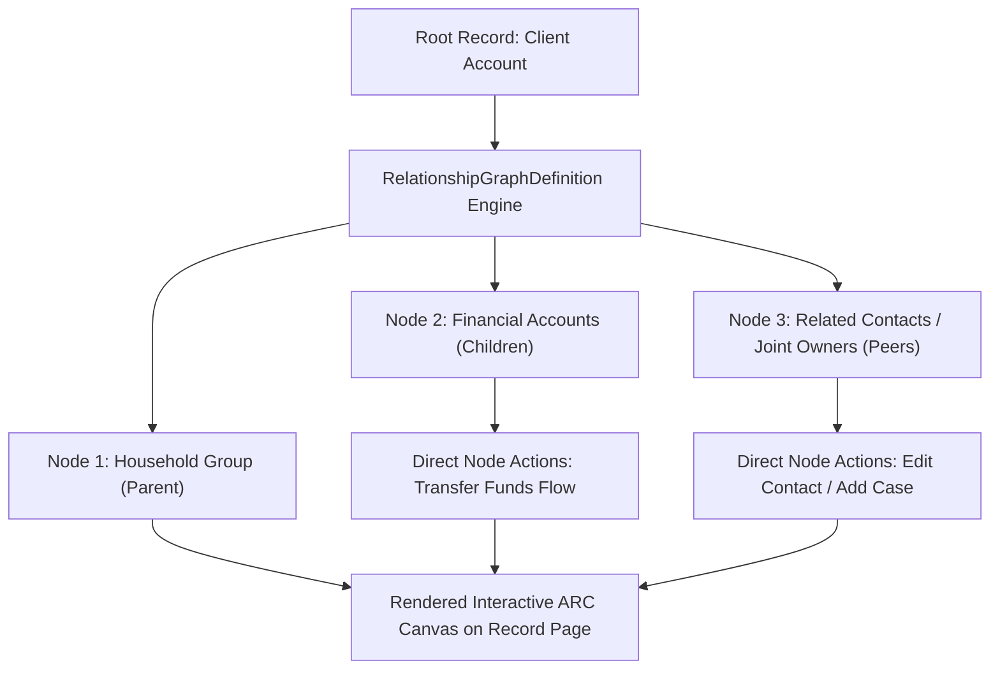

## Architectural Overview

`RelationshipGraphDefinition` is the underlying metadata framework behind Salesforce **Actionable Relationship Center (ARC)** graphs. In industry solutions like Financial Services Cloud (FSC), Health Cloud, and Public Sector Solutions, data models extend far beyond standard one-to-many parent-child relationships. Organizations manage complex multi-layered networks involving households, business groups, joint owners, patient care providers, and legal entities.

Instead of navigating fragmented related lists, ARC provides a visual, interactive graph component embedded directly within [FlexiPage](/docs/metadata/flexipage-metadata-type/) layouts. `RelationshipGraphDefinition` declaratively models the graph topology: identifying root entities, relationship traversal paths, node display fields, filter criteria, and contextual action menus (e.g., launching an account opening Flow or creating a new party relationship record).



## Directory and File Conventions

`RelationshipGraphDefinition` records are stored as XML files inside the `relationshipGraphDefinitions` folder.

| Property | Value |
| :--- | :--- |
| **Directory Path** | `force-app/main/default/relationshipGraphDefinitions/` |
| **File Suffix** | `.relationshipGraphDefinition-meta.xml` |
| **XML Root Element** | `<RelationshipGraphDefinition>` |
| **API Version** | `68.0` |

## Key Metadata Fields

The definition structure specifies graph hierarchy, node connections, and action associations.

| Field Name | Type | Required | Description |
| :--- | :--- | :--- | :--- |
| `masterLabel` | `string` | Yes | Human-readable title of the ARC graph displayed to users. |
| `developerName` | `string` | Yes | Unique programmatic identifier of the graph definition. |
| `rootNode` | `string` | Yes | Identifier specifying the root or starting sObject entity of the graph. |
| `graphType` | `string` | Yes | Type of visual layout (e.g., `Hierarchical`, `Network`, `Tree`). |
| `isActive` | `boolean` | No | Indicates whether the graph definition is active and available in App Builder. |
| `description` | `string` | No | Architectural description of the business relationship model. |
| `nodeDefinitions` | `RelationshipGraphNode[]` | Yes | Collection of node definitions defining display fields, actions, and child links. |

## Declarative XML and Package Manifest Examples

The following example configures an ARC graph mapping a Wealth Management Client Account to its associated financial accounts and authorized beneficiaries:

```xml title="force-app/main/default/relationshipGraphDefinitions/Wealth_Client_ARC.relationshipGraphDefinition-meta.xml"
<?xml version="1.0" encoding="UTF-8"?>
<RelationshipGraphDefinition xmlns="http://soap.sforce.com/2006/04/metadata">
    <masterLabel>Wealth Client Relationship Graph</masterLabel>
    <developerName>Wealth_Client_ARC</developerName>
    <rootNode>Account_Root</rootNode>
    <graphType>Hierarchical</graphType>
    <isActive>true</isActive>
    <description>Visual ARC graph depicting client household affiliations and financial accounts.</description>
    <nodeDefinitions>
        <developerName>Account_Root</developerName>
        <label>Client Account</label>
        <objectApiName>Account</objectApiName>
        <displayFields>Name,AccountNumber,Type</displayFields>
    </nodeDefinitions>
    <nodeDefinitions>
        <developerName>Financial_Accounts_Node</developerName>
        <label>Financial Accounts</label>
        <objectApiName>FinServ__FinancialAccount__c</objectApiName>
        <displayFields>Name,FinServ__Balance__c,FinServ__FinancialAccountNumber__c</displayFields>
    </nodeDefinitions>
</RelationshipGraphDefinition>
```

### Package Manifest (`package.xml`)

```xml title="manifest/package.xml"
<?xml version="1.0" encoding="UTF-8"?>
<Package xmlns="http://soap.sforce.com/2006/04/metadata">
    <types>
        <members>Wealth_Client_ARC</members>
        <name>RelationshipGraphDefinition</name>
    </types>
    <types>
        <members>Account</members>
        <name>CustomObject</name>
    </types>
    <version>68.0</version>
</Package>
```

## CLI Retrieval and Deployment Commands

Retrieve and deploy `RelationshipGraphDefinition` components via the Salesforce CLI:

```bash
# Retrieve all RelationshipGraphDefinitions
sf project retrieve start --metadata RelationshipGraphDefinition

# Deploy a specific graph definition
sf project deploy start --source-dir force-app/main/default/relationshipGraphDefinitions/Wealth_Client_ARC.relationshipGraphDefinition-meta.xml

# Retrieve the graph definition alongside dependent FlexiPages
sf project retrieve start --metadata "RelationshipGraphDefinition:Wealth_Client_ARC,FlexiPage:Wealth_Account_Record_Page"
```

## Architect Best Practices and Gotchas

- **Schema Dependencies:** Every node definition references specific sObjects and field API names. If a referenced custom field or industry package (like FSC) is missing from the destination org, deployment will fail with reference validation errors.
- **Graph Traversal Limits:** While ARC can traverse multi-level hierarchies, configuring more than 4 or 5 levels of nested nodes can negatively impact page load time and user comprehension. Keep graph depths focused on immediate operational context.
- **Action Security Enforcement:** Quick actions and Flows configured on individual graph nodes respect the user's object and field-level permissions. Ensure target profiles or permission sets grant access to all referenced child actions.

> [!TIP]
> Place the Actionable Relationship Center component within an independent tab on the Lightning Record Page so that graph rendering queries only execute when the user navigates to the tab.
