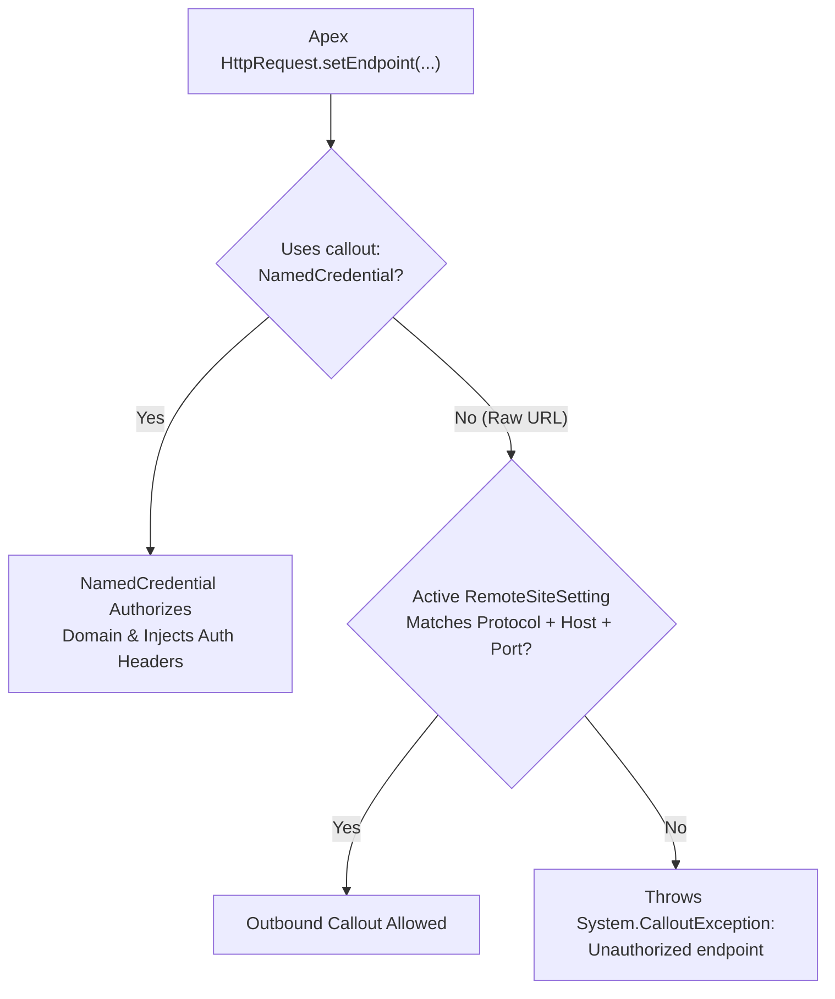

The `RemoteSiteSetting` metadata type registers an external domain and protocol in Salesforce's **Remote Site Settings** outbound allowlist. Available in API version 19.0 and later, any outbound [ApexClass](/docs/metadata/apex-class-metadata-type/) `HttpRequest` or Visualforce callout that specifies a raw `https://...` URL (rather than a `callout:` [NamedCredential](/docs/metadata/named-credential-metadata-type/)) will fail with `System.CalloutException: Unauthorized endpoint, please check Setup->Security->Remote site settings` unless an active `RemoteSiteSetting` matches the target protocol, host, and port.

In Salesforce DX projects, remote site settings are stored in `force-app/main/default/remoteSiteSettings/` with the `.remoteSite-meta.xml` suffix.



## Key Metadata Fields

| Field | Type | Required | Description |
|---|---|---|---|
| `url` | `string` | Yes | Protocol, domain, and optional port of the external endpoint (for example, `https://api.stripe.com`) |
| `isActive` | `boolean` | Yes | Activates (`true`) or disables (`false`) the allowlist entry |
| `disableProtocolSecurity` | `boolean` | Yes | Always set to `false` in production so HTTPS protocol security is enforced |
| `description` | `string` | No | Documents which integration or Apex class consumes this endpoint |

## Production-Grade XML Example

Below is a `RemoteSiteSetting` (`Stripe_Payment_Gateway.remoteSite-meta.xml`) authorizing HTTPS callouts to `https://api.stripe.com`:

```xml
<?xml version="1.0" encoding="UTF-8"?>
<RemoteSiteSetting xmlns="http://soap.sforce.com/2006/04/metadata">
    <description>Authorizes outbound HTTPS webhook verification callouts to the Stripe Payment API.</description>
    <disableProtocolSecurity>false</disableProtocolSecurity>
    <isActive>true</isActive>
    <url>https://api.stripe.com</url>
</RemoteSiteSetting>
```

> [!TIP]
> **Prefer `NamedCredential` Over `RemoteSiteSetting`**: Whenever possible, use [NamedCredential](/docs/metadata/named-credential-metadata-type/) + [ExternalCredential](/docs/metadata/external-credential-metadata-type/) instead of `RemoteSiteSetting`. Named Credentials eliminate hardcoded endpoint URLs in Apex, manage OAuth 2.0/JWT authentication outside code, and automatically authorize the outbound endpoint without a `RemoteSiteSetting`.

## Auditing Remote Site Settings via Tooling API (`RemoteProxy`)

In the Tooling API, `RemoteSiteSetting` is exposed as the `RemoteProxy` object:

```sql
-- Audit all Remote Site Settings and flag any insecure HTTP or protocol-disabled entries (Tooling API)
SELECT Id, SiteName, EndpointUrl, IsActive, DisableProtocolSecurity, Description
FROM RemoteProxy
ORDER BY SiteName ASC
```

