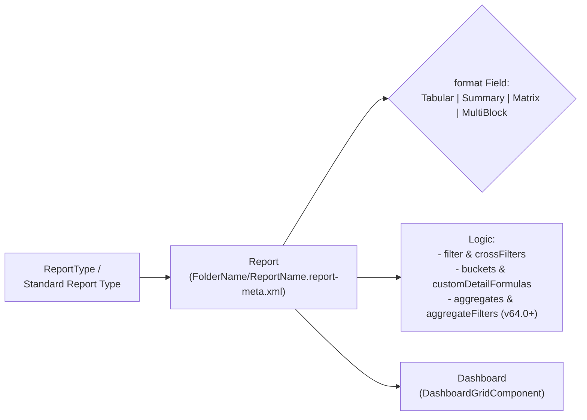

The `Report` metadata type represents a custom analytics report in Salesforce (`Tabular`, `Summary`, `Matrix`, or `MultiBlock` Joined Report). Introduced in API version 14.0 (with `aggregateFilters` added in API v64.0 and `crossFilters` documented in v68.0), `Report` encapsulates displayed `columns`, row and column groupings (`groupingsDown`, `groupingsAcross`), custom summary formulas (`aggregates`), row-level formulas (`customDetailFormulas`), bucket fields (`buckets`), and embedded charts (`chart`).

In Salesforce DX projects, reports are stored inside folder subdirectories at `force-app/main/default/reports/<FolderName>/<ReportDeveloperName>.report-meta.xml`.



## Key Metadata Fields

| Field | Type | Required | Description |
|---|---|---|---|
| `name` | `string` | Yes | UI display title of the report |
| `format` | `ReportFormat` | Yes | `Tabular`, `Summary`, `Matrix`, or `MultiBlock` (Joined Report) |
| `reportType` | `string` | Yes | Standard report type code (such as `Opportunity`, `CaseList`) or custom [ReportType](/docs/metadata/report-type-metadata-type/) developer name (`CustomEntity$Invoice__c`) |
| `scope` | `string` | No | Ownership scope (`organization`, `user`, `team`, `my_team_territory`) |
| `columns` | `ReportColumn[]` | No | Ordered fields (`field`, `aggregateTypes`: `Sum`, `Average`, `Maximum`, `Minimum`) |
| `groupingsDown` | `ReportGrouping[]` | No | Up to 3 row groupings for `Summary` reports (2 for `Matrix`) |
| `groupingsAcross` | `ReportGrouping[]` | No | Up to 2 column groupings for `Matrix` reports |
| `aggregates` | `ReportAggregate[]` | No | Custom Summary Formulas (`calculatedFormula`, `datatype`, `developerName` prefixed with `FORMULA1`) |
| `customDetailFormulas` | `ReportCustomDetailFormula[]` | No | Row-Level Formulas (`calculatedFormula`, ` developerName` set to `CDF1`) |
| `filter` | `ReportFilter` | No | Field filter criteria (`criteriaItems` + `booleanFilter`) |
| `crossFilters` | `ReportCrossFilter[]` | No | `WITH` (`includes`) or `WITHOUT` (`excludes`) child object filters |
| `timeFrameFilter` | `ReportTimeFrameFilter` | No | Date field and interval filter (`dateColumn`, `interval`) |

## Production-Grade XML Example (Summary Report with Custom Summary Formula)

Below is a `Summary` report (`force-app/main/default/reports/Executive_Sales_Reports/Quarterly_Enterprise_Pipeline.report-meta.xml`) grouped by `StageName` with a win-rate custom summary formula:

```xml
<?xml version="1.0" encoding="UTF-8"?>
<Report xmlns="http://soap.sforce.com/2006/04/metadata">
    <aggregates>
        <calculatedFormula>WON:SUM / RowCount</calculatedFormula>
        <datatype>percent</datatype>
        <developerName>FORMULA1</developerName>
        <isActive>true</isActive>
        <isCrossBlock>false</isCrossBlock>
        <masterLabel>Stage Win Rate %</masterLabel>
        <scale>1</scale>
    </aggregates>
    <columns>
        <field>OPPORTUNITY_NAME</field>
    </columns>
    <columns>
        <field>ACCOUNT_NAME</field>
    </columns>
    <columns>
        <aggregateTypes>Sum</aggregateTypes>
        <aggregateTypes>Average</aggregateTypes>
        <field>AMOUNT</field>
    </columns>
    <columns>
        <field>CLOSE_DATE</field>
    </columns>
    <description>Executive pipeline summary grouped by stage for the current fiscal quarter.</description>
    <filter>
        <criteriaItems>
            <column>AMOUNT</column>
            <columnToColumn>false</columnToColumn>
            <isUnlocked>true</isUnlocked>
            <operator>greaterOrEqual</operator>
            <value>50000</value>
        </criteriaItems>
    </filter>
    <format>Summary</format>
    <groupingsDown>
        <dateGranularity>Day</dateGranularity>
        <field>STAGE_NAME</field>
        <sortOrder>Asc</sortOrder>
    </groupingsDown>
    <name>Quarterly Enterprise Pipeline</name>
    <reportType>Opportunity</reportType>
    <scope>organization</scope>
    <showDetails>true</showDetails>
    <showGrandTotal>true</showGrandTotal>
    <showSubTotals>true</showSubTotals>
    <timeFrameFilter>
        <dateColumn>CLOSE_DATE</dateColumn>
        <interval>INTERVAL_CURRENT</interval>
    </timeFrameFilter>
</Report>
```

> [!WARNING]
> **Nested Report Folders Require a Trailing Slash (`/`) in `package.xml`**: When retrieving or deploying a nested `ReportFolder` without a trailing slash (`<members>Sales_Ops/EMEA_Reports</members>`), Metadata API assumes `EMEA_Reports` is a report file and throws `Entity of type 'Report' named 'Sales_Ops/EMEA_Reports' cannot be found`. Always append a trailing slash to folder paths:
> ```xml
> <types>
>     <members>Sales_Ops/</members>
>     <members>Sales_Ops/EMEA_Reports/</members>
>     <members>Sales_Ops/EMEA_Reports/Quarterly_Enterprise_Pipeline</members>
>     <name>Report</name>
> </types>
> ```

## Querying Reports and Folders with SOQL

```sql
-- 1. List all public and shared Reports with their Folder DeveloperName
SELECT Id, Name, DeveloperName, FolderName, Format, LastRunDate, LastViewedDate
FROM Report
WHERE FolderName != 'Private Reports'
ORDER BY FolderName, Name ASC

-- 2. List all Report Folders to construct package.xml paths
SELECT Id, Name, DeveloperName, AccessType, Type
FROM Folder
WHERE Type = 'Report' AND DeveloperName != null
ORDER BY DeveloperName ASC
```

