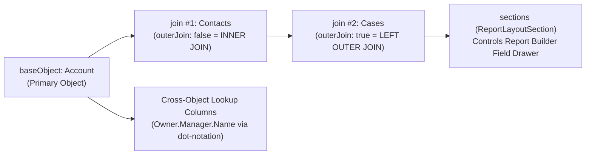

The `ReportType` metadata type represents a **Custom Report Type**—the underlying data model template that determines which objects, join types (`outerJoin`), and field columns are available to users in the Lightning Report Builder. Available in API version 14.0 and later, `ReportType` supports standard, custom, external (`__x`), and Data Cloud (`data_cloud`, `semantic_model`) objects.

In Salesforce DX projects, custom report types are stored in `force-app/main/default/reportTypes/` with the `.reportType-meta.xml` suffix.



## Key Architectural Advantage: Lookup Field Spanning vs. Object Joins

A `ReportType` can join at most **4 objects** top-down (Parent -> Child -> Grandchild -> Great-Grandchild). However, inside `<sections><columns>`, you can traverse **upward** across lookup relationships up to 4 levels deep using dot notation (for example, `<field>Account__c.Parent.Owner.Department</field>`). Always use **Add Fields Related via Lookup** (dot-notation `<field>` entries) for parent/sibling lookups so you save your 4 `<join>` slots for true 1-to-many child collections.

## Key Metadata Fields

| Field | Location | Required | Description |
|---|---|---|---|
| `baseObject` | Root | Yes | **Not updateable**. Primary root object API name (`Account`, `Invoice__c`, etc.) |
| `label` | Root | Yes | Display name shown when choosing a Report Type |
| `category` | Root | Yes | Report Type folder category (`accounts`, `opportunities`, `cases`, `other`, `data_cloud`, `flow`) |
| `deployed` | Root | Yes | `true` (Deployed to end users) or `false` (In Development) |
| `description` | Root | No | Explains which object joins and lookup fields are included |
| `join` | Root / `ObjectRelationship` | No | Recursive child relationship join (`relationship` plural name + `outerJoin` boolean) |
| `outerJoin` | `ObjectRelationship` | Yes | `true` ("A with or without B" left outer join) or `false` ("A with B" inner join) |
| `sections` | Root | No | Drawer categories (`masterLabel` + `columns`) |
| `field` | `columns` | Yes | Field API name (or dot-notation lookup path) |
| `table` | `columns` | Yes | Object path (`Account`, `Account.Contacts`, `Account.Contacts.Cases`) |
| `checkedByDefault` | `columns` | Yes | Automatically adds the column to newly created reports when `true` |
| `displayNameOverride` | `columns` | No | Custom column alias shown in Report Builder |

## Production-Grade XML Example

Below is a `ReportType` (`Accounts_With_Contacts_And_Open_Cases.reportType-meta.xml`) joining `Account` -> `Contacts` (inner join) -> `Cases` (left outer join) with cross-object lookup columns:

```xml
<?xml version="1.0" encoding="UTF-8"?>
<ReportType xmlns="http://soap.sforce.com/2006/04/metadata">
    <baseObject>Account</baseObject>
    <category>accounts</category>
    <deployed>true</deployed>
    <description>Accounts with Contacts and optional Cases, including Account Owner Manager lookup fields.</description>
    <join>
        <join>
            <outerJoin>true</outerJoin>
            <relationship>Cases</relationship>
        </join>
        <outerJoin>false</outerJoin>
        <relationship>Contacts</relationship>
    </join>
    <label>Accounts with Contacts and Optional Cases</label>
    <sections>
        <columns>
            <checkedByDefault>true</checkedByDefault>
            <field>Name</field>
            <table>Account</table>
        </columns>
        <columns>
            <checkedByDefault>false</checkedByDefault>
            <displayNameOverride>Account Executive Manager</displayNameOverride>
            <field>Owner.Manager.Name</field>
            <table>Account</table>
        </columns>
        <masterLabel>Account Details</masterLabel>
    </sections>
    <sections>
        <columns>
            <checkedByDefault>true</checkedByDefault>
            <field>Name</field>
            <table>Account.Contacts</table>
        </columns>
        <columns>
            <checkedByDefault>true</checkedByDefault>
            <field>Email</field>
            <table>Account.Contacts</table>
        </columns>
        <masterLabel>Contacts</masterLabel>
    </sections>
    <sections>
        <columns>
            <checkedByDefault>true</checkedByDefault>
            <field>CaseNumber</field>
            <table>Account.Contacts.Cases</table>
        </columns>
        <columns>
            <checkedByDefault>false</checkedByDefault>
            <field>Status</field>
            <table>Account.Contacts.Cases</table>
        </columns>
        <masterLabel>Support Cases</masterLabel>
    </sections>
</ReportType>
```

> [!TIP]
> **Redeploying Deleted ReportTypes Preserves IDs**: If a `ReportType` is accidentally deleted in an org, redeploying its `.reportType-meta.xml` with the same `fullName` via Metadata API restores the original `ReportType` record with its original `Id`—preventing broken report dependencies.

