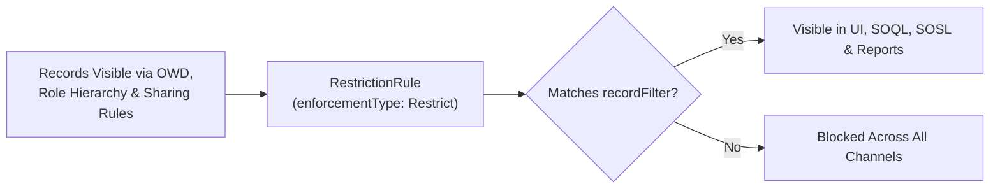

## Why `RestrictionRule` Solves the "Over-Shared Parent Record" Problem

For decades, Salesforce's record-level security model was strictly additive: Organization-Wide Defaults (OWD) set the baseline, and Role Hierarchies, [SharingRules](/docs/metadata/sharing-rules-metadata-type/), Teams, and Manual Sharing opened access up. However, certain child objects—such as **`Task`**, **`Event`**, **`Contract`**, **`Quote`**, or Master-Detail custom objects—inherit visibility from their parent `Account` or `Case`, making it impossible to hide sensitive HR tasks or executive contracts using standard Sharing Rules.

The **`RestrictionRule`** metadata type (`restrictionRules/<Name>.rule-meta.xml`) introduces **subtractive filtering** (`enforcementType: Restrict`) as well as **default view scoping** (`enforcementType: Scoping`).



---

## Key Metadata Fields on `RestrictionRule`

| Field | Type | Required | Description |
|---|---|---|---|
| `enforcementType` | `EnforcementType` | Yes | `Restrict` (hard security restriction rule) or `Scoping` (productivity scoping rule). |
| `targetEntity` | `string` | Yes | Object API name (`Task`, `Event`, `Contract`, `Quote`, `Account`, or `Custom_Object__c`). |
| `userCriteria` | `string` | Yes | Formula/criteria evaluating which logged-in users the rule applies to (e.g., `$Permission.Contractor_Restricted_Access = true`). |
| `recordFilter` | `string` | Yes | Criteria evaluating which records those users are permitted to see (e.g., `Is_Confidential__c = false`). |
| `active` | `boolean` | Yes | Enables (`true`) or disables (`false`) the rule. |
| `masterLabel` | `string` | Yes | Human-readable rule name in Object Manager. |
| `version` | `int` | Yes | Rule schema version (`1`). |

---

## Real-World XML Examples

### 1. Restriction Rule Using a Custom Permission (`restrictionRules/Hide_Executive_Legal_Tasks.rule-meta.xml`)

> [!TIP]
> **Always Use `$Permission` Instead of Hardcoded `ProfileId` in `userCriteria`:** Official documentation examples often show `$User.ProfileId = '00e...'`, which breaks CI/CD deployments across Sandboxes and Scratch Orgs. Binding `userCriteria` to a [CustomPermission](/docs/metadata/custom-permission-metadata-type/) makes your `RestrictionRule` 100% portable!

```xml
<?xml version="1.0" encoding="UTF-8"?>
<RestrictionRule xmlns="http://soap.sforce.com/2006/04/metadata">
    <active>true</active>
    <description>Restricts external support contractors to viewing only non-confidential Tasks assigned to their division.</description>
    <enforcementType>Restrict</enforcementType>
    <masterLabel>Hide Executive Legal Tasks</masterLabel>
    <recordFilter>Is_Executive_Confidential__c = false</recordFilter>
    <targetEntity>Task</targetEntity>
    <userCriteria>$Permission.External_Support_Contractor = true</userCriteria>
    <version>1</version>
</RestrictionRule>
```

### 2. Scoping Rule on `Account` (`restrictionRules/Scope_Accounts_By_User_Division.rule-meta.xml`)

```xml
<?xml version="1.0" encoding="UTF-8"?>
<RestrictionRule xmlns="http://soap.sforce.com/2006/04/metadata">
    <active>true</active>
    <description>Scopes default Account list views and lookups to match the logged-in seller division.</description>
    <enforcementType>Scoping</enforcementType>
    <masterLabel>Scope Accounts By User Division</masterLabel>
    <recordFilter>Sales_Division__c = $User.Division</recordFilter>
    <targetEntity>Account</targetEntity>
    <userCriteria>$User.IsActive = true</userCriteria>
    <version>1</version>
</RestrictionRule>
```

---

## Querying `RestrictionRule` via Tooling API

You can audit all active Restriction Rules and Scoping Rules across your org by querying `RestrictionRule` via the **Tooling API**.

```sql
SELECT Id, DeveloperName, MasterLabel, EntityDefinition.QualifiedApiName,
       EnforcementType, Active, UserCriteria, RecordFilter, LastModifiedDate
FROM RestrictionRule
ORDER BY EntityDefinition.QualifiedApiName, EnforcementType, DeveloperName
```

---

## Senior Architect Best Practices & Performance Rules

- **Index Fields Referenced in `recordFilter`:** Because Salesforce appends `recordFilter` to every SOQL query, List View, Report, and Lookup executed by matching users, any custom field used inside `recordFilter` **must** be indexed (marked External ID or custom indexed) on large-data-volume (LDV) objects to prevent query timeouts.
- **One Active Rule Evaluated Per User:** Ensure that a single user only matches **one** active `RestrictionRule` on a given object. If multiple active rules match the same user on the same object, Salesforce only evaluates one of them (non-deterministically).

