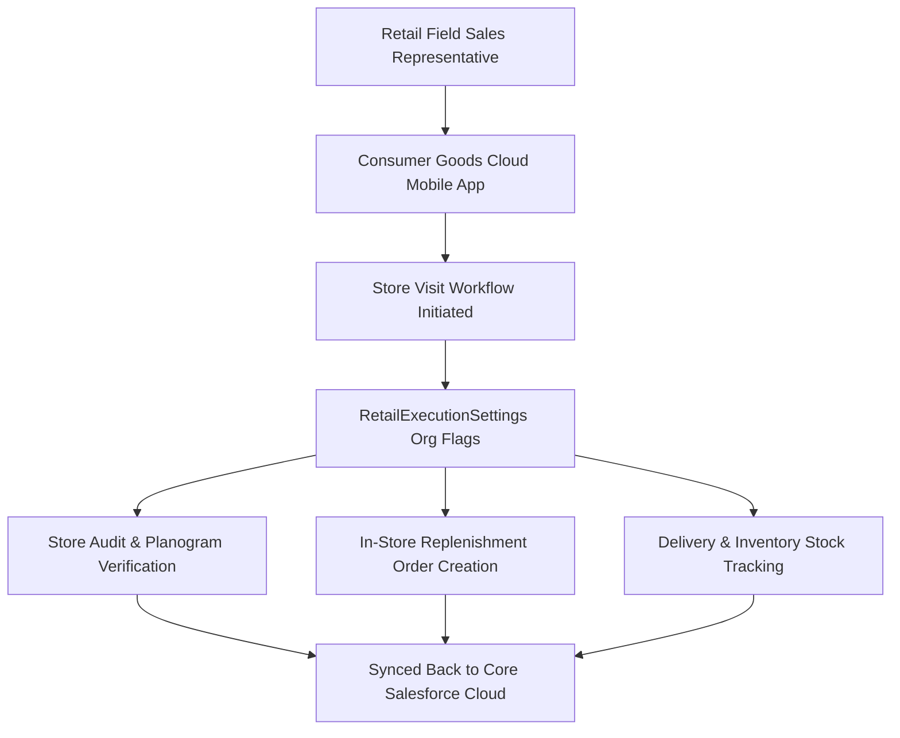

## Architectural Overview

`RetailExecutionSettings` represents the org-level configuration file that enables and controls **Consumer Goods Cloud (CGC) Retail Execution**. Consumer goods enterprises manage expansive retail field forces tasked with store visits, merchandising audits, promotional compliance, planogram checks, and van delivery logistics.

Through `RetailExecutionSettings`, architects declaratively activate core retail execution features across sandbox and production tiers. This includes governing whether field sales reps can generate replenishment orders directly during store visits, activating inventory tracking modules, and configuring automated scheduling behaviors. Packaging this configuration as metadata guarantees that scratch orgs and multi-tier deployment pipelines automatically instantiate properly configured retail environments.



## Directory and File Conventions

`RetailExecutionSettings` is a singleton settings metadata file residing in the `settings` directory.

| Property | Value |
| :--- | :--- |
| **Directory Path** | `force-app/main/default/settings/` |
| **File Name** | `RetailExecution.settings-meta.xml` |
| **XML Root Element** | `<RetailExecutionSettings>` |
| **API Version** | `68.0` |

## Key Metadata Fields

The settings file exposes boolean switches governing retail execution features.

| Field Name | Type | Required | Description |
| :--- | :--- | :--- | :--- |
| `enableRetailExecution` | `boolean` | No | Activates the core Consumer Goods Cloud Retail Execution engine. |
| `enableOrderGeneration` | `boolean` | No | Allows field reps to draft and submit replenishment sales orders during a retail visit. |
| `enableInventoryTracking` | `boolean` | No | Enables tracking of shelf stock, display quantities, and store warehouse inventory. |
| `enableVisitScheduling` | `boolean` | No | Activates automated route planning and store visit scheduling algorithms. |

## Declarative XML and Package Manifest Examples

The following sample configures an active Retail Execution environment with order generation and inventory tracking enabled:

```xml title="force-app/main/default/settings/RetailExecution.settings-meta.xml"
<?xml version="1.0" encoding="UTF-8"?>
<RetailExecutionSettings xmlns="http://soap.sforce.com/2006/04/metadata">
    <enableRetailExecution>true</enableRetailExecution>
    <enableOrderGeneration>true</enableOrderGeneration>
    <enableInventoryTracking>true</enableInventoryTracking>
    <enableVisitScheduling>true</enableVisitScheduling>
</RetailExecutionSettings>
```

### Package Manifest (`package.xml`)

```xml title="manifest/package.xml"
<?xml version="1.0" encoding="UTF-8"?>
<Package xmlns="http://soap.sforce.com/2006/04/metadata">
    <types>
        <members>RetailExecution</members>
        <name>Settings</name>
    </types>
    <version>68.0</version>
</Package>
```

## CLI Retrieval and Deployment Commands

Manage `RetailExecutionSettings` using the Salesforce CLI:

```bash
# Retrieve RetailExecution settings
sf project retrieve start --metadata "Settings:RetailExecution"

# Deploy settings to target org
sf project deploy start --source-dir force-app/main/default/settings/RetailExecution.settings-meta.xml

# Validate settings deployment in CI pipeline
sf project deploy validate --metadata "Settings:RetailExecution"
```

## Architect Best Practices and Gotchas

- **Industry License Prerequisite:** Deploying `RetailExecutionSettings` into an org lacking active Consumer Goods Cloud or Lightning Retail Execution licenses results in immediate deployment failure (`Feature not enabled`).
- **Scratch Org Provisioning:** When utilizing scratch orgs for CGC development, declare the `ConsumerGoodsCloud` feature in `project-scratch-def.json` before deploying this settings file.
- **Mobile Offline Dependency:** Toggling `enableOrderGeneration` or `enableInventoryTracking` impacts mobile synchronization schemas. Field reps running the offline app must perform a full synchronization cycle after changes to prevent local schema mismatches.

> [!NOTE]
> Activating `enableRetailExecution` exposes standard retail objects such as `RetailStore`, `StoreVisit`, and `AssessmentTask` in Object Manager.
