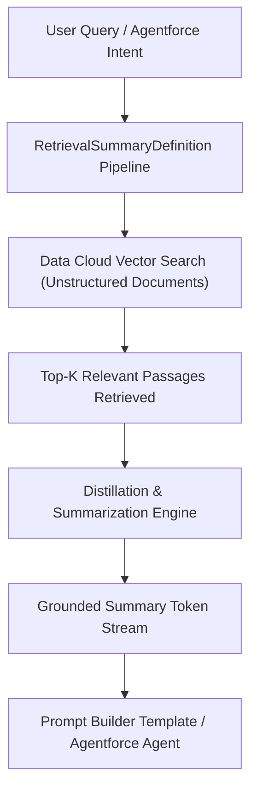

## Architectural Overview

`RetrievalSummaryDefinition` represents the declarative blueprint for **Retrieval-Augmented Generation (RAG)** grounding within the Salesforce Einstein 1 and Agentforce architectures. In enterprise generative AI implementations, Large Language Models (LLMs) must be grounded with proprietary enterprise data (such as product documentation, knowledge articles, support transcripts, or compliance policies) to produce accurate, hallucination-free responses.

Rather than injecting massive unstructured documents directly into LLM context windows—which inflates token consumption and degrades reasoning latency—`RetrievalSummaryDefinition` choreographs a two-stage pipeline:
1. **Semantic Vector Search:** Retrieves the most contextually relevant document chunks from Data Cloud Vector Indexes or hybrid search retrievers.
2. **Contextual Distillation & Summarization:** Applies a summarization model to distill retrieved passages into concise, grounded context before passing them to Prompt Builder or Agentforce autonomous agents.



## Directory and File Conventions

`RetrievalSummaryDefinition` artifacts are stored in the `retrievalSummaryDefinitions` directory within the default package folder.

| Property | Value |
| :--- | :--- |
| **Directory Path** | `force-app/main/default/retrievalSummaryDefinitions/` |
| **File Suffix** | `.retrievalSummaryDefinition-meta.xml` |
| **XML Root Element** | `<RetrievalSummaryDefinition>` |
| **API Version** | `68.0` |

## Key Metadata Fields

The definition establishes data connector bindings, vector search index links, and summarization parameters.

| Field Name | Type | Required | Description |
| :--- | :--- | :--- | :--- |
| `masterLabel` | `string` | Yes | Human-readable title displayed in Prompt Builder and Agentforce Studio. |
| `developerName` | `string` | Yes | Programmatic API name representing the retriever in metadata. |
| `dataConnector` | `string` | Yes | Identifier of the Data Cloud search index or vector database connector. |
| `searchType` | `string` | Yes | Search mechanism: `Vector`, `Hybrid`, or `Keyword`. |
| `summaryModel` | `string` | Yes | Model endpoint used for intermediate passage summarization. |
| `maxResults` | `integer` | No | Maximum number of candidate passages retrieved from the index. |
| `status` | `string` | Yes | Operational state of the definition (`Active`, `Draft`, `Inactive`). |
| `description` | `string` | No | Architectural description of the retrieval and grounding strategy. |

## Declarative XML and Package Manifest Examples

The following example establishes a retrieval summary pipeline grounding customer service agents on knowledge base troubleshooting guides:

```xml title="force-app/main/default/retrievalSummaryDefinitions/Knowledge_Support_Retriever.retrievalSummaryDefinition-meta.xml"
<?xml version="1.0" encoding="UTF-8"?>
<RetrievalSummaryDefinition xmlns="http://soap.sforce.com/2006/04/metadata">
    <masterLabel>Knowledge Support Retriever</masterLabel>
    <developerName>Knowledge_Support_Retriever</developerName>
    <dataConnector>Support_Docs_Vector_Index</dataConnector>
    <searchType>Hybrid</searchType>
    <summaryModel>sfdc_einstein_gpt_summarizer</summaryModel>
    <maxResults>5</maxResults>
    <status>Active</status>
    <description>Retrieves top 5 support knowledge articles and generates a synthesized grounding summary for Case copilot prompts.</description>
</RetrievalSummaryDefinition>
```

### Package Manifest (`package.xml`)

```xml title="manifest/package.xml"
<?xml version="1.0" encoding="UTF-8"?>
<Package xmlns="http://soap.sforce.com/2006/04/metadata">
    <types>
        <members>Knowledge_Support_Retriever</members>
        <name>RetrievalSummaryDefinition</name>
    </types>
    <version>68.0</version>
</Package>
```

## CLI Retrieval and Deployment Commands

Retrieve and deploy `RetrievalSummaryDefinition` metadata with the Salesforce CLI:

```bash
# Retrieve all retrieval summary definitions
sf project retrieve start --metadata RetrievalSummaryDefinition

# Deploy definition to target sandbox
sf project deploy start --source-dir force-app/main/default/retrievalSummaryDefinitions/Knowledge_Support_Retriever.retrievalSummaryDefinition-meta.xml

# Validate definition deployment
sf project deploy validate --metadata RetrievalSummaryDefinition:Knowledge_Support_Retriever
```

## Architect Best Practices and Gotchas

- **Data Cloud Index Dependencies:** The vector search index referenced in `dataConnector` must be provisioned and active in Data Cloud before this metadata type can be successfully deployed.
- **Token Window Management:** While `maxResults` controls passage volume, ensure the intermediate `summaryModel` does not exceed prompt size limits when combined with user conversation histories.
- **Security and Masking:** Grounding pipelines respect Einstein Trust Layer data masking and zero-data retention policies. Verify that data ingested into the underlying vector index complies with data residency regulations.

> [!RELEASE] Winter '27
> API version 68.0 introduces enhanced hybrid search scoring combining semantic embeddings with BM25 keyword matching for higher domain-specific recall.
