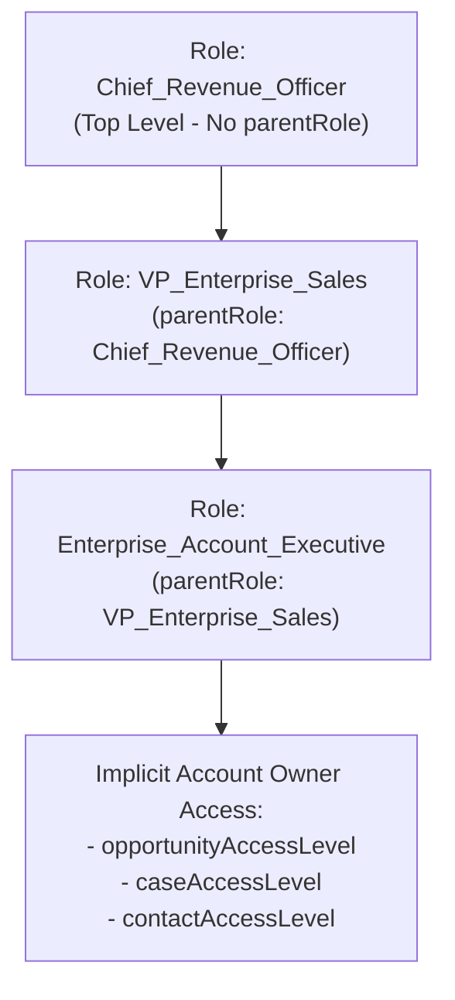

The `Role` metadata type represents a single node in your organization's **Role Hierarchy**. Introduced in API version 24.0 (extending `RoleOrTerritory`), `Role` governs vertical record-level visibility: any user assigned to a parent role (`parentRole`) automatically inherits read/edit access to records owned by or shared with users in subordinate roles (for all standard objects and custom objects with `Grant Access Using Hierarchies` enabled).

In Salesforce DX projects, role definitions are stored in `force-app/main/default/roles/` with the `.role-meta.xml` suffix.



## Key Metadata Fields

| Field | Type | Required | Description |
|---|---|---|---|
| `name` | `string` | Yes | UI display label of the Role in the Role Hierarchy tree |
| `parentRole` | `string` | No | Developer `fullName` of the role immediately above this role in the hierarchy |
| `description` | `string` | No | Description of the role's scope |
| `opportunityAccessLevel` | `string` | No | Account owner's implicit access to child Opportunities (`None`, `Read`, or `Edit`) |
| `caseAccessLevel` | `string` | No | Account owner's implicit access to child Cases (`None`, `Read`, or `Edit`) |
| `contactAccessLevel` | `string` | No | Account owner's implicit access to child Contacts (`None`, `Read`, or `Edit`) |
| `mayForecastManagerShare` | `boolean` | No | Indicates whether the forecast manager can share forecast data |

## Production-Grade XML Example

Below is a `Role` definition (`VP_Enterprise_Sales.role-meta.xml`) reporting to `Chief_Revenue_Officer`:

```xml
<?xml version="1.0" encoding="UTF-8"?>
<Role xmlns="http://soap.sforce.com/2006/04/metadata">
    <caseAccessLevel>Read</caseAccessLevel>
    <contactAccessLevel>Edit</contactAccessLevel>
    <description>Vice President of Enterprise Sales overseeing North America AEs.</description>
    <mayForecastManagerShare>false</mayForecastManagerShare>
    <name>VP, Enterprise Sales</name>
    <opportunityAccessLevel>Edit</opportunityAccessLevel>
    <parentRole>Chief_Revenue_Officer</parentRole>
</Role>
```

> [!TIP]
> **PreventingImplicit Sharing Recalculation Locks**: Setting `opportunityAccessLevel` and `caseAccessLevel` to `None` on roles that do not require automatic visibility into every child Opportunity or Case on their Accounts reduces implicit `OpportunityShare` and `CaseShare` table volume and speeds up Account ownership transfers.

## Querying the Role Hierarchy with SOQL (`UserRole`)

In SOQL, roles are stored in the standard `UserRole` object:

```sql
-- 1. Inspect the Role Hierarchy structure and implicit Account child access
SELECT Id, DeveloperName, Name, ParentRoleId, PortalType,
       OpportunityAccessForAccountOwner, CaseAccessForAccountOwner, ContactAccessForAccountOwner
FROM UserRole
WHERE PortalType = 'None'
ORDER BY Name ASC

-- 2. Count active users per Role to identify unpopulated or skewed roles
SELECT UserRole.DeveloperName, UserRole.Name, COUNT(Id) activeUsers
FROM User
WHERE IsActive = true AND UserRoleId != null
GROUP BY UserRole.DeveloperName, UserRole.Name
ORDER BY COUNT(Id) DESC
```

