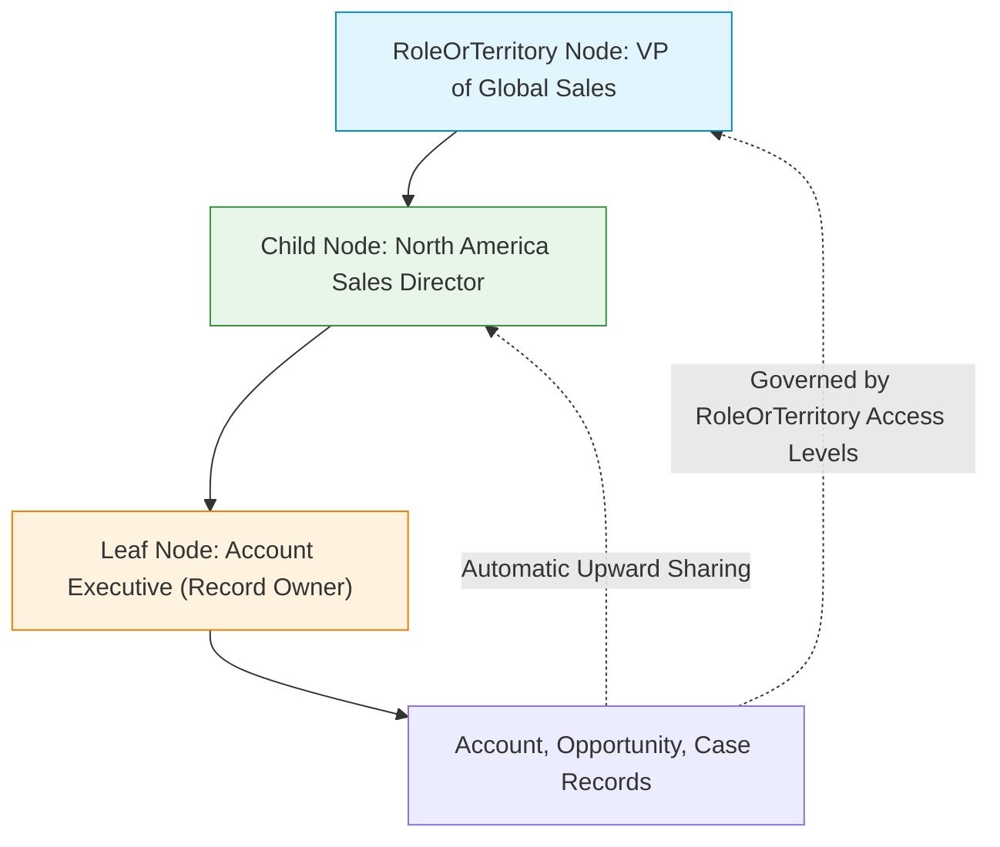

## Architectural Overview

`RoleOrTerritory` is the foundational abstract metadata type that underpins Salesforce hierarchical security and record access architectures. Both the standard **User Role Hierarchy** (`Role`) and **Enterprise Territory Management** (`Territory2`) inherit attributes and behavior defined by `RoleOrTerritory`.

In enterprise orgs with private or hybrid Org-Wide Defaults (OWD), record access flows upward through management hierarchies via the **Grant Access Using Hierarchies** mechanism. `RoleOrTerritory` dictates the baseline permissions that users positioned at or above a given node possess over child records—specifically Opportunities, Cases, and Contacts associated with Accounts owned by subordinate users.

Understanding `RoleOrTerritory` is critical for Technical Architects designing scalable security architectures, avoiding data skew, and preventing catastrophic sharing recalculation bottlenecks during organizational restructuring.



## Directory and File Conventions

In source format, implementations of `RoleOrTerritory` manifest primarily as individual files inside the `roles` directory.

| Property | Value |
| :--- | :--- |
| **Directory Path** | `force-app/main/default/roles/` |
| **File Suffix** | `.role-meta.xml` |
| **XML Root Element** | `<Role>` |
| **API Version** | `68.0` |

## Key Metadata Fields

The metadata model defines the node identifier, parent hierarchy linkages, and child entity access levels.

| Field Name | Type | Required | Description |
| :--- | :--- | :--- | :--- |
| `name` | `string` | Yes | Human-readable label of the role or territory node. |
| `description` | `string` | No | Architectural description of the role responsibilities. |
| `parentRole` | `string` | No | API name of the parent role in the hierarchy (omitted for the root node). |
| `caseAccessLevel` | `string` | No | Access level for Cases on accounts: `None`, `Read`, or `Edit`. |
| `contactAccessLevel` | `string` | No | Access level for Contacts on accounts: `None`, `Read`, or `Edit`. |
| `opportunityAccessLevel` | `string` | No | Access level for Opportunities on accounts: `None`, `Read`, or `Edit`. |
| `mayForecastManagerShare` | `boolean` | No | Indicates whether forecast managers can share collaborative forecasts. |

## Declarative XML and Package Manifest Examples

The following example configures a regional sales director role reporting to the Global Sales VP:

```xml title="force-app/main/default/roles/North_America_Sales_Director.role-meta.xml"
<?xml version="1.0" encoding="UTF-8"?>
<Role xmlns="http://soap.sforce.com/2006/04/metadata">
    <caseAccessLevel>Read</caseAccessLevel>
    <contactAccessLevel>Edit</contactAccessLevel>
    <description>Regional Sales Director overseeing North America enterprise accounts.</description>
    <mayForecastManagerShare>false</mayForecastManagerShare>
    <name>North America Sales Director</name>
    <opportunityAccessLevel>Edit</opportunityAccessLevel>
    <parentRole>Global_VP_Sales</parentRole>
</Role>
```

### Package Manifest (`package.xml`)

```xml title="manifest/package.xml"
<?xml version="1.0" encoding="UTF-8"?>
<Package xmlns="http://soap.sforce.com/2006/04/metadata">
    <types>
        <members>Global_VP_Sales</members>
        <members>North_America_Sales_Director</members>
        <name>Role</name>
    </types>
    <version>68.0</version>
</Package>
```

## CLI Retrieval and Deployment Commands

Retrieve and deploy role hierarchy structures with the Salesforce CLI:

```bash
# Retrieve all roles
sf project retrieve start --metadata Role

# Deploy a specific role definition
sf project deploy start --metadata Role:North_America_Sales_Director

# Retrieve roles along with associated sharing rules
sf project retrieve start --metadata "Role,SharingRules"
```

## Architect Best Practices and Gotchas

- **Parent Role Deployment Ordering:** When deploying a new multi-tier role hierarchy into a clean scratch org, parent roles must either already exist or be included in the same deployment manifest. A child role referencing a missing `parentRole` will fail with `Parent Role not found`.
- **Sharing Rule Recalculation Impact:** Reparenting an existing role with thousands of descendant users or accounts triggers enterprise-wide asynchronous sharing recalculations. Schedule these deployments during off-peak maintenance windows to avoid database row lock contention.
- **Account Data Skew Avoidance:** Do not assign hundreds of active users to a single leaf role if those users own thousands of accounts. Distribute users across horizontal role segments to maintain optimal sharing table query performance.

> [!WARNING]
> Setting `opportunityAccessLevel` or `caseAccessLevel` to `None` restricts managers from seeing child records owned by subordinates unless explicit criteria-based sharing rules or team memberships grant access.
