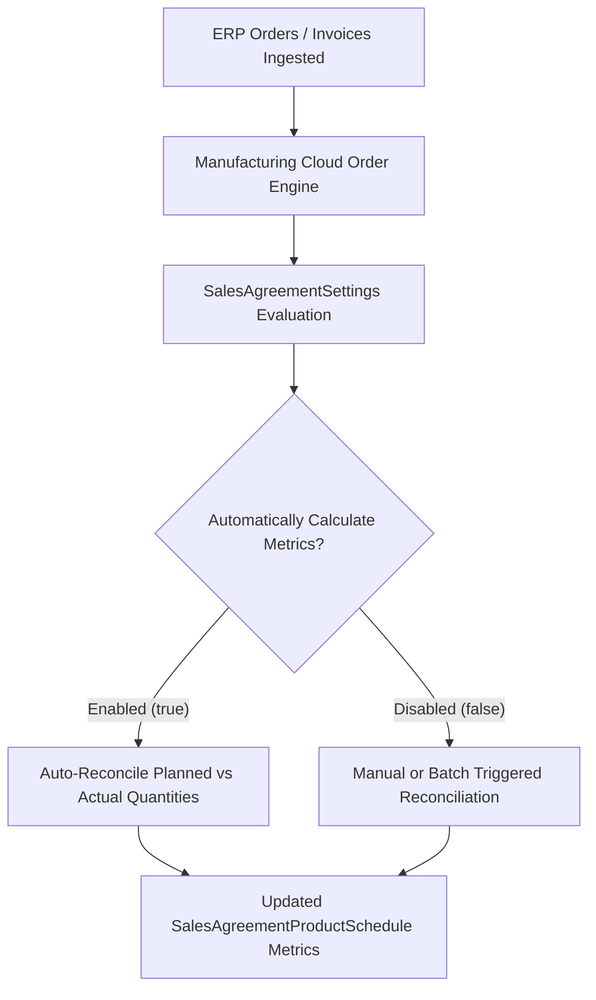

## Architectural Overview

`SalesAgreementSettings` configures org-level operational rules for **Sales Agreements** in Salesforce Manufacturing Cloud. In heavy manufacturing, industrial distribution, and automotive supply chains, commercial agreements span multi-year horizons detailing run-rate business: agreed quantities, negotiated price tiers, planned delivery intervals, and actual order drawdowns.

Using `SalesAgreementSettings`, Technical Architects declaratively govern the calculation engine that reconciles planned versus actual orders. Activating automated actuals calculation ensures that when ERP integration pipelines or Sales Cloud order management workflows insert or update orders, sales agreement product schedules automatically recalculate fulfillment percentages, volume compliance, and remaining revenue commitments in near real time.



## Directory and File Conventions

`SalesAgreementSettings` is a singleton settings metadata file located in the `settings` directory.

| Property | Value |
| :--- | :--- |
| **Directory Path** | `force-app/main/default/settings/` |
| **File Name** | `SalesAgreement.settings-meta.xml` |
| **XML Root Element** | `<SalesAgreementSettings>` |
| **API Version** | `68.0` |

## Key Metadata Fields

The settings file exposes switches controlling sales agreement behavior and recalculation mechanisms.

| Field Name | Type | Required | Description |
| :--- | :--- | :--- | :--- |
| `enableSalesAgreements` | `boolean` | No | Activates the core Sales Agreement functionality in the organization. |
| `automaticallyCalculateMetrics` | `boolean` | No | Automatically updates actual quantities and revenues from orders and invoices. |
| `enableMultipleSalesAgreementsPerOrder` | `boolean` | No | Allows order line items to be allocated across distinct sales agreements. |
| `actualsCalculationMode` | `string` | No | Calculation source mode: `Orders`, `Invoices`, or `OrdersAndInvoices`. |

## Declarative XML and Package Manifest Examples

The following sample enables automated actuals calculations derived directly from confirmed orders:

```xml title="force-app/main/default/settings/SalesAgreement.settings-meta.xml"
<?xml version="1.0" encoding="UTF-8"?>
<SalesAgreementSettings xmlns="http://soap.sforce.com/2006/04/metadata">
    <enableSalesAgreements>true</enableSalesAgreements>
    <automaticallyCalculateMetrics>true</automaticallyCalculateMetrics>
    <enableMultipleSalesAgreementsPerOrder>true</enableMultipleSalesAgreementsPerOrder>
    <actualsCalculationMode>Orders</actualsCalculationMode>
</SalesAgreementSettings>
```

### Package Manifest (`package.xml`)

```xml title="manifest/package.xml"
<?xml version="1.0" encoding="UTF-8"?>
<Package xmlns="http://soap.sforce.com/2006/04/metadata">
    <types>
        <members>SalesAgreement</members>
        <name>Settings</name>
    </types>
    <version>68.0</version>
</Package>
```

## CLI Retrieval and Deployment Commands

Manage `SalesAgreementSettings` using standard Salesforce CLI operations:

```bash
# Retrieve SalesAgreement settings
sf project retrieve start --metadata "Settings:SalesAgreement"

# Deploy settings to target org
sf project deploy start --source-dir force-app/main/default/settings/SalesAgreement.settings-meta.xml

# Validate settings deployment in staging
sf project deploy validate --metadata "Settings:SalesAgreement"
```

## Architect Best Practices and Gotchas

- **Feature License Requirements:** Deploying `SalesAgreementSettings` into an environment lacking Manufacturing Cloud licenses or Sales Agreement permission sets will cause a deployment failure indicating the feature is not accessible.
- **Large Volume Order Drawdowns:** When `automaticallyCalculateMetrics` is enabled, bulk DML operations on `Order` or `OrderItem` records trigger background rollup jobs on related agreements. During massive ERP initial data loads, temporarily disable automated calculation to prevent row-lock errors and governor limit exhaustion.
- **Scratch Org Definitions:** Ensure your `project-scratch-def.json` has `ManufacturingCloud` or the appropriate license feature toggled on before deploying this settings file in continuous integration workflows.

> [!NOTE]
> Setting `enableMultipleSalesAgreementsPerOrder` to true enables split allocations, allowing multi-product purchase orders to decrement run-rate contracts across distinct business units.
