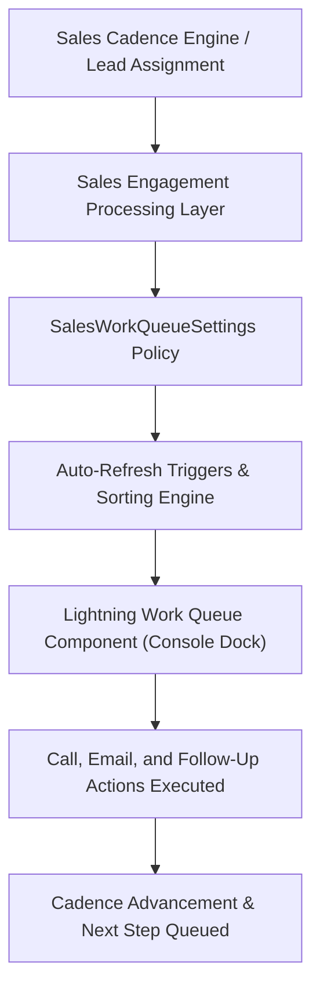

## Architectural Overview

`SalesWorkQueueSettings` configures the organizational behavior of the **Sales Engagement (formerly High Velocity Sales / HVS) Work Queue**. Modern inside sales and business development teams manage high velocity outreach across thousands of inbound leads, prospect accounts, and renewal contacts via structured Sales Cadences.

The Work Queue serves as the mission control center docked in the Lightning Sales Console, guiding sales representatives through their next best steps: phone calls via Lightning Dialer/CTI, automated emails, LinkedIn InMail touches, and custom follow-up tasks. Through `SalesWorkQueueSettings`, Technical Architects declaratively manage real-time queue synchronization, task sorting algorithms, and automated completion behaviors across multi-environment deployment pipelines.



## Directory and File Conventions

`SalesWorkQueueSettings` is maintained as a singleton file in the `settings` directory.

| Property | Value |
| :--- | :--- |
| **Directory Path** | `force-app/main/default/settings/` |
| **File Name** | `SalesWorkQueue.settings-meta.xml` |
| **XML Root Element** | `<SalesWorkQueueSettings>` |
| **API Version** | `68.0` |

## Key Metadata Fields

The settings file exposes switches governing cadence queue responsiveness and task presentation.

| Field Name | Type | Required | Description |
| :--- | :--- | :--- | :--- |
| `enableSalesWorkQueue` | `boolean` | No | Enables the Sales Engagement Work Queue across the organization. |
| `enableCadenceAutoRefresh` | `boolean` | No | Automatically updates the queue as prospects reach their next cadence step. |
| `enablePrioritizedList` | `boolean` | No | Sorts outreach tasks according to Einstein Lead Scoring or custom priority rules. |
| `enableSplitViewQueue` | `boolean` | No | Enables split-view navigation sidebars for rapid queue item cycling. |

## Declarative XML and Package Manifest Examples

The following sample configures an optimized Sales Engagement queue with auto-refresh and prioritized lists enabled:

```xml title="force-app/main/default/settings/SalesWorkQueue.settings-meta.xml"
<?xml version="1.0" encoding="UTF-8"?>
<SalesWorkQueueSettings xmlns="http://soap.sforce.com/2006/04/metadata">
    <enableCadenceAutoRefresh>true</enableCadenceAutoRefresh>
    <enablePrioritizedList>true</enablePrioritizedList>
    <enableSalesWorkQueue>true</enableSalesWorkQueue>
    <enableSplitViewQueue>true</enableSplitViewQueue>
</SalesWorkQueueSettings>
```

### Package Manifest (`package.xml`)

```xml title="manifest/package.xml"
<?xml version="1.0" encoding="UTF-8"?>
<Package xmlns="http://soap.sforce.com/2006/04/metadata">
    <types>
        <members>SalesWorkQueue</members>
        <name>Settings</name>
    </types>
    <version>68.0</version>
</Package>
```

## CLI Retrieval and Deployment Commands

Manage `SalesWorkQueueSettings` with the Salesforce CLI:

```bash
# Retrieve SalesWorkQueue settings
sf project retrieve start --metadata "Settings:SalesWorkQueue"

# Deploy settings to target org
sf project deploy start --source-dir force-app/main/default/settings/SalesWorkQueue.settings-meta.xml

# Validate settings deployment in staging
sf project deploy validate --metadata "Settings:SalesWorkQueue"
```

## Architect Best Practices and Gotchas

- **Sales Engagement License Dependency:** Target sandboxes must have the Sales Engagement feature provisioned. Deploying into an org without active Sales Engagement licenses produces a deployment failure (`Feature SalesWorkQueue is not enabled`).
- **Browser Performance Optimization:** While `enableCadenceAutoRefresh` keeps reps up to date, very high-volume orgs with hundreds of concurrent reps should monitor client-side browser performance to ensure frequent background polling does not interfere with CTI audio streams.
- **Console Layout Integration:** Ensure that console FlexiPage layouts have the Work Queue component placed in a prominent subtab or utility bar so reps can access their daily action list seamlessly.

> [!TIP]
> Combine `enablePrioritizedList` with Einstein Lead Scoring so high-converting prospects automatically float to the top of daily sales queues.
