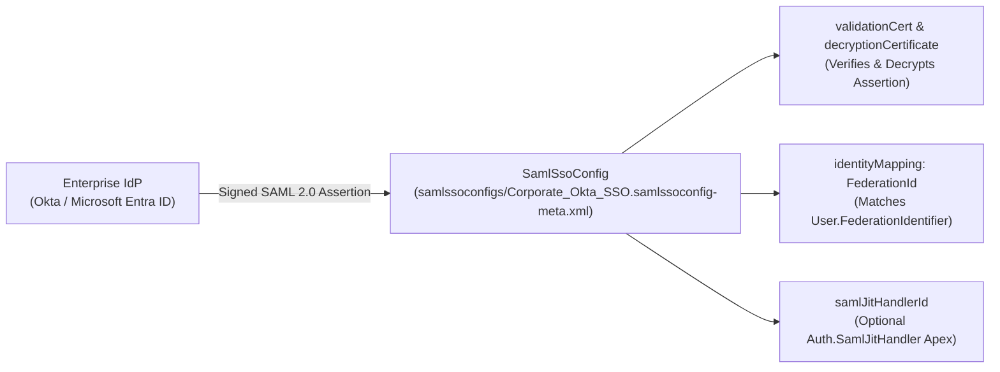

## Why the `SamlSsoConfig` Metadata Type Is the Cornerstone of Enterprise SSO

While [AuthProvider](/docs/metadata/auth-provider-metadata-type/) configures OpenID Connect (OIDC) and OAuth 2.0 social/enterprise login, **`SamlSsoConfig`** (`samlssoconfigs/<Name>.samlssoconfig-meta.xml`) configures **SAML 2.0 Single Sign-On** with enterprise Identity Providers (IdPs) such as **Okta**, **Microsoft Entra ID (Azure AD)**, **PingFederate**, and **ADFS**.



---

## Key Metadata Fields on `SamlSsoConfig`

| Field | Type | Required | Description |
|---|---|---|---|
| `name` | `string` | Yes | Developer name of the SAML SSO configuration. |
| `samlVersion` | `SamlType` | Yes | Always use `SAML2_0` (`SAML1_1` is legacy). |
| `issuer` | `string` | Yes | The Entity ID / Issuer URI provided by your Identity Provider. |
| `samlEntityId` | `string` | Yes | The Audience URI expected in inbound SAML assertions (always use your My Domain URL, e.g., `https://acme.my.salesforce.com`). |
| `identityMapping` | `SamlIdentityType` | Yes | `FederationId` (recommended best practice), `Username`, or `UserId`. |
| `identityLocation` | `SamlIdentityLocationType` | Yes | `SubjectNameId` (identity is in `<Subject><NameID>`) or `Attribute` (identity is in a named SAML `<Attribute>`). |
| `validationCert` | `string` | Yes | Base64-encoded X.509 public certificate from the IdP used to verify SAML response signatures. |
| `requestSignatureMethod` | `string` | No | `RSA-SHA256` (recommended) or `RSA-SHA1`. |
| `useSameDigestAlgoForSigning` | `boolean` | No | *(API v55.0+)* When `true`, matches the digest algorithm (`SHA-256`) to `requestSignatureMethod`. |
| `userProvisioning` | `boolean` | No | Enables Just-in-Time (JIT) user creation/updates on login (requires `identityMapping = FederationId`). |
| `samlJitHandlerId` | `string` | No | Apex class implementing `Auth.SamlJitHandler` for custom JIT provisioning. |

---

## Real-World XML Example (`samlssoconfigs/Entra_ID_Enterprise_SSO.samlssoconfig-meta.xml`)

```xml
<?xml version="1.0" encoding="UTF-8"?>
<SamlSsoConfig xmlns="http://soap.sforce.com/2006/04/metadata">
    <executionUserId>jit.admin@acme.example.com</executionUserId>
    <identityLocation>SubjectNameId</identityLocation>
    <identityMapping>FederationId</identityMapping>
    <issuer>https://sts.windows.net/00000000-0000-0000-0000-000000000000/</issuer>
    <loginUrl>https://login.microsoftonline.com/00000000-0000-0000-0000-000000000000/saml2</loginUrl>
    <logoutUrl>https://login.microsoftonline.com/common/wsfederation?wa=wsignout1.0</logoutUrl>
    <name>Entra_ID_Enterprise_SSO</name>
    <redirectBinding>false</redirectBinding>
    <requestSignatureMethod>RSA-SHA256</requestSignatureMethod>
    <samlEntityId>https://acme.my.salesforce.com</samlEntityId>
    <samlJitHandlerId>EnterpriseSamlJitHandler</samlJitHandlerId>
    <samlVersion>SAML2_0</samlVersion>
    <singleLogoutBinding>RedirectBinding</singleLogoutBinding>
    <singleLogoutUrl>https://login.microsoftonline.com/00000000-0000-0000-0000-000000000000/saml2</singleLogoutUrl>
    <useConfigRequestMethod>true</useConfigRequestMethod>
    <useSameDigestAlgoForSigning>true</useSameDigestAlgoForSigning>
    <userProvisioning>true</userProvisioning>
    <validationCert>MIIDBTCCAe2gAwIBAgIQN33ROa6p...</validationCert>
</SamlSsoConfig>
```

---

## Querying `SamlSsoConfig` via SOQL

You can audit all SAML SSO configurations, signature algorithms, and JIT handlers in your org using standard SOQL:

```sql
SELECT Id, DeveloperName, MasterLabel, Issuer, SamlEntityId,
       IdentityMapping, IdentityLocation, RequestSignatureMethod,
       OptionsSpInitBinding, OptionsUserProvisioning,
       SamlJitHandler.Name, ExecutionUser.Username
FROM SamlSsoConfig
ORDER BY DeveloperName ASC
```

---

## Senior Architect Best Practices

> [!WARNING]
> **Hardcoded `requestSigningCertId` in `SamlSsoConfig`:** Unlike `decryptionCertificate` (which references the Certificate's developer name), `<requestSigningCertId>` stores a **18-character Salesforce `0P1...` Certificate ID**! When deploying `SamlSsoConfig` between Sandboxes and Production, either omit `<requestSigningCertId>` so Salesforce uses the default signing certificate or use `sfdx-project.json` replacements to map the target org's `0P1` ID.

