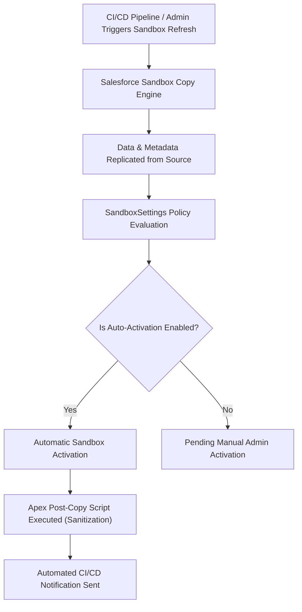

## Architectural Overview

`SandboxSettings` defines the organizational parameters governing sandbox provisioning, refresh cycles, and lifecycle governance. In enterprise DevOps and continuous integration architectures, managing fleets of Developer, Developer Pro, Partial Copy, and Full Copy sandboxes requires programmatic consistency to minimize administrative overhead.

By declaring `SandboxSettings` in source control, Technical Architects automate crucial sandbox behaviors. This includes toggling **auto-activation** (which eliminates the manual administrative approval delay after a hours-long sandbox copy completes), controlling participation in seasonal release preview pods, and orchestrating post-copy data masking and environment sanitization scripts.



## Directory and File Conventions

`SandboxSettings` is maintained as a singleton metadata configuration file within the `settings` directory.

| Property | Value |
| :--- | :--- |
| **Directory Path** | `force-app/main/default/settings/` |
| **File Name** | `Sandbox.settings-meta.xml` |
| **XML Root Element** | `<SandboxSettings>` |
| **API Version** | `68.0` |

## Key Metadata Fields

The settings file exposes parameters controlling sandbox refresh workflows and preview routing.

| Field Name | Type | Required | Description |
| :--- | :--- | :--- | :--- |
| `enableSandboxAutoActivate` | `boolean` | No | Automatically activates sandboxes upon completion of the refresh or copy job. |
| `disableSandboxPreview` | `boolean` | No | Prevents the sandbox from being upgraded to upcoming seasonal preview releases. |
| `postCopyApexScript` | `string` | No | Identifies the default Apex class implementing `SandboxPostCopy` executed post-refresh. |

## Declarative XML and Package Manifest Examples

The following example activates automatic sandbox activation and specifies a post-copy environment configuration script:

```xml title="force-app/main/default/settings/Sandbox.settings-meta.xml"
<?xml version="1.0" encoding="UTF-8"?>
<SandboxSettings xmlns="http://soap.sforce.com/2006/04/metadata">
    <enableSandboxAutoActivate>true</enableSandboxAutoActivate>
    <disableSandboxPreview>false</disableSandboxPreview>
</SandboxSettings>
```

### Package Manifest (`package.xml`)

```xml title="manifest/package.xml"
<?xml version="1.0" encoding="UTF-8"?>
<Package xmlns="http://soap.sforce.com/2006/04/metadata">
    <types>
        <members>Sandbox</members>
        <name>Settings</name>
    </types>
    <version>68.0</version>
</Package>
```

## CLI Retrieval and Deployment Commands

Retrieve and deploy `SandboxSettings` using the Salesforce CLI:

```bash
# Retrieve Sandbox settings
sf project retrieve start --metadata "Settings:Sandbox"

# Deploy Sandbox settings to production or parent org
sf project deploy start --source-dir force-app/main/default/settings/Sandbox.settings-meta.xml

# Check deployment status
sf project deploy report
```

## Architect Best Practices and Gotchas

- **Auto-Activation Risks in Staging Orgs:** In multi-developer environments, enabling `enableSandboxAutoActivate` on staging or UAT sandboxes immediately terminates active user sessions when a refresh finishes. Coordinate team refresh schedules carefully.
- **Apex Post-Copy Sanitization:** Always couple sandbox automation with an Apex class implementing `System.SandboxPostCopy` to mask customer PII (emails, phone numbers) and update Named Credentials so sandboxes do not make callouts to production third-party systems.
- **Production Org Context:** Sandbox lifecycle settings are predominantly managed in the Production organization that owns the sandbox licenses. Attempting to deploy sandbox creation settings into a scratch org that cannot provision child sandboxes will result in unsupported setting warnings.

> [!WARNING]
> Ensure all active developer work is merged and backed up in version control prior to triggering an auto-activated refresh, as auto-activation permanently overwrites uncommitted sandbox metadata.
