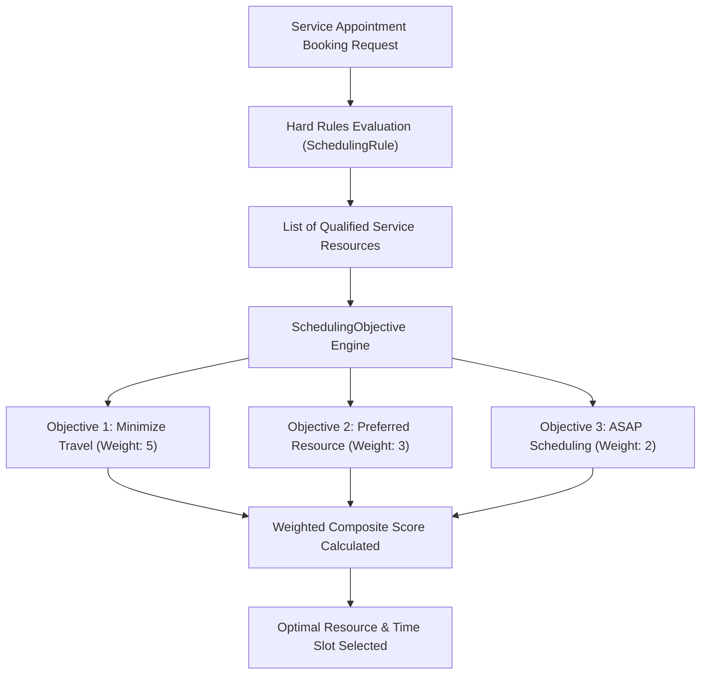

## Architectural Overview

`SchedulingObjective` defines the mathematical optimization criteria and scoring weights utilized by the **Field Service (FSL)** and **Salesforce Scheduler** appointment assignment engines. When dispatching thousands of service appointments, mobile technician visits, or wealth advisor consultations, organizations must balance competing business goals: reducing vehicle fuel and drive times, maximizing customer satisfaction through preferred resources, expediting service delivery (ASAP scheduling), and distributing workloads equitably across teams.

Unlike hard constraints that disqualify candidates outright, `SchedulingObjective` establishes **soft constraints** and relative grading functions. Each objective evaluates eligible candidates and assigns a numerical score from 0 to 100. Scheduling Policies aggregate these objective scores according to assigned architectural weights, mathematically determining the optimal appointment slot and assigned resource.



## Directory and File Conventions

`SchedulingObjective` components are stored as XML files inside the `schedulingObjectives` directory.

| Property | Value |
| :--- | :--- |
| **Directory Path** | `force-app/main/default/schedulingObjectives/` |
| **File Suffix** | `.schedulingObjective-meta.xml` |
| **XML Root Element** | `<SchedulingObjective>` |
| **API Version** | `68.0` |

## Key Metadata Fields

The metadata definition establishes the objective archetype, calculation parameters, and target scoring metrics.

| Field Name | Type | Required | Description |
| :--- | :--- | :--- | :--- |
| `masterLabel` | `string` | Yes | Human-readable title of the objective in policy configuration. |
| `developerName` | `string` | Yes | Unique programmatic identifier in metadata operations. |
| `schedulingObjectiveType` | `string` | Yes | Algorithmic objective type (`MinimizeTravel`, `Asap`, `PreferredResource`, `BalanceWorkload`). |
| `description` | `string` | No | Architectural explanation of the scoring behavior. |
| `resourcePreference` | `string` | No | Configuration for matching preferred versus required service resources. |

## Declarative XML and Package Manifest Examples

The following example configures a travel minimization objective that heavily penalizes transit times between appointments:

```xml title="force-app/main/default/schedulingObjectives/Minimize_Technician_Travel.schedulingObjective-meta.xml"
<?xml version="1.0" encoding="UTF-8"?>
<SchedulingObjective xmlns="http://soap.sforce.com/2006/04/metadata">
    <masterLabel>Minimize Technician Travel</masterLabel>
    <developerName>Minimize_Technician_Travel</developerName>
    <schedulingObjectiveType>MinimizeTravel</schedulingObjectiveType>
    <description>Scores candidate appointments higher when travel distance and driving duration from previous jobs are minimized.</description>
</SchedulingObjective>
```

### Package Manifest (`package.xml`)

```xml title="manifest/package.xml"
<?xml version="1.0" encoding="UTF-8"?>
<Package xmlns="http://soap.sforce.com/2006/04/metadata">
    <types>
        <members>Minimize_Technician_Travel</members>
        <name>SchedulingObjective</name>
    </types>
    <version>68.0</version>
</Package>
```

## CLI Retrieval and Deployment Commands

Retrieve and deploy `SchedulingObjective` metadata with the Salesforce CLI:

```bash
# Retrieve all scheduling objectives
sf project retrieve start --metadata SchedulingObjective

# Deploy a specific objective definition
sf project deploy start --source-dir force-app/main/default/schedulingObjectives/Minimize_Technician_Travel.schedulingObjective-meta.xml

# Retrieve objectives alongside scheduling policies
sf project retrieve start --metadata "SchedulingObjective,WorkRule"
```

## Architect Best Practices and Gotchas

- **Field Service License Dependencies:** `SchedulingObjective` requires active Field Service or Salesforce Scheduler package permissions. Deployments to standard developer editions without Field Service enabled will fail.
- **Balancing Competing Objectives:** Stacking mutually opposing objectives with equal high weights (e.g., aggressive `Asap` scheduling versus `MinimizeTravel`) can lead to erratic resource allocations. Tune weights empirically in sandbox environments using the Field Service Dispatcher Console.
- **Appointment Complexity:** In dense metropolitan territories, excessive objective calculations across high candidate pools can increase booking response times. Combine objectives with strict territory filtering rules to constrain the candidate evaluation search space.

> [!TIP]
> Group complementary objectives into distinct Scheduling Policies—such as an "Emergency Dispatch Policy" prioritizing ASAP, and a "Standard Maintenance Policy" prioritizing Minimize Travel.
