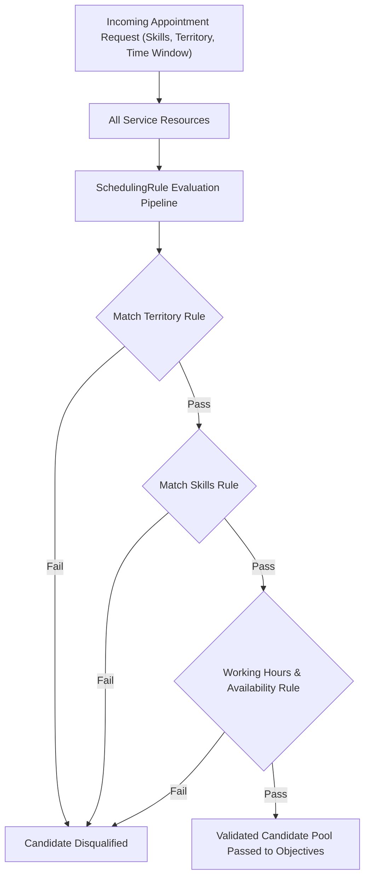

## Architectural Overview

`SchedulingRule` (historically known as a **Work Rule** in Field Service) represents a mandatory, non-negotiable operational constraint applied during appointment scheduling in **Field Service (FSL)** and **Salesforce Scheduler**. While scheduling objectives score and rank qualified candidates, `SchedulingRule` components act as boolean gates: a service resource either satisfies the rule criteria or is immediately eliminated from candidate consideration.

In enterprise field operations, failing to enforce hard rules can have catastrophic consequences: sending an unlicensed electrician to a high-voltage utility site, dispatching a mobile nurse outside their geographic territory, or breaching statutory labor laws regarding maximum consecutive working hours. By managing `SchedulingRule` instances as version-controlled metadata, Technical Architects guarantee compliance across all environments and scheduling policies.



## Directory and File Conventions

`SchedulingRule` components reside in the `schedulingRules` directory of the SFDX workspace.

| Property | Value |
| :--- | :--- |
| **Directory Path** | `force-app/main/default/schedulingRules/` |
| **File Suffix** | `.schedulingRule-meta.xml` |
| **XML Root Element** | `<SchedulingRule>` |
| **API Version** | `68.0` |

## Key Metadata Fields

The definition outlines the constraint mechanism, target criteria, and enforcement properties.

| Field Name | Type | Required | Description |
| :--- | :--- | :--- | :--- |
| `masterLabel` | `string` | Yes | Human-readable name of the rule displayed in Dispatcher Console. |
| `developerName` | `string` | Yes | Programmatic API name representing the rule in metadata. |
| `ruleType` | `string` | Yes | Type of constraint (`MatchSkills`, `MatchTerritory`, `WorkingHours`, `RequiredResources`). |
| `isActive` | `boolean` | No | Indicates whether this constraint is actively evaluated. |
| `description` | `string` | No | Architectural description of the compliance or business constraint. |
| `isEnforceRule` | `boolean` | No | Designates whether the rule is strictly enforced or allows dispatcher overrides. |

## Declarative XML and Package Manifest Examples

The following example configures a mandatory skill-matching rule verifying that dispatched technicians possess certifications matching work order skill requirements:

```xml title="force-app/main/default/schedulingRules/Mandatory_Skill_Match.schedulingRule-meta.xml"
<?xml version="1.0" encoding="UTF-8"?>
<SchedulingRule xmlns="http://soap.sforce.com/2006/04/metadata">
    <masterLabel>Mandatory Skill Match</masterLabel>
    <developerName>Mandatory_Skill_Match</developerName>
    <ruleType>MatchSkills</ruleType>
    <isActive>true</isActive>
    <isEnforceRule>true</isEnforceRule>
    <description>Disqualifies technicians who lack active certifications matching Work Order skill requirements.</description>
</SchedulingRule>
```

### Package Manifest (`package.xml`)

```xml title="manifest/package.xml"
<?xml version="1.0" encoding="UTF-8"?>
<Package xmlns="http://soap.sforce.com/2006/04/metadata">
    <types>
        <members>Mandatory_Skill_Match</members>
        <name>SchedulingRule</name>
    </types>
    <version>68.0</version>
</Package>
```

## CLI Retrieval and Deployment Commands

Manage `SchedulingRule` components using standard Salesforce CLI operations:

```bash
# Retrieve all scheduling rules
sf project retrieve start --metadata SchedulingRule

# Deploy a specific rule definition
sf project deploy start --source-dir force-app/main/default/schedulingRules/Mandatory_Skill_Match.schedulingRule-meta.xml

# Validate the rule in a staging sandbox
sf project deploy validate --metadata SchedulingRule:Mandatory_Skill_Match
```

## Architect Best Practices and Gotchas

- **Over-Constrained Schedules:** Stacking too many rigid rules (e.g., tight operating hours, exact skill levels, and secondary territory exclusions) can result in zero eligible candidates ("No slots available"), degrading customer booking conversion.
- **Skill Level Validation:** When configuring `MatchSkills`, verify whether skill levels are enabled. If skill levels are active, a technician possessing the required skill at level 3 will be disqualified if the appointment specifies level 4.
- **Integration with Scheduling Policies:** A `SchedulingRule` has no impact until it is added to an active Scheduling Policy. Always deploy the associated policy metadata alongside the individual rule.

> [!WARNING]
> Disabling `isEnforceRule` allows dispatchers to manually override appointment assignments that breach the constraint, which can expose organizations to regulatory non-compliance.
