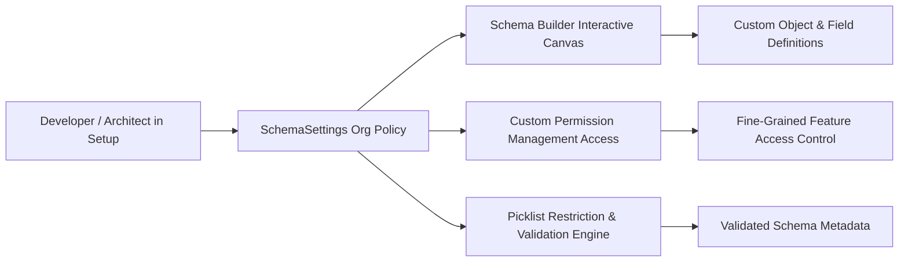

## Architectural Overview

`SchemaSettings` represents the organizational settings metadata controlling schema definition behaviors, Schema Builder administration, and custom permission delegation. In enterprise implementations, maintaining strict guardrails around how administrators interact with Object Manager and Schema Builder is crucial for preventing accidental data model sprawl and uncontrolled relationship creation.

Through `SchemaSettings`, Technical Architects codify data modeling governance into source control. This ensures that features like enhanced custom permission delegation and schema visualization tools behave consistently across developer environments, automated scratch orgs, sandboxes, and production.



## Directory and File Conventions

`SchemaSettings` is stored as a singleton configuration file inside the `settings` directory.

| Property | Value |
| :--- | :--- |
| **Directory Path** | `force-app/main/default/settings/` |
| **File Name** | `Schema.settings-meta.xml` |
| **XML Root Element** | `<SchemaSettings>` |
| **API Version** | `68.0` |

## Key Metadata Fields

The settings file exposes parameters controlling schema visualization and administrative permissions.

| Field Name | Type | Required | Description |
| :--- | :--- | :--- | :--- |
| `enableSchemaBuilder` | `boolean` | No | Enables the visual drag-and-drop Schema Builder tool in Setup. |
| `enableManageCustomPermissions` | `boolean` | No | Allows delegated administrators to manage and assign custom permissions. |
| `enableRestrictPicklistValues` | `boolean` | No | Enforces strict validation preventing unlisted values from being inserted into restricted picklists. |

## Declarative XML and Package Manifest Examples

The following example enables Schema Builder and delegated custom permission management:

```xml title="force-app/main/default/settings/Schema.settings-meta.xml"
<?xml version="1.0" encoding="UTF-8"?>
<SchemaSettings xmlns="http://soap.sforce.com/2006/04/metadata">
    <enableManageCustomPermissions>true</enableManageCustomPermissions>
    <enableSchemaBuilder>true</enableSchemaBuilder>
</SchemaSettings>
```

### Package Manifest (`package.xml`)

```xml title="manifest/package.xml"
<?xml version="1.0" encoding="UTF-8"?>
<Package xmlns="http://soap.sforce.com/2006/04/metadata">
    <types>
        <members>Schema</members>
        <name>Settings</name>
    </types>
    <version>68.0</version>
</Package>
```

## CLI Retrieval and Deployment Commands

Retrieve and deploy `SchemaSettings` using standard Salesforce CLI commands:

```bash
# Retrieve Schema settings
sf project retrieve start --metadata "Settings:Schema"

# Deploy Schema settings to target org
sf project deploy start --source-dir force-app/main/default/settings/Schema.settings-meta.xml

# Validate deployment in scratch org
sf project deploy validate --metadata "Settings:Schema"
```

## Architect Best Practices and Gotchas

- **Schema Builder Governance in Production:** In mature enterprise environments, creating custom objects and fields directly within production via Schema Builder bypasses version control and CI/CD validation. Use `SchemaSettings` and permission sets to restrict Schema Builder write operations to sandbox environments.
- **Scratch Org Definitions:** Add `schemaSettings` configurations directly into `project-scratch-def.json` under `settings` so that newly created automated test orgs reflect exact production schema policies.
- **Custom Permission Delegation:** Activating `enableManageCustomPermissions` enables security teams to delegate application-specific custom permissions without granting broad `Manage Users` system privileges.

> [!TIP]
> Always pair `SchemaSettings` with [PermissionSet](/docs/metadata/permission-set-metadata-type/) deployments to ensure delegated administrators have the necessary functional scopes.
