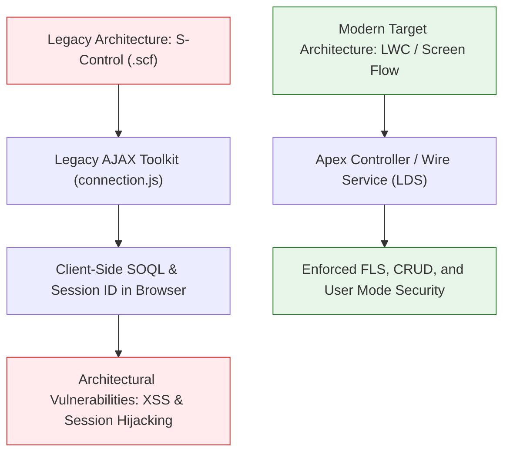

## Architectural Overview

`Scontrol` represents one of the earliest client-side extensibility mechanisms on the Salesforce platform. Introduced prior to Visualforce and modern JavaScript frameworks, an S-Control is an HTML and JavaScript snippet that executes directly inside the end-user's browser, typically embedded within a custom Web Tab, custom link, or standard page layout iframe using the legacy **AJAX Toolkit** (`connection.js`).

Salesforce officially deprecated the creation of new S-Controls in the **Spring '10** release, superseding them with Visualforce and later with **Lightning Web Components (LWC)** and **Flow**. In modern enterprise architectures, Technical Architects rarely build S-Controls; instead, they encounter `Scontrol` metadata when conducting legacy org assessments, executing technical debt remediation, and decomposing ancient monoliths during Lightning migration programs.



## Directory and File Conventions

`Scontrol` metadata components follow a two-file convention within the `scontrols` directory: an XML descriptor file and a paired payload file.

| Property | Value |
| :--- | :--- |
| **Directory Path** | `force-app/main/default/scontrols/` |
| **Descriptor File Suffix** | `.scf-meta.xml` |
| **Payload File Suffix** | `.scf` |
| **XML Root Element** | `<Scontrol>` |
| **API Version** | `68.0` |

## Key Metadata Fields

The `Scontrol` descriptor file contains metadata governing encoding, content type, and caching.

| Field Name | Type | Required | Description |
| :--- | :--- | :--- | :--- |
| `name` | `string` | Yes | Unique programmatic identifier of the S-Control. |
| `content` | `string` | No | Inline HTML or JavaScript content (if not provided as a separate file). |
| `encodingKey` | `Encoding` | Yes | Character encoding used for file payload parsing (e.g., `UTF-8`). |
| `fileContent` | `base64Binary` | No | Base64-encoded binary content for zipped or binary assets. |
| `fileName` | `string` | No | Original file name of the bundled asset. |
| `htmlWrapper` | `string` | No | Specifies the wrapper format (`NoOutput`, `SimpleHTML`, `Custom`). |
| `supportsCaching` | `boolean` | No | Designates whether the client browser is permitted to cache the output. |

## Declarative XML and Package Manifest Examples

The following example illustrates the metadata descriptor for a legacy invoice generator S-Control:

```xml title="force-app/main/default/scontrols/LegacyInvoiceGenerator.scf-meta.xml"
<?xml version="1.0" encoding="UTF-8"?>
<Scontrol xmlns="http://soap.sforce.com/2006/04/metadata">
    <encodingKey>UTF-8</encodingKey>
    <name>LegacyInvoiceGenerator</name>
    <description>Legacy S-Control generating PDF invoices via client-side AJAX Toolkit.</description>
    <htmlWrapper>NoOutput</htmlWrapper>
    <supportsCaching>false</supportsCaching>
</Scontrol>
```

### Accompanying Payload File

```html title="force-app/main/default/scontrols/LegacyInvoiceGenerator.scf"
<!DOCTYPE html>
<html>
<head>
    <script src="/soap/ajax/68.0/connection.js" type="text/javascript"></script>
    <script type="text/javascript">
        sforce.connection.sessionId = '{!$Api.Session_ID}';
        // Legacy client-side SOQL execution
    </script>
</head>
<body>
    <p>Legacy Invoice Generator undergoing LWC deprecation.</p>
</body>
</html>
```

### Package Manifest (`package.xml`)

```xml title="manifest/package.xml"
<?xml version="1.0" encoding="UTF-8"?>
<Package xmlns="http://soap.sforce.com/2006/04/metadata">
    <types>
        <members>LegacyInvoiceGenerator</members>
        <name>Scontrol</name>
    </types>
    <version>68.0</version>
</Package>
```

## CLI Retrieval and Deployment Commands

Retrieve and audit `Scontrol` assets using the Salesforce CLI:

```bash
# Retrieve all legacy S-Controls for audit
sf project retrieve start --metadata Scontrol

# Deploy an existing S-Control during environment migration
sf project deploy start --source-dir force-app/main/default/scontrols/LegacyInvoiceGenerator.scf-meta.xml

# Destructive deployment to decommission an S-Control
sf project deploy start --metadata Scontrol:LegacyInvoiceGenerator --post-destructive-changes manifest/destructiveChanges.xml
```

## Architect Best Practices and Gotchas

- **Security Risks in Modern Browsers:** S-Controls expose `{!$Api.Session_ID}` directly inside client-side JavaScript, creating significant vulnerabilities to Cross-Site Scripting (XSS) and session hijacking. Modern security reviews flag S-Controls as high-risk security findings.
- **Decommissioning Dependencies:** Before deleting an `Scontrol` via destructive changes, inspect all [CustomObject](/docs/metadata/custom-object-metadata-type/) custom buttons, links, Web Tabs, and page layouts. If a button or layout still references the S-Control, destructive deployment will be blocked.
- **Migration Strategy:** Map existing S-Controls directly to [Flow](/docs/metadata/flow-metadata-type/) or Lightning Web Components. Screen Flows can replace 90% of legacy S-Control prompt dialogs without writing a single line of custom code.

> [!WARNING]
> You cannot create new S-Controls in modern Salesforce orgs. Attempting to deploy a newly created `Scontrol` into an org that did not previously contain S-Controls will be rejected by the Metadata API.
