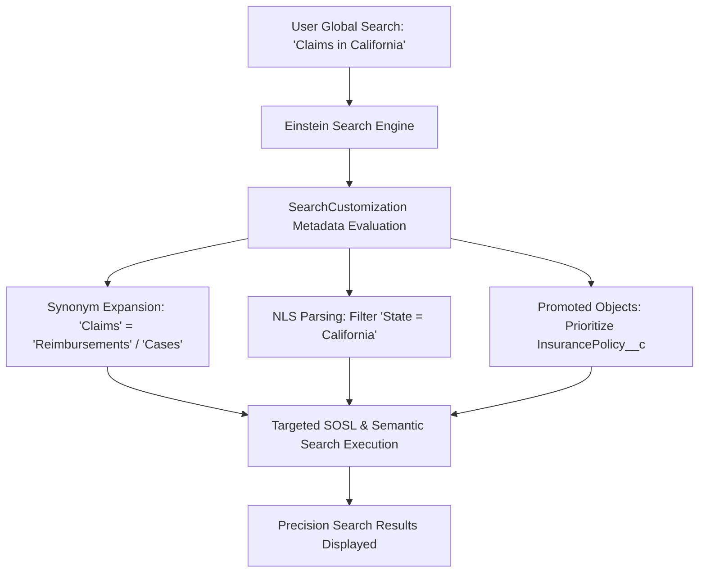

## Architectural Overview

`SearchCustomization` defines the declarative intelligence and dictionary models governing **Einstein Search** across the Salesforce platform. In high-volume enterprise organizations, global search is the primary navigation mechanism for end users. Without tailored search customizations, users struggle with industry acronyms, colloquial synonyms, or irrelevant cross-object search results that dilute productivity.

Using `SearchCustomization`, Technical Architects configure **Synonym Groups**, promoted objects, and Natural Language Search (NLS) mappings as version-controlled metadata. This ensures that when a service agent searches for *"claims"*, the search engine automatically surfaces matching *"policies"*, *"accidents"*, or *"reimbursements"*, delivering highly targeted results tailored to organizational terminology.



## Directory and File Conventions

`SearchCustomization` metadata records are stored as XML files inside the `searchCustomizations` directory.

| Property | Value |
| :--- | :--- |
| **Directory Path** | `force-app/main/default/searchCustomizations/` |
| **File Suffix** | `.searchCustomization-meta.xml` |
| **XML Root Element** | `<SearchCustomization>` |
| **API Version** | `68.0` |

## Key Metadata Fields

The definition outlines synonym dictionaries, promoted entities, and query interpretation parameters.

| Field Name | Type | Required | Description |
| :--- | :--- | :--- | :--- |
| `masterLabel` | `string` | Yes | Human-readable title of the search customization. |
| `developerName` | `string` | Yes | Unique programmatic identifier in source format. |
| `synonymGroups` | `SynonymGroup[]` | No | Collection of related terms that expand search query reach. |
| `promotedObjects` | `string[]` | No | List of sObject entities elevated to top search result rankings. |
| `isActive` | `boolean` | No | Indicates whether this search customization is actively enforced. |
| `description` | `string` | No | Architectural description of the search customization intent. |

## Declarative XML and Package Manifest Examples

The following example establishes synonym groups and promoted search objects for an insurance claims management organization:

```xml title="force-app/main/default/searchCustomizations/Insurance_Claims_Search.searchCustomization-meta.xml"
<?xml version="1.0" encoding="UTF-8"?>
<SearchCustomization xmlns="http://soap.sforce.com/2006/04/metadata">
    <masterLabel>Insurance Claims Search</masterLabel>
    <developerName>Insurance_Claims_Search</developerName>
    <description>Synonym groups and promoted objects for insurance claims and policy searches.</description>
    <isActive>true</isActive>
    <synonymGroups>
        <languages>en_US</languages>
        <terms>claim,incident,loss,reimbursement</terms>
    </synonymGroups>
    <synonymGroups>
        <languages>en_US</languages>
        <terms>policy,coverage,underwriting,contract</terms>
    </synonymGroups>
</SearchCustomization>
```

### Package Manifest (`package.xml`)

```xml title="manifest/package.xml"
<?xml version="1.0" encoding="UTF-8"?>
<Package xmlns="http://soap.sforce.com/2006/04/metadata">
    <types>
        <members>Insurance_Claims_Search</members>
        <name>SearchCustomization</name>
    </types>
    <version>68.0</version>
</Package>
```

## CLI Retrieval and Deployment Commands

Retrieve and deploy `SearchCustomization` metadata via the Salesforce CLI:

```bash
# Retrieve all search customizations
sf project retrieve start --metadata SearchCustomization

# Deploy a specific search customization
sf project deploy start --source-dir force-app/main/default/searchCustomizations/Insurance_Claims_Search.searchCustomization-meta.xml

# Validate the deployment against staging
sf project deploy validate --metadata SearchCustomization:Insurance_Claims_Search
```

## Architect Best Practices and Gotchas

- **Synonym Group Limits:** Salesforce limits the number of synonym groups and total synonyms per group (maximum 2,000 synonym groups per org). Focus synonyms on high-impact domain terms rather than common linguistic variations already handled by lemmatization.
- **Search Indexing Latency:** Newly deployed synonym groups take effect after search index caches refresh (typically within a few minutes). Test searches in sandbox environments after index propagation.
- **Profile Customization Parity:** When tailoring search experiences for specific departments, coordinate search customizations with [Profile](/docs/metadata/profile-metadata-type/) or Permission Set assignments to ensure users have read access to promoted objects.

> [!TIP]
> Periodically review search analytics in Setup under Search Manager to identify common "zero-result" user search queries and convert them into new synonym mappings.
