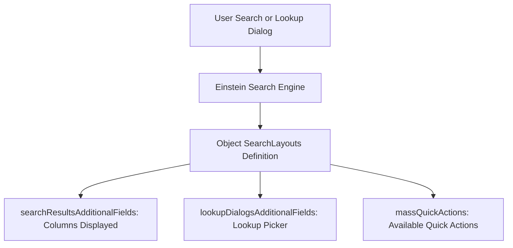

## Architectural Overview

`SearchLayouts` is a fundamental user experience metadata component in Salesforce that governs how record data is displayed in search interfaces across both Classic and Lightning Experience. When users perform a global search, execute an SOSL query, open a modal lookup dialog, or interact with list view mass action buttons, `SearchLayouts` dictates which fields and actions are exposed.

From an enterprise governance perspective, well-designed search layouts are vital for data discoverability and operational efficiency. In complex orgs with hundreds of fields per object, exposing the right discriminating fields—such as status, account tier, billing city, or external IDs—ensures end users and service agents quickly identify correct records without clicking into individual records.



## Directory and File Conventions

In SFDX source format, `SearchLayouts` is defined as a child metadata structure embedded within the parent `CustomObject` XML definition or managed alongside object definitions.

| Property | Value |
| :--- | :--- |
| **Metadata Type Name** | `SearchLayouts` (Child of `CustomObject`) |
| **Parent Metadata Type** | `CustomObject` |
| **SFDX Storage Location** | `force-app/main/default/objects/<ObjectName>/<ObjectName>.object-meta.xml` |
| **XML Root Element** | `<searchLayouts>` |

## Key Metadata Fields

The `SearchLayouts` schema supports multiple layout contexts, each targeting a specific user interaction mode:

| Field Name | Field Type | Required | Architectural Description |
| :--- | :--- | :--- | :--- |
| `searchResultsAdditionalFields` | `string[]` | No | List of field API names displayed as columns in global search results. |
| `lookupDialogsAdditionalFields` | `string[]` | No | Fields displayed as columns in standard modal lookup dialogs. |
| `lookupPhoneDialogsAdditionalFields` | `string[]` | No | Fields shown in Softphone and CTI lookup popup windows. |
| `searchFilterFields` | `string[]` | No | Fields available as search filters in classic search filter panes. |
| `searchResultsCustomButtons` | `string[]` | No | List of custom WebLink buttons available on the search results page. |
| `massQuickActions` | `string[]` | No | List of quick action API names available for mass execution on list views. |

> [!NOTE]
> In Lightning Experience, Einstein Search dynamically customizes search results based on user profile and search relevance, but the fields defined in `searchResultsAdditionalFields` remain the foundational baseline columns.

## Declarative XML and Package Manifest Examples

Below is an example of a `CustomObject` definition incorporating an enterprise-grade `searchLayouts` block:

```xml title="force-app/main/default/objects/Invoice__c/Invoice__c.object-meta.xml"
<?xml version="1.0" encoding="UTF-8"?>
<CustomObject xmlns="http://soap.sforce.com/2006/04/metadata">
    <label>Invoice</label>
    <pluralLabel>Invoices</pluralLabel>
    <sharingModel>ReadWrite</sharingModel>
    <searchLayouts>
        <searchResultsAdditionalFields>Account__c</searchResultsAdditionalFields>
        <searchResultsAdditionalFields>Invoice_Date__c</searchResultsAdditionalFields>
        <searchResultsAdditionalFields>Total_Amount__c</searchResultsAdditionalFields>
        <searchResultsAdditionalFields>Status__c</searchResultsAdditionalFields>
        <searchResultsAdditionalFields>Payment_Due_Date__c</searchResultsAdditionalFields>
        <lookupDialogsAdditionalFields>Account__c</lookupDialogsAdditionalFields>
        <lookupDialogsAdditionalFields>Status__c</lookupDialogsAdditionalFields>
        <lookupDialogsAdditionalFields>Total_Amount__c</lookupDialogsAdditionalFields>
        <lookupPhoneDialogsAdditionalFields>Account__c</lookupPhoneDialogsAdditionalFields>
        <lookupPhoneDialogsAdditionalFields>Status__c</lookupPhoneDialogsAdditionalFields>
    </searchLayouts>
</CustomObject>
```

### Manifest Definition (`package.xml`)

Because `SearchLayouts` is retrieved and deployed with the parent object, the manifest references the target `CustomObject`:

```xml title="manifest/package.xml"
<?xml version="1.0" encoding="UTF-8"?>
<Package xmlns="http://soap.sforce.com/2006/04/metadata">
    <types>
        <members>Invoice__c</members>
        <name>CustomObject</name>
    </types>
    <version>68.0</version>
</Package>
```

## Retrieval and Deployment

Use the Salesforce CLI to retrieve and deploy the parent custom object containing search layout configurations:

```bash
# Retrieve custom object containing search layouts
sf project retrieve start --metadata "CustomObject:Invoice__c"

# Deploy search layout changes
sf project deploy start --metadata "CustomObject:Invoice__c"
```

## Senior Architect Deployment Best Practices and Gotchas

1. **Field Dependency Verification**: A search layout cannot reference a custom field that has not yet been deployed or created. If deploying a new object and fields together, ensure the fields are included in the same transaction; otherwise, deployment fails with `Field not found in SearchLayouts`.
2. **Field-Level Security (FLS)**: Including a field in `searchResultsAdditionalFields` does not bypass FLS. If a user profile or permission set does not grant `Read` access to `Total_Amount__c`, that column remains blank for that user.
3. **Decomposition vs. Monolithic Objects**: When using SFDX source decomposition, some tools extract fields into separate directories (`fields/`) while keeping `<searchLayouts>` in `<ObjectName>.object-meta.xml`. Ensure automated CI scripts do not wipe out `<searchLayouts>` when merging object metadata.
4. **Standard Object Search Layouts**: For standard objects like `Account` or `Contact`, modifying search layouts requires deploying the corresponding standard object metadata file (for example, `objects/Account/Account.object-meta.xml`).

> [!TIP]
> Keep the number of fields in `searchResultsAdditionalFields` between 4 and 8 fields. Exceeding 10 columns causes horizontal scrolling and degrades mobile and split-view search usability.
