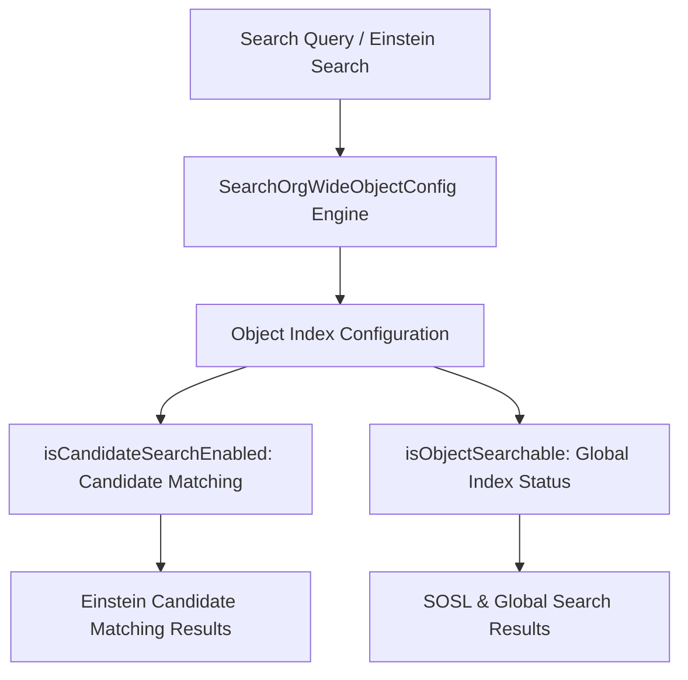

## Architectural Overview

`SearchOrgWideObjectConfig` enables architects and platform administrators to configure object-level search indexing and retrieval behaviors at the organizational scale. While standard Salesforce global search indexes all searchable objects by default, enterprise applications frequently require fine-grained control over which objects participate in Einstein Search, candidate matching (such as candidate searches in recruiting and staffing clouds), and natural language processing.

Controlling search indexing per object is especially critical in high-volume enterprise architectures. High-volume transactional logging or audit tables (such as `PaymentLog__c` or `ApiPayload__c`) generate millions of records that add unnecessary load to search indexing pipelines without providing value in global search. `SearchOrgWideObjectConfig` allows organizations to selectively exclude or tailor search capabilities for specific objects.



## Directory and File Conventions

In SFDX projects, `SearchOrgWideObjectConfig` records are stored in the `searchOrgWideObjectConfigs` directory.

| Property | Value |
| :--- | :--- |
| **Metadata Type Name** | `SearchOrgWideObjectConfig` |
| **SFDX Storage Folder** | `force-app/main/default/searchOrgWideObjectConfigs/` |
| **File Suffix** | `.searchOrgWideObjectConfig-meta.xml` |
| **Naming Pattern** | `<ObjectName>.searchOrgWideObjectConfig-meta.xml` |

## Key Metadata Fields

The `SearchOrgWideObjectConfig` metadata structure defines the following core properties:

| Field Name | Field Type | Required | Architectural Description |
| :--- | :--- | :--- | :--- |
| `fullName` | `string` | Yes | Unique developer name identifying the configuration, typically matching the target object API name. |
| `object` | `string` | Yes | Target standard or custom object API name (for example, `Candidate__c` or `Account`). |
| `isCandidateSearchEnabled` | `boolean` | No | Specifies whether candidate search capabilities are enabled for this object in specialized recruitment or match modules. |
| `isObjectSearchable` | `boolean` | No | Governs whether the object is indexed for global search and SOSL query execution. |

> [!NOTE]
> `SearchOrgWideObjectConfig` operates in conjunction with the object's `enableSearch` attribute in `CustomObject`. If `enableSearch` is `false` on the custom object definition, search indexing is disabled regardless of this configuration.

## Declarative XML and Package Manifest Examples

Below is an enterprise configuration enabling candidate search on a custom `CandidateProfile__c` object:

```xml title="force-app/main/default/searchOrgWideObjectConfigs/CandidateProfile__c.searchOrgWideObjectConfig-meta.xml"
<?xml version="1.0" encoding="UTF-8"?>
<SearchOrgWideObjectConfig xmlns="http://soap.sforce.com/2006/04/metadata">
    <object>CandidateProfile__c</object>
    <isCandidateSearchEnabled>true</isCandidateSearchEnabled>
    <isObjectSearchable>true</isObjectSearchable>
</SearchOrgWideObjectConfig>
```

### Manifest Definition (`package.xml`)

```xml title="manifest/package.xml"
<?xml version="1.0" encoding="UTF-8"?>
<Package xmlns="http://soap.sforce.com/2006/04/metadata">
    <types>
        <members>CandidateProfile__c</members>
        <name>SearchOrgWideObjectConfig</name>
    </types>
    <version>68.0</version>
</Package>
```

## Retrieval and Deployment

To retrieve or deploy `SearchOrgWideObjectConfig` definitions using the Salesforce CLI:

```bash
# Retrieve candidate search configuration for a specific object
sf project retrieve start --metadata "SearchOrgWideObjectConfig:CandidateProfile__c"

# Deploy search org-wide object configurations
sf project deploy start --metadata "SearchOrgWideObjectConfig"
```

## Senior Architect Deployment Best Practices and Gotchas

1. **Object Existence Prerequisite**: Deploy the underlying `CustomObject` before or alongside the `SearchOrgWideObjectConfig`. If the target object does not exist in the target org, deployment will fail with a reference error.
2. **Re-Indexing Latency**: Enabling or disabling searchability on an object with existing records triggers an asynchronous re-indexing job in the Salesforce search backend. Search results may take several minutes to reflect the configuration change.
3. **Scratch Org Definitions**: In scratch org automation, verify that any prerequisite features (such as Recruiting or specific Industry cloud features) are specified in `project-scratch-def.json` if candidate search is required.
4. **CI/CD Regression Safeguards**: Do not disable `isObjectSearchable` on objects that downstream Apex code queries via `SOSL` statements, as SOSL queries targeting unindexed objects will return empty result sets.

> [!TIP]
> Audit all custom objects with record counts exceeding 5 million. If an object is solely queried by exact keys via SOQL and never searched by users, disabling global search indexing helps conserve platform indexing resources.
