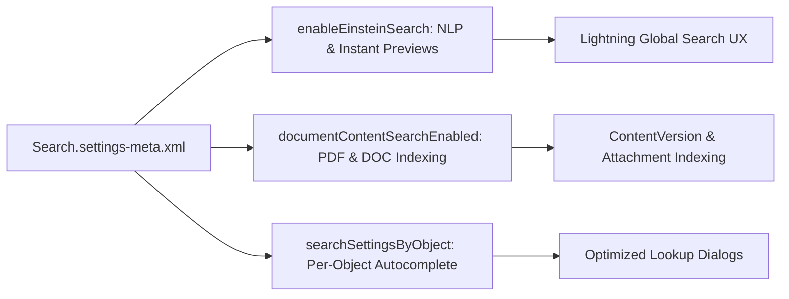

## Architectural Overview

`SearchSettings` is a critical org-level configuration metadata type that governs the search subsystem across an entire Salesforce instance. It defines settings for Einstein Search, lookup autocomplete, document content indexing, English punctuation clustering, and search scope personalization.

In modern enterprise architectures, search performance directly correlates with user productivity. When users enter search terms into the Lightning search bar or execute SOSL queries in integration pipelines, `SearchSettings` establishes how indexing algorithms tokenize terms, how lookups resolve parent records, and whether natural language queries can decipher intents like "my open opportunities in California".



## Directory and File Conventions

In SFDX source format, `SearchSettings` is stored in the `settings` directory under the filename `Search.settings-meta.xml`.

| Property | Value |
| :--- | :--- |
| **Metadata Type Name** | `Settings` (member: `Search`) or `SearchSettings` |
| **SFDX Storage Folder** | `force-app/main/default/settings/` |
| **File Name** | `Search.settings-meta.xml` |
| **Scratch Org Setting Key** | `searchSettings` |

## Key Metadata Fields

The `SearchSettings` XML structure provides comprehensive toggles for platform-level search behavior:

| Field Name | Field Type | Required | Architectural Description |
| :--- | :--- | :--- | :--- |
| `documentContentSearchEnabled` | `boolean` | No | Enables full-text indexing for files, documents, and Chatter attachments. |
| `enableEinsteinSearch` | `boolean` | No | Enables Einstein Search personalization, actionable UI, and natural language search. |
| `optimizeSearchForEnglishByDisablingPunctuationClustering` | `boolean` | No | Disables punctuation clustering in English to improve search recall for hyphenated terms. |
| `searchSettingsByObject` | `ObjectSearchSetting[]` | No | Array specifying lookup autocomplete and enhanced lookup options for individual objects. |

### ObjectSearchSetting Subtype Fields

| Subfield Name | Field Type | Architectural Description |
| :--- | :--- | :--- |
| `name` | `string` | API name of the target standard or custom object. |
| `lookupAutoCompleteEnabled` | `boolean` | Enables instant dropdown auto-complete suggestions for lookups targeting this object. |
| `enhancedLookupEnabled` | `boolean` | Enables search filtering and multi-column sorting within lookup dialogs. |

> [!NOTE]
> In Winter '27, Einstein Search is enabled by default in new orgs, but managing `SearchSettings` in your version control repository ensures consistent search behavior across scratch orgs, developer sandboxes, and production environments.

## Declarative XML and Package Manifest Examples

Below is a production-hardened `Search.settings-meta.xml` file configured for an enterprise sales and service organization:

```xml title="force-app/main/default/settings/Search.settings-meta.xml"
<?xml version="1.0" encoding="UTF-8"?>
<SearchSettings xmlns="http://soap.sforce.com/2006/04/metadata">
    <documentContentSearchEnabled>true</documentContentSearchEnabled>
    <enableEinsteinSearch>true</enableEinsteinSearch>
    <optimizeSearchForEnglishByDisablingPunctuationClustering>true</optimizeSearchForEnglishByDisablingPunctuationClustering>
    <searchSettingsByObject>
        <name>Account</name>
        <enhancedLookupEnabled>true</enhancedLookupEnabled>
        <lookupAutoCompleteEnabled>true</lookupAutoCompleteEnabled>
    </searchSettingsByObject>
    <searchSettingsByObject>
        <name>Contact</name>
        <enhancedLookupEnabled>true</enhancedLookupEnabled>
        <lookupAutoCompleteEnabled>true</lookupAutoCompleteEnabled>
    </searchSettingsByObject>
    <searchSettingsByObject>
        <name>Opportunity</name>
        <enhancedLookupEnabled>true</enhancedLookupEnabled>
        <lookupAutoCompleteEnabled>true</lookupAutoCompleteEnabled>
    </searchSettingsByObject>
</SearchSettings>
```

### Manifest Definition (`package.xml`)

```xml title="manifest/package.xml"
<?xml version="1.0" encoding="UTF-8"?>
<Package xmlns="http://soap.sforce.com/2006/04/metadata">
    <types>
        <members>Search</members>
        <name>Settings</name>
    </types>
    <version>68.0</version>
</Package>
```

## Retrieval and Deployment

Use the Salesforce CLI to retrieve and deploy org search settings:

```bash
# Retrieve Search settings
sf project retrieve start --metadata "Settings:Search"

# Deploy Search settings to target environment
sf project deploy start --metadata "Settings:Search"
```

## Senior Architect Deployment Best Practices and Gotchas

1. **Scratch Org Bootstrapping**: Always include `searchSettings` in your `config/project-scratch-def.json` or deploy `Search.settings-meta.xml` during scratch org provisioning to avoid subtle UX discrepancies during test automation.
2. **Lookup Autocomplete Pre-requisites**: When specifying objects in `searchSettingsByObject`, ensure custom objects exist in the org before deploying `SearchSettings`. Deploying settings referencing a non-existent object will cause deployment errors.
3. **Punctuation Clustering Considerations**: Disabling punctuation clustering improves search for alphanumeric serial numbers (e.g. `ABC-1234`), but may alter search recall for multi-part hyphenated names. Validate search results in sandbox before enabling globally.
4. **Content Search Indexing Timelines**: Toggling `documentContentSearchEnabled` does not immediately index historical files. Salesforce initiates a background queue to crawl and index existing documents.

> [!TIP]
> Combine `lookupAutoCompleteEnabled` with properly configured search layouts. Users type 2-3 characters and immediately see the right matching record without having to open full modal dialogs.
