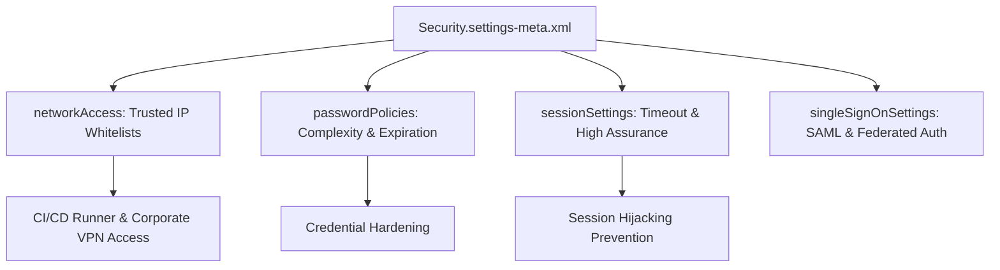

## Architectural Overview

`SecuritySettings` is the architectural bedrock of compliance, authentication posture, and access security in Salesforce. It encapsulates the core security settings governing session lifetimes, password complexity, identity verification, trusted network IP ranges (`networkAccess`), and Single Sign-On (SSO) enforcement.

In enterprise deployments, managing `SecuritySettings` via declarative metadata version control is mandatory for SOC 2, HIPAA, and ISO 27001 audits. Relying on manual setup adjustments introduces security drift between environments. By codifying security controls in `Security.settings-meta.xml`, security architects ensure that developer sandboxes, UAT environments, and production instances enforce uniform information security standards.



## Directory and File Conventions

In SFDX source format, `SecuritySettings` is stored in the `settings` directory under the filename `Security.settings-meta.xml`.

| Property | Value |
| :--- | :--- |
| **Metadata Type Name** | `Settings` (member: `Security`) or `SecuritySettings` |
| **SFDX Storage Folder** | `force-app/main/default/settings/` |
| **File Name** | `Security.settings-meta.xml` |
| **Scratch Org Setting Key** | `securitySettings` |

## Key Metadata Fields

The `SecuritySettings` schema contains multiple complex subtypes:

| Field Name | Field Type | Required | Architectural Description |
| :--- | :--- | :--- | :--- |
| `networkAccess` | `NetworkAccess` | No | List of trusted IP address ranges (`ipRanges`) allowed to access the org without verification codes. |
| `passwordPolicies` | `PasswordPolicies` | No | Rules for password expiration, complexity, history retention, and lockout duration. |
| `sessionSettings` | `SessionSettings` | No | Timeout policies, clickjack protection, session lock to IP address, and high-assurance session rules. |
| `singleSignOnSettings` | `SingleSignOnSettings` | No | Toggles for federated SSO, certificate pinning, and delegated authentication. |
| `canUsersGrantLoginAccess` | `boolean` | No | Governs whether administrators or support personnel can log in as another user. |

### NetworkAccess and IpRanges

```xml
<networkAccess>
    <ipRanges>
        <description>Corporate VPN Gateway</description>
        <end>198.51.100.254</end>
        <start>198.51.100.1</start>
    </ipRanges>
</networkAccess>
```

> [!WARNING]
> The `networkAccess` section is an absolute replacement list. If a deployment omits an existing IP range (such as an automated deployment runner or corporate gateway), that range is deleted upon deployment, potentially locking out automated integrations.

## Declarative XML and Package Manifest Examples

Below is a production-hardened `Security.settings-meta.xml` complying with modern corporate security standards:

```xml title="force-app/main/default/settings/Security.settings-meta.xml"
<?xml version="1.0" encoding="UTF-8"?>
<SecuritySettings xmlns="http://soap.sforce.com/2006/04/metadata">
    <canUsersGrantLoginAccess>true</canUsersGrantLoginAccess>
    <networkAccess>
        <ipRanges>
            <description>Corporate HQ Primary Gateway</description>
            <end>203.0.113.254</end>
            <start>203.0.113.1</start>
        </ipRanges>
        <ipRanges>
            <description>CI/CD Build Pipeline Dedicated Runner</description>
            <end>198.51.100.50</end>
            <start>198.51.100.50</start>
        </ipRanges>
    </networkAccess>
    <passwordPolicies>
        <complexity>SpecialCharacters</complexity>
        <expiration>NinetyDays</expiration>
        <historyRestriction>24</historyRestriction>
        <lockoutInterval>FifteenMinutes</lockoutInterval>
        <maxLoginAttempts>FiveAttempts</maxLoginAttempts>
        <minimumPasswordLength>12</minimumPasswordLength>
        <minimumPasswordLifetime>true</minimumPasswordLifetime>
        <obscureSecretAnswer>true</obscureSecretAnswer>
        <questionRestriction>DoesNotContainPassword</questionRestriction>
    </passwordPolicies>
    <sessionSettings>
        <disableTimeoutWarning>false</disableTimeoutWarning>
        <enableCSRFOnGet>true</enableCSRFOnGet>
        <enableCSRFOnPost>true</enableCSRFOnPost>
        <enableCacheAndAutocomplete>false</enableCacheAndAutocomplete>
        <enableClickjackNonsetupSFDC>true</enableClickjackNonsetupSFDC>
        <enableClickjackNonsetupUser>true</enableClickjackNonsetupUser>
        <enableClickjackSetup>true</enableClickjackSetup>
        <enablePostForSessions>true</enablePostForSessions>
        <enableSMSIdentity>true</enableSMSIdentity>
        <forceLogoutOnSessionTimeout>true</forceLogoutOnSessionTimeout>
        <forceRelogin>true</forceRelogin>
        <lockSessionsToDomain>true</lockSessionsToDomain>
        <lockSessionsToIp>false</lockSessionsToIp>
        <sessionTimeout>TwoHours</sessionTimeout>
    </sessionSettings>
</SecuritySettings>
```

### Manifest Definition (`package.xml`)

```xml title="manifest/package.xml"
<?xml version="1.0" encoding="UTF-8"?>
<Package xmlns="http://soap.sforce.com/2006/04/metadata">
    <types>
        <members>Security</members>
        <name>Settings</name>
    </types>
    <version>68.0</version>
</Package>
```

## Retrieval and Deployment

Retrieve and deploy `SecuritySettings` using the CLI:

```bash
# Retrieve Security settings
sf project retrieve start --metadata "Settings:Security"

# Deploy Security settings
sf project deploy start --metadata "Settings:Security"
```

## Senior Architect Deployment Best Practices and Gotchas

1. **Lock Sessions to IP Address**: Setting `lockSessionsToIp` to `true` can cause severe session drops in organizations where mobile users or remote workers roam between cellular towers and VPN tunnels with dynamic IP addresses. Use with caution.
2. **Environment Variable Separation**: Maintain environment-specific branches or deployment parameter replacements for `networkAccess`. Sandbox IP ranges often include office staging networks that should never be trusted in production.
3. **Session Timeout vs. Integration Users**: Enforcing short timeouts in `sessionSettings` applies to interactive UI sessions. Ensure integration users utilize Connected Apps and OAuth token flows rather than web sessions to prevent authentication interruptions.
4. **Destructive Changes on IP Ranges**: Always perform pre-deployment diffs on `Security.settings-meta.xml`. A careless git merge can drop critical API gateway IP ranges and interrupt mission-critical third-party integrations.

> [!TIP]
> Store IP range manifests in a separate, version-controlled spreadsheet or data dictionary to cross-verify all CIDR blocks before committing updates to `Security.settings-meta.xml`.
