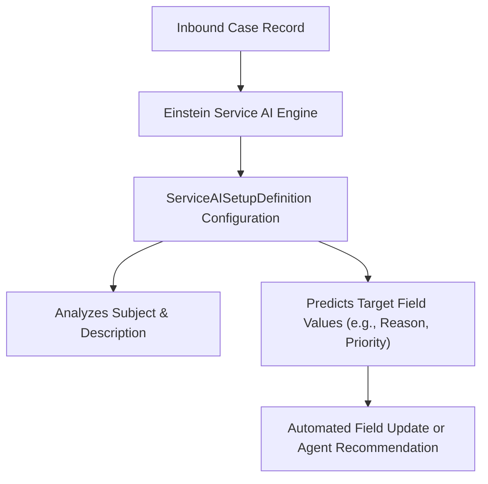

## Architectural Overview

`ServiceAISetupDefinition` represents the declarative blueprint for Einstein for Service machine learning models, primarily **Einstein Case Classification** and **Einstein Case Wrap-Up**. These capabilities employ natural language processing (NLP) to analyze incoming customer inquiries (from email, web forms, or chat transcripts) and automatically predict or populate case fields such as `Reason`, `Priority`, `Type`, or custom resolution codes.

In an enterprise contact center architecture, deploying `ServiceAISetupDefinition` metadata allows architects to standardize AI model configurations across sandboxes and production without manually rebuilding field mappings through Setup wizards. It defines the machine learning model scope, target objects, and lifecycle status.



## Directory and File Conventions

In SFDX source format, `ServiceAISetupDefinition` components are stored in the `serviceAISetupDefinitions` folder.

| Property | Value |
| :--- | :--- |
| **Metadata Type Name** | `ServiceAISetupDefinition` |
| **SFDX Storage Folder** | `force-app/main/default/serviceAISetupDefinitions/` |
| **File Suffix** | `.serviceAISetupDefinition-meta.xml` |
| **Naming Pattern** | `<DeveloperName>.serviceAISetupDefinition-meta.xml` |

## Key Metadata Fields

The `ServiceAISetupDefinition` metadata schema includes the following architectural elements:

| Field Name | Field Type | Required | Architectural Description |
| :--- | :--- | :--- | :--- |
| `fullName` | `string` | Yes | Unique developer name identifying the AI model setup definition. |
| `masterLabel` | `string` | Yes | User-facing display label shown in Service Cloud Setup. |
| `status` | `string` | Yes | Model lifecycle state (e.g. `Draft`, `Configured`, `Active`, `Inactive`). |
| `modelType` | `string` | Yes | Type of AI model being configured (e.g. `CaseClassification`, `CaseWrapUp`). |
| `sourceObject` | `string` | Yes | Primary source object analyzed by the model (typically `Case`). |
| `description` | `string` | No | Architectural summary of the model intent and business scope. |

> [!NOTE]
> While the metadata specifies the model structure, training requires a minimum historical record count (typically at least 400 closed cases meeting model criteria over the prior 6 months) within the target environment before the model can be built and activated.

## Declarative XML and Package Manifest Examples

Below is an example of an Einstein Case Classification setup definition:

```xml title="force-app/main/default/serviceAISetupDefinitions/Case_Triage_Classifier.serviceAISetupDefinition-meta.xml"
<?xml version="1.0" encoding="UTF-8"?>
<ServiceAISetupDefinition xmlns="http://soap.sforce.com/2006/04/metadata">
    <description>Predicts Reason, Type, and Priority for inbound customer support cases</description>
    <masterLabel>Case Triage Classifier</masterLabel>
    <modelType>CaseClassification</modelType>
    <sourceObject>Case</sourceObject>
    <status>Configured</status>
</ServiceAISetupDefinition>
```

### Manifest Definition (`package.xml`)

```xml title="manifest/package.xml"
<?xml version="1.0" encoding="UTF-8"?>
<Package xmlns="http://soap.sforce.com/2006/04/metadata">
    <types>
        <members>Case_Triage_Classifier</members>
        <name>ServiceAISetupDefinition</name>
    </types>
    <version>68.0</version>
</Package>
```

## Retrieval and Deployment

Use the Salesforce CLI to retrieve and deploy `ServiceAISetupDefinition` components:

```bash
# Retrieve AI setup definitions
sf project retrieve start --metadata "ServiceAISetupDefinition:Case_Triage_Classifier"

# Deploy all Service AI setup definitions
sf project deploy start --metadata "ServiceAISetupDefinition"
```

## Senior Architect Deployment Best Practices and Gotchas

1. **Licensing and Feature Prerequisites**: Einstein Case Classification requires Service Cloud Einstein licenses. Deploying `ServiceAISetupDefinition` to an org or scratch org lacking Einstein permissions will fail with feature enablement errors.
2. **Metadata vs. Training Boundary**: Deploying a `ServiceAISetupDefinition` with `<status>Active</status>` does not immediately activate inference in an empty sandbox. The administrator must initiate a model build via Setup or API once representative training data is seeded.
3. **Field Dependencies**: Ensure that all custom fields referenced as inputs or targets (configured via `ServiceAISetupField`) are deployed in the same or prior metadata deployment package.
4. **Environment Promotion Strategy**: In continuous deployment pipelines, promote `ServiceAISetupDefinition` in `Draft` or `Configured` status, seed testing data in staging sandboxes, validate prediction thresholds, and activate the model as a verified post-deployment step.

> [!TIP]
> Before deploying AI definitions to production, audit existing case records to ensure clean picklist values without excessive legacy values that might skew machine learning classification accuracy.
