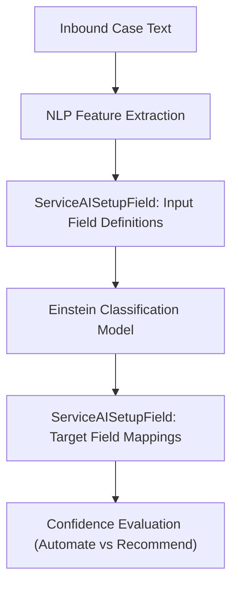

## Architectural Overview

`ServiceAISetupField` defines the specific field mappings, input feature selections, and prediction targets utilized by Einstein for Service machine learning models (such as Case Classification and Case Wrap-Up). When Einstein evaluates inbound text from customer support cases or chat transcripts, `ServiceAISetupField` specifies which fields serve as the predictive inputs (e.g., `Subject`, `Description`) and which fields receive AI recommendations or automated updates (e.g., `Priority`, `Reason`, or custom triage picklists).

From a systems architecture perspective, `ServiceAISetupField` provides granular control over automation thresholds. By configuring confidence score thresholds per field, architects can establish automated tiered workflows: high-confidence predictions automatically populate and route the case, medium-confidence predictions present on-screen recommendations to human agents, and low-confidence predictions are suppressed to avoid false positives.



## Directory and File Conventions

In SFDX source format, `ServiceAISetupField` records are maintained either as child components inside `ServiceAISetupDefinition` or stored in the `serviceAISetupFields` directory.

| Property | Value |
| :--- | :--- |
| **Metadata Type Name** | `ServiceAISetupField` |
| **SFDX Storage Folder** | `force-app/main/default/serviceAISetupFields/` |
| **File Suffix** | `.serviceAISetupField-meta.xml` |
| **Naming Pattern** | `<DefinitionName>.<FieldName>.serviceAISetupField-meta.xml` |

## Key Metadata Fields

The `ServiceAISetupField` metadata schema contains the following architectural attributes:

| Field Name | Field Type | Required | Architectural Description |
| :--- | :--- | :--- | :--- |
| `fullName` | `string` | Yes | Qualified identifier linking parent definition and field API name. |
| `field` | `string` | Yes | Target or source field API name on the Case object (e.g. `Reason` or `Category__c`). |
| `fieldType` | `string` | Yes | Classification of the field (such as `Input`, `Target`, or `Extraction`). |
| `operator` | `string` | No | Evaluation operator applied to input filtering or value conditions. |
| `value` | `string` | No | Baseline value or condition filter applied to the mapped field. |
| `isInput` | `boolean` | No | Indicates whether this field is ingested as a feature by the model. |
| `isTarget` | `boolean` | No | Indicates whether this field receives model predictions. |

> [!NOTE]
> Only specific data types are eligible as target fields in Einstein Case Classification: single-select picklists, checkboxes, and certain standard categorizations. Long text area fields cannot be configured as prediction targets.

## Declarative XML and Package Manifest Examples

Below is an enterprise XML definition mapping a custom triage category field as a target prediction:

```xml title="force-app/main/default/serviceAISetupFields/Case_Triage_Classifier.Triage_Category__c.serviceAISetupField-meta.xml"
<?xml version="1.0" encoding="UTF-8"?>
<ServiceAISetupField xmlns="http://soap.sforce.com/2006/04/metadata">
    <field>Triage_Category__c</field>
    <fieldType>Target</fieldType>
    <isInput>false</isInput>
    <isTarget>true</isTarget>
</ServiceAISetupField>
```

### Manifest Definition (`package.xml`)

```xml title="manifest/package.xml"
<?xml version="1.0" encoding="UTF-8"?>
<Package xmlns="http://soap.sforce.com/2006/04/metadata">
    <types>
        <members>Case_Triage_Classifier.Triage_Category__c</members>
        <members>Case_Triage_Classifier.Priority</members>
        <name>ServiceAISetupField</name>
    </types>
    <version>68.0</version>
</Package>
```

## Retrieval and Deployment

Use the Salesforce CLI to retrieve and deploy `ServiceAISetupField` mappings:

```bash
# Retrieve field mappings for an AI setup definition
sf project retrieve start --metadata "ServiceAISetupField:Case_Triage_Classifier.Triage_Category__c"

# Deploy all Service AI setup fields
sf project deploy start --metadata "ServiceAISetupField"
```

## Senior Architect Deployment Best Practices and Gotchas

1. **Strict Dependency Order**: A `ServiceAISetupField` references both a parent `ServiceAISetupDefinition` and an existing field on `Case`. Both the custom field and the setup definition must be deployed prior to or in the same transaction as the setup field.
2. **Picklist Value Distribution**: Ensure that target picklist fields have distinct, well-distributed values in historical data. If 98% of cases use a default picklist value, model accuracy will suffer from severe class imbalance.
3. **Automate vs. Recommend Boundaries**: When configuring automation thresholds, start with a high confidence cutoff (e.g. 95%) for direct automation to prevent erroneous case routing, while setting a lower threshold (e.g. 75%) for recommendations shown in the agent utility bar.
4. **Impact of Renaming Custom Fields**: Renaming a custom field API name in metadata will break `ServiceAISetupField` references. Update the setup field mapping metadata simultaneously to prevent deployment failure.

> [!TIP]
> Include `Subject` and `Description` as inputs, but avoid including short text fields with high noise (like tracking numbers or transaction hashes) that degrade NLP tokenization efficiency.
