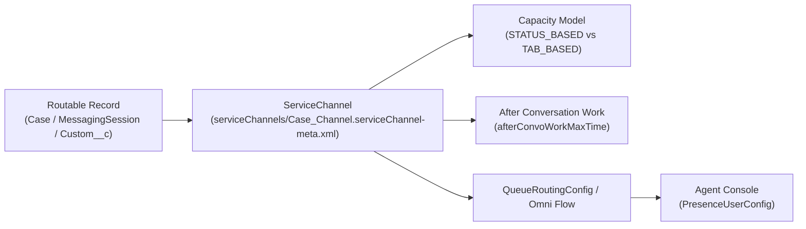

## Why the `ServiceChannel` Metadata Type Is the Entry Point to Omni-Channel

In Salesforce Omni-Channel architecture, Omni-Channel cannot route a record until its SObject type is registered as a **`ServiceChannel`** (`serviceChannels/<Name>.serviceChannel-meta.xml`). A `ServiceChannel` defines:

1. **Which SObject is routable** (`relatedEntityType`, such as `Case`, `Lead`, `MessagingSession`, `VoiceCall`, or a custom object).
2. **How agent capacity is measured and released** (`capacityModel`: `TAB_BASED` vs. `STATUS_BASED`).
3. **Secondary Routing Priority** (`secondaryRoutingPriorityField`): How Omni-Channel breaks ties among items in the same priority queue (for example, sorting by an SLA target date or customer lifetime value field).
4. **After Conversation Work (ACW) Timers** (`afterConvoWorkMaxTime`): Giving voice and messaging agents a structured wrap-up window after a conversation ends.



---

## Key Metadata Fields on `ServiceChannel`

| Field | Type | Required | Description |
|---|---|---|---|
| `relatedEntityType` | `string` | Yes | API name of the object routed by this channel (`Case`, `Lead`, `MessagingSession`, `Custom_Ticket__c`). Only one `ServiceChannel` can exist per object type! |
| `label` | `string` | Yes | Human-readable channel name in Omni-Channel Setup and Omni Supervisor. |
| `capacityModel` | `OmniChannelCapacityModel` | No | *(API v65.0+)* `TAB_BASED` or `STATUS_BASED`. |
| `serviceChannelStatusFieldName` | `string` | Conditional | Field API name (`Status`) evaluated when `capacityModel` is `STATUS_BASED`. |
| `serviceChannelFieldValues` | `ServiceChannelStatusField[]` | Conditional | Maps field values (`Working`, `Waiting on Customer`) to `IN_PROGRESS`, `PAUSED`, or `COMPLETED` capacity states. |
| `secondaryRoutingPriorityField` | `string` | No | Field on the target object used to order queued items within the same primary routing priority. |
| `doesMinimizeWidgetOnAccept` | `boolean` | No | Automatically minimizes the Omni-Channel utility widget when the agent accepts a work item. |
| `isAfterConvoWorkTimerEnabled` | `boolean` | No | *(API v55.0+)* Enables After Conversation Work (ACW) timer for the channel. |
| `afterConvoWorkMaxTime` | `int` | No | *(API v55.0+)* Maximum ACW duration in seconds (`10` to `3600`). |

---

## Real-World XML Example: Status-Based Case Service Channel

File: `force-app/main/default/serviceChannels/Support_Cases_Channel.serviceChannel-meta.xml`

```xml
<?xml version="1.0" encoding="UTF-8"?>
<ServiceChannel xmlns="http://soap.sforce.com/2006/04/metadata">
    <capacityModel>STATUS_BASED</capacityModel>
    <doesMinimizeWidgetOnAccept>true</doesMinimizeWidgetOnAccept>
    <isCheckCapOnOwnerChange>true</isCheckCapOnOwnerChange>
    <isCheckCapOnStatusChange>true</isCheckCapOnStatusChange>
    <label>Support Cases Channel</label>
    <relatedEntityType>Case</relatedEntityType>
    <secondaryRoutingPriorityField>Case.SLA_Priority_Rank__c</secondaryRoutingPriorityField>
    <serviceChannelFieldValues>
        <StatusFieldValue>New</StatusFieldValue>
        <StatusFieldValueType>IN_PROGRESS</StatusFieldValueType>
    </serviceChannelFieldValues>
    <serviceChannelFieldValues>
        <StatusFieldValue>Working</StatusFieldValue>
        <StatusFieldValueType>IN_PROGRESS</StatusFieldValueType>
    </serviceChannelFieldValues>
    <serviceChannelFieldValues>
        <StatusFieldValue>Waiting on Customer</StatusFieldValue>
        <StatusFieldValueType>PAUSED</StatusFieldValueType>
    </serviceChannelFieldValues>
    <serviceChannelStatusFieldName>Status</serviceChannelStatusFieldName>
</ServiceChannel>
```

---

## Querying `ServiceChannel` via SOQL

In Apex (for example, when calling `OmniChannel` routing APIs or querying `PendingServiceRouting` / `AgentWork`), you frequently need the `ServiceChannelId`.

```sql
SELECT Id, DeveloperName, MasterLabel, RelatedEntity,
       SecondaryRoutingPriorityField, CapacityModel,
       DoesMinimizeWidgetOnAccept
FROM ServiceChannel
ORDER BY MasterLabel ASC
```

---

## Senior Architect Best Practices & Gotchas

> [!WARNING]
> **One `ServiceChannel` Per Object Rule:** Salesforce enforces a strict 1:1 relationship between `ServiceChannel` and `relatedEntityType`. If the target Sandbox already has a `ServiceChannel` for `Case` with a different `DeveloperName` (for example, `sfdc_liveagent` or `Cases`), deploying a second `ServiceChannel` with `<relatedEntityType>Case</relatedEntityType>` will fail with a duplicate entity error.

- **Use `STATUS_BASED` Capacity for Asynchronous Cases:** With `TAB_BASED` capacity, an agent who accidentally closes a Case console tab immediately looks "available" to Omni-Channel even though they still own 10 unfinished Cases. `STATUS_BASED` capacity combined with `PAUSED` values (`Waiting on Customer`) accurately reflects real workload.
