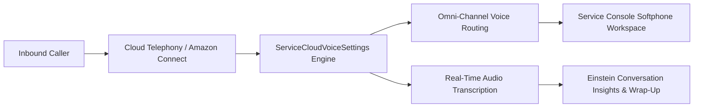

## Architectural Overview

`ServiceCloudVoiceSettings` governs the core platform configuration for **Service Cloud Voice**, Salesforce's native cloud telephony and contact center integration. By connecting telephony providers (such as Amazon Connect, Genesys Cloud, Cisco Webex, or custom BYOT solutions) directly into the Salesforce Service Console, Service Cloud Voice unites phone calls, digital channels, and CRM data into a single pane of glass.

Architecturally, `ServiceCloudVoiceSettings` controls whether telephony integration is active, how inbound calls route into Omni-Channel, whether automatic call transcription and recording are enabled, and how agent softphones interact with browser audio APIs. Declarative management of this metadata ensures seamless promotion from sandboxes to production without disrupting contact center operations.



## Directory and File Conventions

In SFDX source format, `ServiceCloudVoiceSettings` is stored in the `settings` directory under the filename `ServiceCloudVoice.settings-meta.xml`.

| Property | Value |
| :--- | :--- |
| **Metadata Type Name** | `Settings` (member: `ServiceCloudVoice`) or `ServiceCloudVoiceSettings` |
| **SFDX Storage Folder** | `force-app/main/default/settings/` |
| **File Name** | `ServiceCloudVoice.settings-meta.xml` |
| **Scratch Org Setting Key** | `serviceCloudVoiceSettings` |

## Key Metadata Fields

The `ServiceCloudVoiceSettings` XML schema defines several critical operational flags:

| Field Name | Field Type | Required | Architectural Description |
| :--- | :--- | :--- | :--- |
| `enableServiceCloudVoice` | `boolean` | No | Enables native Service Cloud Voice contact center telephony integration. |
| `enableAutoCallRecording` | `boolean` | No | Automatically triggers audio recording when an inbound or outbound call connects. |
| `enableVoiceCallSharing` | `boolean` | No | Governs sharing rules and visibility inheritance for `VoiceCall` records. |
| `enableTranscription` | `boolean` | No | Enables real-time speech-to-text audio streaming for live transcription. |

> [!NOTE]
> Service Cloud Voice requires dedicated telephony licensing (such as Service Cloud Voice with Amazon Connect or Partner Telephony add-on licenses) in the target Salesforce organization.

## Declarative XML and Package Manifest Examples

Below is a production-hardened `ServiceCloudVoice.settings-meta.xml` configuration for an enterprise contact center:

```xml title="force-app/main/default/settings/ServiceCloudVoice.settings-meta.xml"
<?xml version="1.0" encoding="UTF-8"?>
<ServiceCloudVoiceSettings xmlns="http://soap.sforce.com/2006/04/metadata">
    <enableAutoCallRecording>true</enableAutoCallRecording>
    <enableServiceCloudVoice>true</enableServiceCloudVoice>
    <enableTranscription>true</enableTranscription>
    <enableVoiceCallSharing>true</enableVoiceCallSharing>
</ServiceCloudVoiceSettings>
```

### Manifest Definition (`package.xml`)

```xml title="manifest/package.xml"
<?xml version="1.0" encoding="UTF-8"?>
<Package xmlns="http://soap.sforce.com/2006/04/metadata">
    <types>
        <members>ServiceCloudVoice</members>
        <name>Settings</name>
    </types>
    <version>68.0</version>
</Package>
```

## Retrieval and Deployment

Use the Salesforce CLI to retrieve and deploy Service Cloud Voice settings:

```bash
# Retrieve Service Cloud Voice settings
sf project retrieve start --metadata "Settings:ServiceCloudVoice"

# Deploy Service Cloud Voice settings
sf project deploy start --metadata "Settings:ServiceCloudVoice"
```

## Senior Architect Deployment Best Practices and Gotchas

1. **Omni-Channel Dependency Order**: Before enabling Service Cloud Voice, ensure that Omni-Channel is fully enabled and configured with voice-capable `ServiceChannel` and `ServicePresenceStatus` metadata.
2. **Contact Center XML Pairing**: Deploying `ServiceCloudVoiceSettings` activates the telephony subsystem, but connecting a specific telephony provider also requires deploying or provisioning `CallCenter` metadata and connected Amazon Connect instance configurations.
3. **Data Privacy and Call Recording**: Enabling `enableAutoCallRecording` has strict legal compliance ramifications (e.g. GDPR, wiretap consent laws). Pair this setting with automated IVR disclosure announcements configured in the telephony flow.
4. **VoiceCall Record Object Access**: Enabling `enableVoiceCallSharing` allows sharing rules on the `VoiceCall` object. Ensure user profiles or permission sets are updated to grant appropriate Read/Edit permissions to contact center supervisors.

> [!TIP]
> Ensure your scratch org definition file includes the `ServiceCloudVoice` feature flag in `project-scratch-def.json` when developing voice integration components in CI/CD pipelines.
