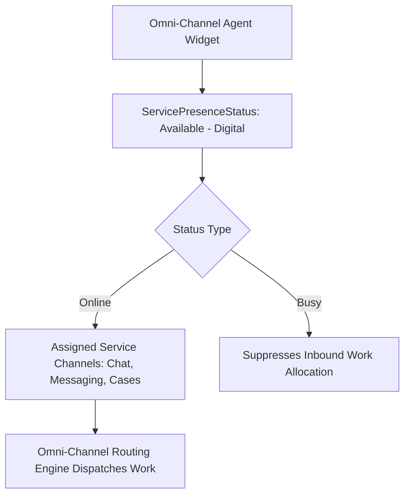

## Architectural Overview

`ServicePresenceStatus` is the core Omni-Channel metadata entity that defines an agent's availability state within Salesforce Service Cloud. When customer support agents sign into the Omni-Channel utility widget, their presence status (e.g., "Available - Messaging & Cases", "Busy - In Training", "On Lunch", "Offline") determines whether the routing engine can push real-time interactions to their workspace.

From an enterprise routing architecture standpoint, `ServicePresenceStatus` acts as the bridge connecting agents to `ServiceChannel` entities. Each status specifies which channels are active: an agent available for voice calls might be suppressed from taking high-concurrency digital chats, or a Tier 2 specialist might receive only escalated cases. Access to statuses is tightly governed via Permission Sets, ensuring strict role-based routing boundaries.



## Directory and File Conventions

In SFDX source format, each `ServicePresenceStatus` is stored in the `servicePresenceStatuses` folder as an individual XML file.

| Property | Value |
| :--- | :--- |
| **Metadata Type Name** | `ServicePresenceStatus` |
| **SFDX Storage Folder** | `force-app/main/default/servicePresenceStatuses/` |
| **File Suffix** | `.servicePresenceStatus-meta.xml` |
| **Naming Pattern** | `<DeveloperName>.servicePresenceStatus-meta.xml` |

## Key Metadata Fields

The `ServicePresenceStatus` schema contains the following architectural elements:

| Field Name | Field Type | Required | Architectural Description |
| :--- | :--- | :--- | :--- |
| `fullName` | `string` | Yes | Developer API name of the presence status. |
| `label` | `string` | Yes | Human-readable label displayed in the Omni-Channel dropdown. |
| `type` | `string` | Yes | Availability category: `Online` (accepts work) or `Busy` (declines work). |
| `channels` | `PresenceStatusChannel[]` | No | List of `ServiceChannel` records bound to this status when `type` is `Online`. |
| `description` | `string` | No | Architectural description of the intended usage for this status. |

### PresenceStatusChannel Subtype

| Subfield Name | Field Type | Architectural Description |
| :--- | :--- | :--- |
| `channel` | `string` | API name of the associated `ServiceChannel` (for example, `sfdc_liveagent` or `CaseChannel`). |

> [!NOTE]
> When `type` is configured as `Busy`, the status cannot have associated `channels`, as busy statuses represent non-working or break states where no channel work should be delivered.

## Declarative XML and Package Manifest Examples

Below is an enterprise XML definition for an agent status accepting both Cases and Messaging sessions:

```xml title="force-app/main/default/servicePresenceStatuses/Available_Digital_Channels.servicePresenceStatus-meta.xml"
<?xml version="1.0" encoding="UTF-8"?>
<ServicePresenceStatus xmlns="http://soap.sforce.com/2006/04/metadata">
    <channels>
        <channel>CaseServiceChannel</channel>
    </channels>
    <channels>
        <channel>MessagingServiceChannel</channel>
    </channels>
    <description>Allows agents to receive inbound cases and real-time messaging interactions</description>
    <label>Available - Digital Channels</label>
    <type>Online</type>
</ServicePresenceStatus>
```

### Manifest Definition (`package.xml`)

```xml title="manifest/package.xml"
<?xml version="1.0" encoding="UTF-8"?>
<Package xmlns="http://soap.sforce.com/2006/04/metadata">
    <types>
        <members>Available_Digital_Channels</members>
        <members>Busy_Meal_Break</members>
        <name>ServicePresenceStatus</name>
    </types>
    <version>68.0</version>
</Package>
```

## Retrieval and Deployment

To retrieve or deploy `ServicePresenceStatus` definitions using the Salesforce CLI:

```bash
# Retrieve all presence statuses
sf project retrieve start --metadata "ServicePresenceStatus"

# Deploy a specific presence status
sf project deploy start --metadata "ServicePresenceStatus:Available_Digital_Channels"
```

## Senior Architect Deployment Best Practices and Gotchas

1. **Permission Set Entitlements**: Creating a `ServicePresenceStatus` does not make it visible to agents. You must deploy corresponding `servicePresenceStatusAccesses` inside a `PermissionSet` or `Profile`.
2. **ServiceChannel Dependency**: Ensure that all referenced `ServiceChannel` components are deployed prior to or simultaneously with the `ServicePresenceStatus`. Referencing a non-existent channel causes immediate deployment failure.
3. **Omni-Channel Feature Requirement**: Target orgs must have Omni-Channel enabled in `OmniChannelSettings` (`enableOmniChannel: true`). Otherwise, the `ServicePresenceStatus` metadata type cannot be resolved.
4. **Destructive Changes and Live Sessions**: Deleting a presence status via destructive manifest requires verifying that no active `UserServicePresence` records are currently in that status in the target org.

> [!TIP]
> Standardize status naming conventions across global contact centers (e.g., `Avail_Tier1_Voice`, `Busy_Training`) and provision access via targeted Permission Sets rather than monolithic Profiles.
