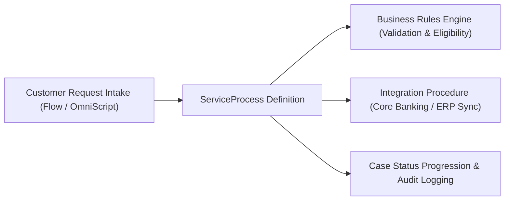

## Architectural Overview

`ServiceProcess` is the metadata encapsulation of **Service Process Studio**, a process orchestration framework prevalent in Salesforce Financial Services Cloud (FSC), Public Sector Solutions, and enterprise Service Cloud implementations. Service Process Studio enables business analysts and architects to design, configure, and execute end-to-end service requests—such as address changes, dispute filings, fee reversals, or account closures—through structured, repeatable workflows.

Architecturally, a `ServiceProcess` metadata component serves as the central orchestration coordinator. It binds together front-end intake interfaces (Screen Flows or OmniScripts), middle-tier business logic (Business Rules Engine lookup tables or Flow decisions), and backend integration actions (Integration Procedures or external API invocations). Managing this as declarative source code ensures enterprise release teams can deploy complex customer journeys deterministically across sandbox hierarchies.



## Directory and File Conventions

In SFDX source format, `ServiceProcess` definitions are located in the `serviceProcesses` directory.

| Property | Value |
| :--- | :--- |
| **Metadata Type Name** | `ServiceProcess` |
| **SFDX Storage Folder** | `force-app/main/default/serviceProcesses/` |
| **File Suffix** | `.serviceProcess-meta.xml` |
| **Naming Pattern** | `<DeveloperName>.serviceProcess-meta.xml` |

## Key Metadata Fields

The `ServiceProcess` schema comprises attributes defining the lifecycle, intake channel, and runtime execution targets:

| Field Name | Field Type | Required | Architectural Description |
| :--- | :--- | :--- | :--- |
| `fullName` | `string` | Yes | Unique developer name identifying the service process. |
| `masterLabel` | `string` | Yes | Human-readable label displayed in Service Process Studio. |
| `description` | `string` | No | Architectural summary of the business process and SLAs. |
| `flowDefinition` | `string` | No | API name of the primary Screen Flow or Orchestration driving the intake experience. |
| `status` | `string` | Yes | Lifecycle status of the process definition (`Draft`, `Active`, `Archived`). |
| `category` | `string` | No | Business domain category (e.g. `AccountManagement`, `Billing`, `Lending`). |

> [!NOTE]
> Service Process Studio is commonly utilized alongside OmniStudio and Industry Cloud data models. Verify that prerequisite Industry packages or licenses are provisioned in target environments before deploying.

## Declarative XML and Package Manifest Examples

Below is a declarative XML definition for an automated Fee Reversal service process:

```xml title="force-app/main/default/serviceProcesses/Fee_Reversal_Process.serviceProcess-meta.xml"
<?xml version="1.0" encoding="UTF-8"?>
<ServiceProcess xmlns="http://soap.sforce.com/2006/04/metadata">
    <category>Billing</category>
    <description>Orchestrates customer fee reversal requests with automated ledger reconciliation</description>
    <flowDefinition>Fee_Reversal_Intake_Flow</flowDefinition>
    <masterLabel>Fee Reversal Request</masterLabel>
    <status>Active</status>
</ServiceProcess>
```

### Manifest Definition (`package.xml`)

```xml title="manifest/package.xml"
<?xml version="1.0" encoding="UTF-8"?>
<Package xmlns="http://soap.sforce.com/2006/04/metadata">
    <types>
        <members>Fee_Reversal_Process</members>
        <name>ServiceProcess</name>
    </types>
    <types>
        <members>Fee_Reversal_Intake_Flow</members>
        <name>Flow</name>
    </types>
    <version>68.0</version>
</Package>
```

## Retrieval and Deployment

Use the Salesforce CLI to retrieve and deploy `ServiceProcess` components:

```bash
# Retrieve a specific service process
sf project retrieve start --metadata "ServiceProcess:Fee_Reversal_Process"

# Deploy service processes and associated flows
sf project deploy start --metadata "ServiceProcess,Flow"
```

## Senior Architect Deployment Best Practices and Gotchas

1. **Dependency Packaging**: A `ServiceProcess` often points to an underlying `flowDefinition`. Always package the referenced Flow and custom fields in the same deployment artifact to avoid unresolved reference errors.
2. **Industry License Activation**: Service Process Studio features require Industry Cloud feature licenses (such as FSC or Health Cloud). In automated CI/CD pipelines, ensure scratch org definitions enable the corresponding Industry features.
3. **Draft to Active Promotion**: Keep service processes in `Draft` state when migrating through early sandbox environments. Validate integration endpoints in integration testing before activating in staging and production.
4. **Audit and Tracking**: Ensure each ServiceProcess writes execution steps to tracking objects (such as `ServiceProcessRequest`) to provide customer service teams with a full audit trail for compliance.

> [!TIP]
> Group related service processes by `category` to allow dynamic discovery on Lightning record pages using conditional FlexiPage component visibility.
