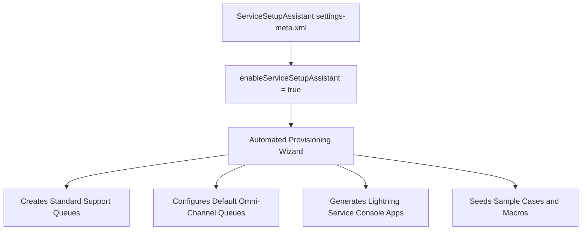

## Architectural Overview

`ServiceSetupAssistantSettings` manages the state of Salesforce's **Service Setup Assistant**, an administrative onboarding wizard designed to rapidly configure core Service Cloud capabilities in fresh orgs. When toggled on, the Assistant automatically generates essential service plumbing, including baseline support queues, case record types, Omni-Channel routing definitions, default lightning service console apps, and email-to-case routing addresses.

In modern DevOps and enterprise governance architectures, understanding and tracking `ServiceSetupAssistantSettings` is essential. While the wizard accelerates initial proof-of-concept setups in developer edition orgs or trial environments, enterprise development teams often prefer to keep it disabled in CI/CD scratch orgs to prevent unwanted automatic creation of unmanaged metadata artifacts that could conflict with deterministic source code.



## Directory and File Conventions

In SFDX source format, `ServiceSetupAssistantSettings` is stored in the `settings` directory under the filename `ServiceSetupAssistant.settings-meta.xml`.

| Property | Value |
| :--- | :--- |
| **Metadata Type Name** | `Settings` (member: `ServiceSetupAssistant`) or `ServiceSetupAssistantSettings` |
| **SFDX Storage Folder** | `force-app/main/default/settings/` |
| **File Name** | `ServiceSetupAssistant.settings-meta.xml` |
| **Scratch Org Setting Key** | `serviceSetupAssistantSettings` |

## Key Metadata Fields

The `ServiceSetupAssistantSettings` schema contains primary toggles controlling the setup assistant lifecycle:

| Field Name | Field Type | Required | Architectural Description |
| :--- | :--- | :--- | :--- |
| `enableServiceSetupAssistant` | `boolean` | No | Toggles the Service Setup Assistant feature on or off within the org. |

> [!NOTE]
> Turning on the Service Setup Assistant triggers asynchronous background jobs in Salesforce that instantiate standard queues, macros, quick text, and lightning console apps.

## Declarative XML and Package Manifest Examples

Below is the declarative XML configuration setting the assistant state:

```xml title="force-app/main/default/settings/ServiceSetupAssistant.settings-meta.xml"
<?xml version="1.0" encoding="UTF-8"?>
<ServiceSetupAssistantSettings xmlns="http://soap.sforce.com/2006/04/metadata">
    <enableServiceSetupAssistant>false</enableServiceSetupAssistant>
</ServiceSetupAssistantSettings>
```

### Manifest Definition (`package.xml`)

```xml title="manifest/package.xml"
<?xml version="1.0" encoding="UTF-8"?>
<Package xmlns="http://soap.sforce.com/2006/04/metadata">
    <types>
        <members>ServiceSetupAssistant</members>
        <name>Settings</name>
    </types>
    <version>68.0</version>
</Package>
```

## Retrieval and Deployment

To retrieve or deploy `ServiceSetupAssistantSettings` via the CLI:

```bash
# Retrieve Service Setup Assistant settings
sf project retrieve start --metadata "Settings:ServiceSetupAssistant"

# Deploy settings to target org
sf project deploy start --metadata "Settings:ServiceSetupAssistant"
```

## Senior Architect Deployment Best Practices and Gotchas

1. **Enterprise CI/CD Recommendation**: Keep `enableServiceSetupAssistant` set to `false` in production and staging repositories. Allowing wizard-generated metadata can lead to naming collisions with enterprise queue definitions and permission sets.
2. **Irreversible Metadata Creation**: Disabling `enableServiceSetupAssistant` after it was previously enabled does not automatically delete the queues, apps, or records that the wizard created. Cleaning up those artifacts requires explicit destructive changes.
3. **Scratch Org Consistency**: If developers rely on the assistant in scratch orgs, document the exact post-provisioning steps so that the resulting configuration matches the metadata stored in version control.
4. **Integration Impact**: The assistant may create default routing addresses that could intercept inbound test emails intended for dedicated sandbox email services.

> [!TIP]
> For demo and sandbox environments needing rapid initial bootstrapping, enable the assistant during org creation, retrieve the generated metadata, clean up unnecessary artifacts, and commit the sanitized files to source control.
