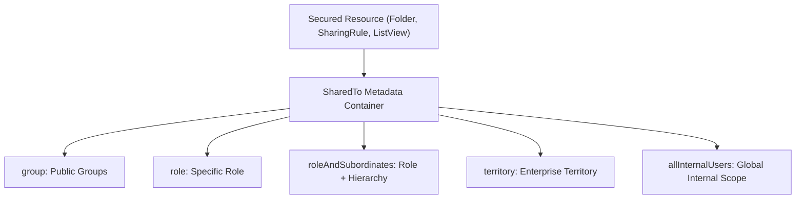

## Architectural Overview

`SharedTo` is one of the most widely reused composite metadata structures across the Salesforce platform. It defines the audience or recipient entities granted access to secured resources. Whenever an architect configures a sharing rule, shares a report folder, grants access to a dashboard folder, or restricts a custom list view to specific business teams, `SharedTo` provides the programmatic declaration of those target entities.

In enterprise access control architectures, managing `SharedTo` correctly is crucial for environment portability. Unlike manual setup sharing where administrators might mistakenly share folders with individual user accounts, `SharedTo` enforces declarative entity abstractions—such as User Roles, Public Groups, Subordinates, Territories, and Portal Roles. This ensures that sharing definitions can be deployed from developer sandboxes to production without hardcoded user IDs.



## Directory and File Conventions

`SharedTo` is not a standalone top-level metadata file; it is an embedded child XML element utilized inside parent metadata files such as `SharingRules`, `ReportFolder`, `DashboardFolder`, and `ListView`.

| Property | Value |
| :--- | :--- |
| **Metadata Type Name** | `SharedTo` (Complex Subtype) |
| **Parent Metadata Types** | `SharingRules`, `ReportFolder`, `DashboardFolder`, `ListView` |
| **XML Element Name** | `<sharedTo>` |
| **Scope** | Embedded XML component across access-controlled metadata |

## Key Metadata Fields

The `SharedTo` XML structure provides multiple recipient entity selectors:

| Field Name | Field Type | Required | Architectural Description |
| :--- | :--- | :--- | :--- |
| `allCustomerPortalUsers` | `string` | No | Empty XML tag granting access to all customer community and portal users. |
| `allInternalUsers` | `string` | No | Empty XML tag granting access to all internal Salesforce users. |
| `allPartnerUsers` | `string` | No | Empty XML tag granting access to all partner portal users. |
| `group` | `string[]` | No | Developer names of Public Groups receiving access. |
| `manager` | `string[]` | No | Developer name representing manager groups. |
| `portalRole` | `string[]` | No | Developer name of portal or community roles receiving access. |
| `queue` | `string[]` | No | Developer names of Queues targeted in sharing rules. |
| `role` | `string[]` | No | Developer names of specific User Roles receiving access. |
| `roleAndSubordinates` | `string[]` | No | Developer name of a User Role including all subordinate roles down the hierarchy. |
| `roleAndSubordinatesInternal` | `string[]` | No | Role and subordinates restricted strictly to internal users, excluding portal users. |
| `territory` | `string[]` | No | Territory developer name for Enterprise Territory Management sharing. |
| `territoryAndSubordinates` | `string[]` | No | Territory developer name including all child territories in the hierarchy. |

> [!NOTE]
> When defining empty tag elements like `<allInternalUsers/>`, the tag presence itself denotes true. In source format, this is typically formatted as `<allInternalUsers></allInternalUsers>`.

## Declarative XML and Package Manifest Examples

Below is an example of a `SharedTo` structure embedded inside an Account criteria-based sharing rule:

```xml title="force-app/main/default/sharingRules/Account.sharingRules-meta.xml"
<?xml version="1.0" encoding="UTF-8"?>
<SharingRules xmlns="http://soap.sforce.com/2006/04/metadata">
    <sharingCriteriaRules>
        <fullName>Share_Key_Accounts_With_Commercial_Team</fullName>
        <accessLevel>Edit</accessLevel>
        <label>Share Key Accounts With Commercial Team</label>
        <sharedTo>
            <group>Commercial_Sales_Operations</group>
            <roleAndSubordinatesInternal>VP_Commercial_Sales</roleAndSubordinatesInternal>
        </sharedTo>
        <criteriaItems>
            <field>AnnualRevenue</field>
            <operation>greaterOrEqual</operation>
            <value>5000000</value>
        </criteriaItems>
    </sharingCriteriaRules>
</SharingRules>
```

### Manifest Definition (`package.xml`)

Deploying sharing rules containing `SharedTo` elements references the parent metadata type:

```xml title="manifest/package.xml"
<?xml version="1.0" encoding="UTF-8"?>
<Package xmlns="http://soap.sforce.com/2006/04/metadata">
    <types>
        <members>Account</members>
        <name>SharingRules</name>
    </types>
    <types>
        <members>Commercial_Sales_Operations</members>
        <name>Group</name>
    </types>
    <types>
        <members>VP_Commercial_Sales</members>
        <name>Role</name>
    </types>
    <version>68.0</version>
</Package>
```

## Retrieval and Deployment

Retrieve the parent sharing rules or folders to manage `SharedTo` structures:

```bash
# Retrieve sharing rules for Account
sf project retrieve start --metadata "SharingRules:Account"

# Deploy updated sharing rules
sf project deploy start --metadata "SharingRules:Account"
```

## Senior Architect Deployment Best Practices and Gotchas

1. **Role and Group Existence**: A `SharedTo` block referencing a group or role will fail deployment if that `Group` or `Role` does not exist in the target org. Include the referenced groups and roles in the deployment bundle.
2. **Prefer Internal Subordinates**: In orgs with Experience Cloud (Communities), use `roleAndSubordinatesInternal` rather than `roleAndSubordinates`. This prevents inadvertent exposure of sensitive data to external portal users sharing the role hierarchy.
3. **Avoid Granular Single-User Assignments**: Do not configure folders or sharing using individual user assignments. Always wrap access into Public Groups to maintain clean CI/CD portability across sandbox environments.
4. **Performance Impact of Nested Subordinates**: Sharing high-volume parent records to large `roleAndSubordinates` trees generates deep share table rows in `AccountShare` or `CustomObject__Share`, which can increase record save times during heavy transactional updates.

> [!TIP]
> Use Public Groups as the target inside `SharedTo` elements for report and dashboard folders. This allows membership updates without modifying or redeploying report folder metadata.
