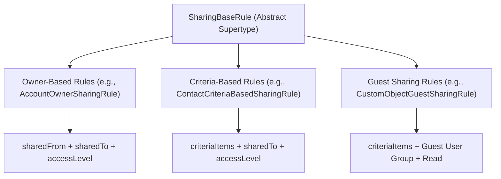

## Architectural Overview

In the Salesforce Metadata API schema, `SharingBaseRule` is the foundational abstract supertype from which all concrete sharing rule types inherit. Whether defining owner-based sharing rules, criteria-based sharing rules, or guest user sharing rules for standard objects (like `Account`, `Contact`, `Opportunity`, `Case`) or custom objects (`CustomObjectOwnerSharingRule`, `CustomObjectCriteriaBasedSharingRule`), `SharingBaseRule` dictates the underlying contract for data access elevation.

Understanding `SharingBaseRule` architecture is essential for enterprise security architects designing multi-tier record sharing models. When Org-Wide Defaults (OWD) are set to Private or Public Read Only, sharing rules open up lateral and cross-departmental access. Because every concrete sharing rule inherits from `SharingBaseRule`, core attributes such as `accessLevel`, `sharedTo`, and `description` follow unified metadata behaviors.



## Directory and File Conventions

Concrete implementations of `SharingBaseRule` are contained within the `sharingRules` directory, partitioned by object name.

| Property | Value |
| :--- | :--- |
| **Abstract Supertype** | `SharingBaseRule` |
| **Concrete Implementations** | `AccountOwnerSharingRule`, `OpportunityCriteriaBasedSharingRule`, etc. |
| **SFDX Storage Folder** | `force-app/main/default/sharingRules/` |
| **File Suffix** | `.sharingRules-meta.xml` |
| **Naming Pattern** | `<ObjectName>.sharingRules-meta.xml` |

## Key Metadata Fields

Attributes defined in `SharingBaseRule` and inherited by all sharing rule types include:

| Field Name | Field Type | Required | Architectural Description |
| :--- | :--- | :--- | :--- |
| `fullName` | `string` | Yes | Unique developer name identifying the individual sharing rule. |
| `accessLevel` | `string` | Yes | Level of access granted: `Read` (Read Only) or `Edit` (Read/Write). |
| `label` | `string` | Yes | Administrative label displayed in Setup and audit logs. |
| `description` | `string` | No | Architectural description outlining business rationale and compliance boundaries. |
| `sharedTo` | `SharedTo` | Yes | Composite recipient structure specifying groups, roles, or territories receiving access. |
| `accountSettings` | `AccountSharingRuleSettings` | No | Specific to Account sharing rules; defines child Opportunity, Case, and Contact access. |

### Access Level Constraints

- For custom objects and most standard objects: `Read` or `Edit`.
- Full access (`All`) cannot be granted via sharing rules; ownership or profile permissions are required for record deletion.
- For guest user sharing rules, `accessLevel` is strictly enforced as `Read`.

> [!NOTE]
> Criteria-based rules also introduce `criteriaItems` and `booleanFilter` elements to specify field-level matching logic (e.g., `(1 AND 2) OR 3`).

## Declarative XML and Package Manifest Examples

Below is an example of an `Account` criteria-based sharing rule inheriting the `SharingBaseRule` structure:

```xml title="force-app/main/default/sharingRules/Account.sharingRules-meta.xml"
<?xml version="1.0" encoding="UTF-8"?>
<SharingRules xmlns="http://soap.sforce.com/2006/04/metadata">
    <sharingCriteriaRules>
        <fullName>Strategic_Accounts_EMEA_Access</fullName>
        <accessLevel>Read</accessLevel>
        <accountSettings>
            <caseAccessLevel>None</caseAccessLevel>
            <contactAccessLevel>Read</contactAccessLevel>
            <opportunityAccessLevel>None</opportunityAccessLevel>
        </accountSettings>
        <description>Grants Read access to EMEA Sales Directors for Strategic Accounts</description>
        <label>Strategic Accounts EMEA Access</label>
        <sharedTo>
            <role>EMEA_Sales_Director</role>
        </sharedTo>
        <criteriaItems>
            <field>Type</field>
            <operation>equals</operation>
            <value>Strategic Partner</value>
        </criteriaItems>
    </sharingCriteriaRules>
</SharingRules>
```

### Manifest Definition (`package.xml`)

```xml title="manifest/package.xml"
<?xml version="1.0" encoding="UTF-8"?>
<Package xmlns="http://soap.sforce.com/2006/04/metadata">
    <types>
        <members>Account</members>
        <name>SharingRules</name>
    </types>
    <version>68.0</version>
</Package>
```

## Retrieval and Deployment

Use the Salesforce CLI to retrieve and deploy sharing rules extending `SharingBaseRule`:

```bash
# Retrieve sharing rules for a specific object
sf project retrieve start --metadata "SharingRules:Account"

# Deploy all sharing rules
sf project deploy start --metadata "SharingRules"
```

## Senior Architect Deployment Best Practices and Gotchas

1. **Recalculation Locking**: Deploying sharing rules against large data volume (LDV) objects (e.g., millions of Account records) initiates sharing recalculation jobs that place database locks on underlying share tables (`AccountShare`). Schedule deployments during off-peak windows.
2. **Dependent Object Access**: Standard objects like `Account` require specifying child access levels (`opportunityAccessLevel`, `caseAccessLevel`). Attempting to set child access higher than parent access is prohibited.
3. **Criteria Rule Limits**: Salesforce enforces a hard limit of 50 criteria-based sharing rules per object. Architecture designs exceeding this threshold must consolidate rules using Public Groups or transition to Apex-managed sharing.
4. **OWD Baseline Requirement**: Sharing rules can only be deployed on objects whose Org-Wide Default (OWD) is set to `Private` or `Public Read Only`. Deploying sharing rules on a `Public Read/Write` object causes deployment errors.

> [!TIP]
> Always verify whether a sharing rule targets an indexed field in `criteriaItems`. Filtering by unindexed text fields can degrade recalculation performance during bulk data loads.
