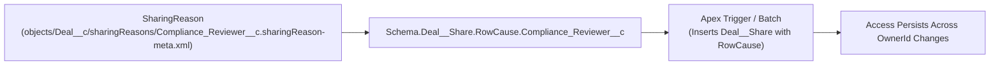

## Why the `SharingReason` Metadata Type Is Essential for Programmatic Sharing

When declarative [SharingRules](/docs/metadata/sharing-rules-metadata-type/) cannot express complex multi-hop or team-based access rules, developers write **Apex Managed Sharing** by inserting rows into the object's share table (`Deal_Registration__Share` or `AccountShare`).

If you insert a share row using `RowCause = 'Manual'`, Salesforce wipes out that share row the moment a user or trigger changes the record's `OwnerId`. Defining a **`SharingReason`** (`objects/<Object>/sharingReasons/<Name>.sharingReason-meta.xml`) creates a dedicated `RowCause` that:

1. **Survives Record Owner Changes:** Shares inserted with a custom `SharingReason` are never deleted when `OwnerId` changes.
2. **Isolates Independent Sharing Engines:** Allows multiple triggers or batch jobs (e.g., `Partner_Tier_Access__c` vs. `Audit_Review_Team__c`) to recalculate and delete only their own share rows without clobbering other sharing logic.

> [!RELEASE] Winter '27
> **Standard Object Support in API v68.0:** Starting in API version 68.0, `SharingReason` is now supported on **standard objects** that have a corresponding `*Share` object (such as `Account` and `Opportunity`) and whose Org-Wide Default can be set to `Private` or `Public Read-Only` (up to 10 custom sharing reasons per standard object)!



---

## SFDX Source Format & Key Fields

In SFDX decomposed object format, each `SharingReason` is stored inside `force-app/main/default/objects/<ObjectName>/sharingReasons/<ReasonName>__c.sharingReason-meta.xml`:

| Field | Type | Required | Description |
|---|---|---|---|
| `fullName` | `string` | Yes | Developer name of the sharing reason ending in `__c` (e.g., `Compliance_Reviewer__c`). |
| `label` | `string` | Yes | Descriptive UI label shown on the **Sharing Hierarchy** page (up to 40 characters). |

---

## Real-World XML & Apex Usage Example

### 1. Metadata File (`objects/Loan_Application__c/sharingReasons/Underwriting_Committee__c.sharingReason-meta.xml`)

```xml
<?xml version="1.0" encoding="UTF-8"?>
<SharingReason xmlns="http://soap.sforce.com/2006/04/metadata">
    <fullName>Underwriting_Committee__c</fullName>
    <label>Underwriting Committee</label>
</SharingReason>
```

### 2. Referencing `SharingReason` in Apex Managed Sharing

```java
Loan_Application__Share shareRecord = new Loan_Application__Share(
    ParentId = loanId,
    UserOrGroupId = committeeGroupId,
    AccessLevel = 'Edit',
    RowCause = Schema.Loan_Application__Share.RowCause.Underwriting_Committee__c
);
Database.insert(shareRecord, false);
```

---

## Querying Share Records by `RowCause` in SOQL

You can audit how many records are shared by each `SharingReason` using `GROUP BY RowCause` on the object's `*Share` table:

```sql
SELECT RowCause, AccessLevel, COUNT(Id) totalShares
FROM Loan_Application__Share
GROUP BY RowCause, AccessLevel
ORDER BY totalShares DESC
```

---

## Senior Architect Best Practices & Gotchas

> [!WARNING]
> **OWD Must Not Be `Public Read/Write` in the Target Org:** If an object's `sharingModel` is set to `ReadWrite` (`Public Read/Write`) in a target Sandbox, its `__Share` table does not exist in the Apex compiler schema, which causes both `SharingReason` and any Apex classes referencing `Schema.MyObject__Share.RowCause` to fail compilation during deployment!

