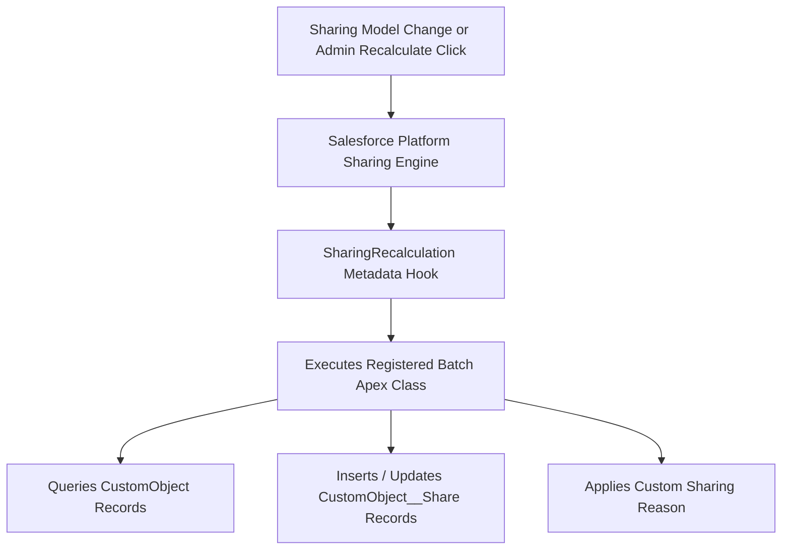

## Architectural Overview

`SharingRecalculation` is an advanced metadata component embedded within custom object definitions that registers a dedicated Apex batch recalculation class. In sophisticated enterprise data models where declarative sharing rules cannot satisfy complex multi-tenant or matrix security requirements, architects implement **Apex-Managed Sharing** using custom sharing reasons (`SharingReason`) and custom share records (`CustomObject__Share`).

However, whenever an organization's default sharing model changes, or when record ownership is restructured in bulk, standard Salesforce sharing recalculation cannot compute custom Apex sharing reasons automatically. `SharingRecalculation` bridges this gap: it instructs the platform to execute a designated batch Apex class when an administrator triggers a manual recalculation or when the object's default sharing model is modified.



## Directory and File Conventions

`SharingRecalculation` is declared directly inside the parent `CustomObject` XML definition file.

| Property | Value |
| :--- | :--- |
| **Metadata Type Name** | `SharingRecalculation` (Child of `CustomObject`) |
| **Parent Metadata Type** | `CustomObject` |
| **SFDX Storage Folder** | `force-app/main/default/objects/<ObjectName>/<ObjectName>.object-meta.xml` |
| **XML Element Tag** | `<sharingRecalculations>` |

## Key Metadata Fields

The `SharingRecalculation` XML structure defines the hook binding the object to its Apex handler:

| Field Name | Field Type | Required | Architectural Description |
| :--- | :--- | :--- | :--- |
| `className` | `string` | Yes | Name of the Apex class implementing `Database.Batchable` to recalculate shares. |

### Apex Implementation Requirement

The Apex class designated in `className` must implement `Database.Batchable<sObject>` and typically follows this design pattern:

```apex
global class ProjectSharingRecalculation implements Database.Batchable<sObject> {
    global Database.QueryLocator start(Database.BatchableContext bc) {
        return Database.getQueryLocator('SELECT Id, Department__c FROM Project__c');
    }
    global void execute(Database.BatchableContext bc, List<Project__c> scope) {
        // Recalculate Project__Share records with custom RowCause
    }
    global void finish(Database.BatchableContext bc) {}
}
```

> [!NOTE]
> The registered Apex batch class must be declared with `global` access if packaged in a managed package or when referenced by platform sharing recalculation hooks.

## Declarative XML and Package Manifest Examples

Below is an enterprise custom object definition binding a custom project sharing recalculation batch:

```xml title="force-app/main/default/objects/Project__c/Project__c.object-meta.xml"
<?xml version="1.0" encoding="UTF-8"?>
<CustomObject xmlns="http://soap.sforce.com/2006/04/metadata">
    <label>Project</label>
    <pluralLabel>Projects</pluralLabel>
    <sharingModel>Private</sharingModel>
    <sharingReasons>
        <fullName>Department_Project_Access__c</fullName>
        <label>Department Project Access</label>
    </sharingReasons>
    <sharingRecalculations>
        <className>ProjectSharingRecalculation</className>
    </sharingRecalculations>
</CustomObject>
```

### Manifest Definition (`package.xml`)

Deploy the `CustomObject` and the registered `ApexClass` simultaneously:

```xml title="manifest/package.xml"
<?xml version="1.0" encoding="UTF-8"?>
<Package xmlns="http://soap.sforce.com/2006/04/metadata">
    <types>
        <members>Project__c</members>
        <name>CustomObject</name>
    </types>
    <types>
        <members>ProjectSharingRecalculation</members>
        <name>ApexClass</name>
    </types>
    <version>68.0</version>
</Package>
```

## Retrieval and Deployment

To retrieve and deploy custom objects with sharing recalculations:

```bash
# Retrieve custom object and corresponding batch class
sf project retrieve start --metadata "CustomObject:Project__c,ApexClass:ProjectSharingRecalculation"

# Deploy object and batch class together
sf project deploy start --metadata "CustomObject:Project__c,ApexClass:ProjectSharingRecalculation"
```

## Senior Architect Deployment Best Practices and Gotchas

1. **Compilation Precedence**: The referenced Apex class must exist and compile cleanly before or during the deployment of the `CustomObject`. Deploying `Project__c.object-meta.xml` without `ProjectSharingRecalculation.cls` will throw a deployment error: `Class not found`.
2. **Deleting Apex Recalculation Classes**: You cannot delete an Apex class that is currently registered in a custom object's `sharingRecalculations`. You must first remove the `<sharingRecalculations>` block from the object metadata and deploy that change before deleting the class.
3. **Batch Governance & Governance Limits**: Ensure the recalculation batch chunks records appropriately (e.g. batch size of 200) to prevent `DmlException` or CPU timeouts when inserting large volumes of `Share` records.
4. **Idempotent Share Insertions**: The batch class should purge existing programmatic shares for the custom `RowCause` before re-inserting to prevent duplicate share errors.

> [!TIP]
> Always pair custom sharing reasons with unit tests that specifically execute the recalculation batch class to ensure coverage and verify share table allocations.
