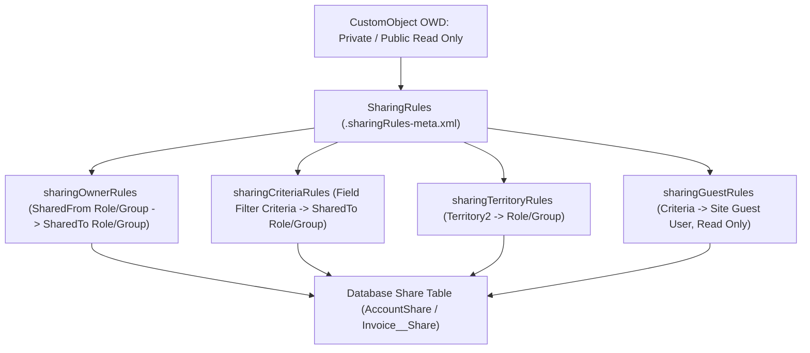

## Overview

The `SharingRules` metadata type (`sharingRules/<ObjectName>.sharingRules-meta.xml`) defines automated record-level sharing exceptions that open up access laterally beyond an object's Organization-Wide Default (`sharingModel` in [CustomObject](/docs/metadata/custom-object-metadata-type/)) and vertical Role Hierarchy.

In API version `33.0` and later, all four categories of sharing rules for an object—**Ownership-Based (`sharingOwnerRules`)**, **Criteria-Based (`sharingCriteriaRules`)**, **Territory-Based (`sharingTerritoryRules`)**, and **Guest User (`sharingGuestRules`)**—are stored together inside `force-app/main/default/sharingRules/<ObjectName>.sharingRules-meta.xml`. You can also deploy or retrieve an individual rule using the child metadata types (`SharingOwnerRule`, `SharingCriteriaRule`, `SharingTerritoryRule`, `SharingGuestRule`) qualified by object name (`Account.Share_Enterprise_Accounts`).



As shown in the architecture diagram above, deploying `SharingRules` causes Salesforce's sharing engine to materialize access rows inside the object's companion database Share table (`AccountShare`, `OpportunityShare`, `Invoice__Share`), which powers instant runtime record visibility.

## Prerequisites

- **Permissions:** "Manage Sharing" and "Customize Application" permissions to deploy sharing rules; "View Setup and Configuration" to retrieve.
- **OWD Prerequisite:** The target object's `sharingModel` or `externalSharingModel` in [CustomObject](/docs/metadata/custom-object-metadata-type/) must be `Private` or `Read` (not `ControlledByParent`).
- **Referenced Groups & Roles:** Every `Role`, `Group` (Public Group), `Queue`, or `Territory2` referenced in `<sharedTo>` or `<sharedFrom>` must exist in the target org.
- **API Version:** Verified against API version `68.0` (Winter '27).

## Key SharingRules XML Elements

| Rule Subtype | Key XML Elements | Architectural Rules & Limits |
| :--- | :--- | :--- |
| `sharingOwnerRules` | `fullName`, `label`, `accessLevel`, `sharedFrom`, `sharedTo`, `accountSettings` (Account only) | Shares records owned by users in `<sharedFrom>` (`role`, `roleAndSubordinates`, `group`, `queue`) with `<sharedTo>`. |
| `sharingCriteriaRules` | `fullName`, `label`, `accessLevel`, `criteriaItems`, `booleanFilter`, `includeRecordsOwnedByAll`, `sharedTo` | Shares records matching `<criteriaItems>` field filters. Always set `<includeRecordsOwnedByAll>true</includeRecordsOwnedByAll>` to include role-less owners. |
| `sharingTerritoryRules` | `fullName`, `label`, `accessLevel`, `sharedFrom` (`territory`, `territoryAndSubordinates`), `sharedTo` | Requires Enterprise Territory Management (`Territory2`) enabled. |
| `sharingGuestRules` | `fullName`, `label`, `accessLevel` (**must be `Read`**), `criteriaItems`, `sharedTo` (`guestUser`) | Grants read-only record access to unauthenticated Experience Cloud or Site guest users. |

> [!WARNING]
> Once a `SharingCriteriaRule` is created in an org, **you cannot change the value of `<includeRecordsOwnedByAll>`** via a subsequent metadata update. Attempting to flip `includeRecordsOwnedByAll` from `false` to `true` on an existing rule fails deployment; you must delete and recreate the rule.

## Auditing Record Sharing via Share Table SOQL

While the rule definitions live in Metadata API, the **runtime results** of `SharingRules` live in each object's `*Share` (standard) or `*__Share` (custom) SOQL table.

### 1. Inspect Why a Record Is Shared (`RowCause` Audit on Custom Object)
Query `Invoice__Share` to see whether a record is shared via Owner, Sharing Rule (`Rule`), Manual Sharing (`Manual`), or Apex Managed Sharing:

```soql
SELECT Id, ParentId, UserOrGroupId, AccessLevel, RowCause, LastModifiedDate
FROM Invoice__Share
WHERE ParentId = 'a01B0000009xYz1IAE'
ORDER BY RowCause ASC
```

### 2. Audit Account Sharing Rules and Associated Opportunity/Case Access
```soql
SELECT AccountId, UserOrGroupId, AccountAccessLevel,
       OpportunityAccessLevel, CaseAccessLevel, RowCause
FROM AccountShare
WHERE RowCause IN ('Rule', 'ImplicitChild', 'Team')
LIMIT 100
```

## Example

The following `Invoice__c.sharingRules-meta.xml` defines both an **Ownership-Based Sharing Rule** (sharing all invoices owned by Regional Sales Roles with the Billing Operations Public Group with `Edit` access) and a **Criteria-Based Sharing Rule** (sharing all `Paid` invoices over \$50,000 with the Executive Audit Group with `Read` access).

```xml title="force-app/main/default/sharingRules/Invoice__c.sharingRules-meta.xml"
<?xml version="1.0" encoding="UTF-8"?>
<SharingRules xmlns="http://soap.sforce.com/2006/04/metadata">
    <sharingCriteriaRules>
        <fullName>Share_High_Value_Paid_Invoices</fullName>
        <accessLevel>Read</accessLevel>
        <booleanFilter>1 AND 2</booleanFilter>
        <criteriaItems>
            <field>Status__c</field>
            <operation>equals</operation>
            <value>Paid</value>
        </criteriaItems>
        <criteriaItems>
            <field>Total_Amount__c</field>
            <operation>greaterOrEqual</operation>
            <value>50000</value>
        </criteriaItems>
        <description>Grants Executive Audit group read access to settled invoices >= $50k.</description>
        < label>Share High Value Paid Invoices</label>
        <sharedTo>
            <group>Executive_Audit_Group</group>
        </sharedTo>
        <includeRecordsOwnedByAll>true</includeRecordsOwnedByAll>
    </sharingCriteriaRules>
    <sharingOwnerRules>
        <fullName>Share_Sales_Invoices_With_Billing_Ops</fullName>
        <accessLevel>Edit</accessLevel>
        <description>Allows Billing Operations public group to edit all invoices owned by Sales roles.</description>
        <label>Share Sales Invoices With Billing Ops</label>
        <sharedFrom>
            <roleAndSubordinates>VP_Global_Sales</roleAndSubordinates>
        </sharedFrom>
        <sharedTo>
            <group>Billing_Operations_Group</group>
        </sharedTo>
    </sharingOwnerRules>
</SharingRules>
```

### Deploying Individual Rules vs All Object Rules in `package.xml`

```xml title="manifest/package.xml"
<?xml version="1.0" encoding="UTF-8"?>
<Package xmlns="http://soap.sforce.com/2006/04/metadata">
    <!-- Option A: Retrieve/Deploy all sharing rules for Invoice__c and Account -->
    <types>
        <members>Invoice__c</members>
        <members>Account</members>
        <name>SharingRules</name>
    </types>
    <!-- Option B: Deploy a single Criteria Rule without touching other rules -->
    <types>
        <members>Invoice__c.Share_High_Value_Paid_Invoices</members>
        <name>SharingCriteriaRule</name>
    </types>
    <version>68.0</version>
</Package>
```

## Limits and Gotchas

- **Total Sharing Rules per Object:** An object can have up to **300 total sharing rules** (Owner + Criteria + Guest combined), of which at most **50 can be Criteria-Based (`SharingCriteriaRule`)** by default (can be increased by Salesforce Support after a performance review).
- **Encrypted & Long Text Fields Not Supported in Criteria:** Fields encrypted with Shield Platform Encryption or typed as `LongTextArea`, `RichTextArea`, or `Formula` cannot be referenced inside `<criteriaItems>` of a `SharingCriteriaRule`.
- **Defer Sharing Calculations for Large Deployments:** In orgs with >5 million records per object, deploying multiple `SharingRules` during business hours can cause row lock timeouts. Suspend sharing rule calculations in **Setup → Defer Sharing Calculations** before deployment and trigger a single consolidated recalculation afterward.

## Related Official Documentation

- [SharingRules Metadata API Reference](https://developer.salesforce.com/docs/atlas.en-us.api_meta.meta/api_meta/meta_sharingrules.htm): Complete XML specification for `SharingRules`, `SharingOwnerRule`, `SharingCriteriaRule`, and `SharingGuestRule`.
- [Record-Level Access: Under the Hood Architect Guide](https://architect.salesforce.com/fundamentals/record-level-access-under-the-hood): Deep dive into Salesforce Share tables and `RowCause` mechanics.
