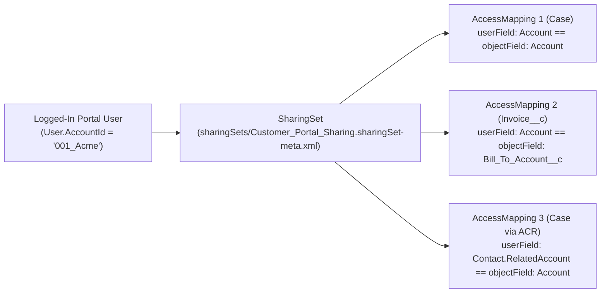

## Why the `SharingSet` Metadata Type Powers High-Volume Experience Cloud Portals

Users with **Customer Community** (High-Volume) licenses are designed to scale to millions of external portal members. To achieve that scale, Salesforce does not generate role hierarchy nodes or calculate standard sharing table rows (`*Share`) for Customer Community users. Instead, **`SharingSet`** (`sharingSets/<Name>.sharingSet-meta.xml`) grants `Read` or `Edit` access at runtime by matching a lookup field on the logged-in `User` (`userField`) against a lookup field on the target record (`objectField`).



---

## Key Metadata Fields on `SharingSet` & `AccessMapping`

| Field | Type | Required | Description |
|---|---|---|---|
| `name` | `string` | Yes | Unique display label of the Sharing Set in Digital Experiences Settings. |
| `description` | `string` | No | Explains which portal persona and records this Sharing Set governs. |
| `profiles` | `string[]` | No | Portal profile names assigned to this Sharing Set (e.g., `Customer Community Plus User`, `Customer Portal Manager`). |
| `accessMappings.object` | `string` | Yes | Target SObject API name (`Case`, `Order`, `WorkOrder`, `Invoice__c`). |
| `accessMappings.accessLevel` | `string` | Yes | `Read` or `Edit`. |
| `accessMappings.userField` | `string` | Yes | Lookup path from the logged-in `User` (`Account`, `Contact`, `Contact.RelatedAccount`, or `Account.ParentId`). |
| `accessMappings.objectField` | `string` | Yes | Lookup path on the target record pointing to an `Account` or `Contact` (e.g., `Account`, `Contact`, `Entitlement.Account`, `Customer_Account__c`). |

---

## Real-World XML Example (`sharingSets/Customer_Self_Service_Sharing.sharingSet-meta.xml`)

```xml
<?xml version="1.0" encoding="UTF-8"?>
<SharingSet xmlns="http://soap.sforce.com/2006/04/metadata">
    <accessMappings>
        <accessLevel>Read</accessLevel>
        <object>Account</object>
        <objectField>Id</objectField>
        <userField>Account</userField>
    </accessMappings>
    <accessMappings>
        <accessLevel>Edit</accessLevel>
        <object>Case</object>
        <objectField>Account</objectField>
        <userField>Contact.RelatedAccount</userField>
    </accessMappings>
    <accessMappings>
        <accessLevel>Read</accessLevel>
        <object>Order</object>
        <objectField>Account</objectField>
        <userField>Account</userField>
    </accessMappings>
    <accessMappings>
        <accessLevel>Read</accessLevel>
        <object>Invoice__c</object>
        <objectField>Billed_Account__c</objectField>
        <userField>Account</userField>
    </accessMappings>
    <description>Grants Customer Community users access to Cases (including related ACR accounts), Orders, and Invoices.</description>
    <name>Customer Self Service Sharing</name>
    <profiles>acme customer community user</profiles>
</SharingSet>
```

---

## Senior Architect Best Practices & Gotchas

> [!TIP]
> **Multi-Account Portal Access with `Contact.RelatedAccount`:** When a single external consultant or regional manager supports multiple B2B customer accounts, enable **Account Contact Relationships (Contacts to Multiple Accounts)** and set `<userField>Contact.RelatedAccount</userField>`. One `SharingSet` mapping will automatically grant that user access to Cases across all Accounts linked to their Contact via `AccountContactRelation`!

- **Profile Names in `<profiles>` Are Lowercase in Metadata:** When retrieving a `SharingSet`, Salesforce outputs custom portal profile names in lowercase (e.g., `<profiles>acme customer community user</profiles>`). Ensure the referenced [Profile](/docs/metadata/profile-metadata-type/) exists in the target org before deploying the `SharingSet`.
