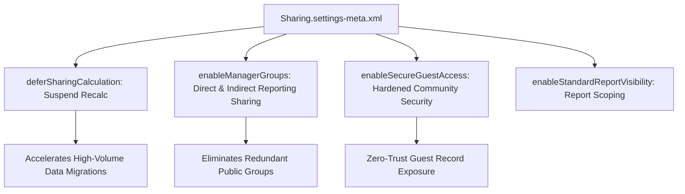

## Architectural Overview

`SharingSettings` is the global metadata type that governs the organization-wide data access infrastructure in Salesforce. While individual object defaults (such as `sharingModel` and `externalSharingModel`) are defined on `CustomObject`, `SharingSettings` controls platform-wide policies: deferred sharing calculation, manager group sharing, standard report visibility, secure guest user record access, and asset sharing.

In large-scale enterprise deployments, managing `SharingSettings` via metadata is critical for data governance and operational stability. For instance, **Deferred Sharing Calculation** allows large data volume (LDV) migration teams to suspend automatic recalculations of sharing rules while importing millions of accounts or reshaping global role hierarchies. Once data loading completes, sharing recalculation is resumed in a controlled, non-blocking window.



## Directory and File Conventions

In SFDX source format, `SharingSettings` is stored in the `settings` directory under the filename `Sharing.settings-meta.xml`.

| Property | Value |
| :--- | :--- |
| **Metadata Type Name** | `Settings` (member: `Sharing`) or `SharingSettings` |
| **SFDX Storage Folder** | `force-app/main/default/settings/` |
| **File Name** | `Sharing.settings-meta.xml` |
| **Scratch Org Setting Key** | `sharingSettings` |

## Key Metadata Fields

The `SharingSettings` metadata structure provides top-level security controls:

| Field Name | Field Type | Required | Architectural Description |
| :--- | :--- | :--- | :--- |
| `deferSharingCalculation` | `boolean` | No | When true, pauses automatic sharing recalculation jobs during bulk updates. |
| `enableAssetSharing` | `boolean` | No | Enables individual record sharing rules and manual sharing on the `Asset` object. |
| `enableExternalSharingModelRule` | `boolean` | No | Enables separate internal and external Org-Wide Defaults for Experience Cloud. |
| `enableManagerGroups` | `boolean` | No | Allows sharing records with a user's direct management chain and subordinate reports. |
| `enableSecureGuestAccess` | `boolean` | No | Enforces private external OWD for guest users and restricts sharing to guest rules. |
| `enableStandardReportVisibility` | `boolean` | No | Enforces standard report visibility based on user role and hierarchy access. |

> [!NOTE]
> `enableSecureGuestAccess` is permanently enforced in modern API versions. However, maintaining this in source ensures consistent baseline security across all scratch orgs and test sandboxes.

## Declarative XML and Package Manifest Examples

Below is an enterprise `Sharing.settings-meta.xml` file configured for strict corporate governance:

```xml title="force-app/main/default/settings/Sharing.settings-meta.xml"
<?xml version="1.0" encoding="UTF-8"?>
<SharingSettings xmlns="http://soap.sforce.com/2006/04/metadata">
    <deferSharingCalculation>false</deferSharingCalculation>
    <enableAssetSharing>true</enableAssetSharing>
    <enableExternalSharingModelRule>true</enableExternalSharingModelRule>
    <enableManagerGroups>true</enableManagerGroups>
    <enableSecureGuestAccess>true</enableSecureGuestAccess>
    <enableStandardReportVisibility>true</enableStandardReportVisibility>
</SharingSettings>
```

### Manifest Definition (`package.xml`)

```xml title="manifest/package.xml"
<?xml version="1.0" encoding="UTF-8"?>
<Package xmlns="http://soap.sforce.com/2006/04/metadata">
    <types>
        <members>Sharing</members>
        <name>Settings</name>
    </types>
    <version>68.0</version>
</Package>
```

## Retrieval and Deployment

Use the Salesforce CLI to retrieve and deploy `SharingSettings`:

```bash
# Retrieve Sharing settings
sf project retrieve start --metadata "Settings:Sharing"

# Deploy Sharing settings
sf project deploy start --metadata "Settings:Sharing"
```

## Senior Architect Deployment Best Practices and Gotchas

1. **Deferred Sharing Calculation Workflow**: Never deploy `deferSharingCalculation: true` into production without a scheduled plan to recalculate. While calculations are deferred, sharing rule changes and role reassignments will not reflect in record visibility until recalculated via the Setup UI.
2. **External Sharing Model Enabling**: Enabling `enableExternalSharingModelRule` allows distinct external sharing models. Once enabled and customized, reverting an object's external sharing model from Private back to Public requires recalculating external shares.
3. **Manager Groups Adoption**: Enabling `enableManagerGroups` provides two automatic groups for every user: `Manager` and `Manager Subordinates`. This significantly reduces the proliferation of custom public groups created solely for hierarchical approvals.
4. **Scratch Org Definitions**: Include `sharingSettings` in `config/project-scratch-def.json` when automated test suites validate community guest user access or manager group record sharing.

> [!TIP]
> Prior to executing massive user role reassignments, enable `deferSharingCalculation` to prevent database locks and race conditions on share tables during business hours.
