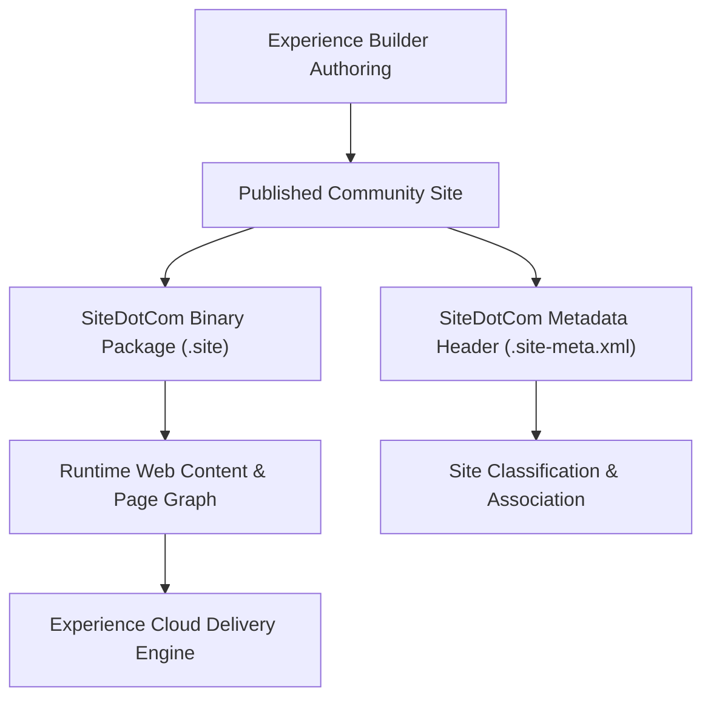

## Architectural Overview

`SiteDotCom` represents the compiled binary site package and metadata definition for Salesforce Experience Cloud (formerly Community Cloud) sites, Site.com portals, and Lightning Web Runtime (LWR) applications. When developers build digital experience pages using Experience Builder, the underlying pages, themes, branding sets, page variations, and component bindings are packaged into a binary `.site` file managed through `SiteDotCom`.

From an enterprise release management standpoint, `SiteDotCom` is one of the most critical yet challenging metadata types. Because the `.site` file is a compiled binary payload rather than readable XML, it cannot be diffed or merged line-by-line in Git. Enterprise teams must pair `SiteDotCom` with companion metadata—specifically `CustomSite`, `Network`, and `ExperienceBundle` (when using Aura sites) or `DigitalExperienceBundle` (when using LWR sites)—to establish robust CI/CD pipelines.



## Directory and File Conventions

In SFDX source format, `SiteDotCom` metadata consists of paired binary and XML files located in the `siteDotComSites` directory.

| Property | Value |
| :--- | :--- |
| **Metadata Type Name** | `SiteDotCom` |
| **SFDX Storage Folder** | `force-app/main/default/siteDotComSites/` |
| **Binary File Suffix** | `.site` |
| **Metadata File Suffix** | `.site-meta.xml` |
| **Naming Pattern** | `<SiteName>.site` and `<SiteName>.site-meta.xml` |

## Key Metadata Fields

The XML companion file (`.site-meta.xml`) contains key operational descriptors:

| Field Name | Field Type | Required | Architectural Description |
| :--- | :--- | :--- | :--- |
| `fullName` | `string` | Yes | Developer name of the site package matching the binary file prefix. |
| `label` | `string` | Yes | Administrative label displayed for the digital experience site. |
| `siteType` | `string` | Yes | Type of site infrastructure (e.g., `ChatterNetwork`, `Visualforce`). |

### Sibling Metadata Types in Digital Experiences

When deploying digital experience sites, `SiteDotCom` is deployed alongside:

- `CustomSite`: The public domain, path, guest user profile, and active status.
- `Network`: Community branding, email settings, member profiles, and tab visibility.
- `ExperienceBundle` / `DigitalExperienceBundle`: Granular text-based JSON/XML source representing individual pages, routes, and components.

> [!NOTE]
> For modern LWR sites, Salesforce uses `DigitalExperienceBundle` for granular source tracking, but `SiteDotCom` remains part of the deployment payload representing the published runtime site container.

## Declarative XML and Package Manifest Examples

Below is an example of the metadata definition file:

```xml title="force-app/main/default/siteDotComSites/Partner_Portal.site-meta.xml"
<?xml version="1.0" encoding="UTF-8"?>
<SiteDotCom xmlns="http://soap.sforce.com/2006/04/metadata">
    <label>Partner Portal</label>
    <siteType>ChatterNetwork</siteType>
</SiteDotCom>
```

The sibling binary file `Partner_Portal.site` resides in the same directory.

### Manifest Definition (`package.xml`)

```xml title="manifest/package.xml"
<?xml version="1.0" encoding="UTF-8"?>
<Package xmlns="http://soap.sforce.com/2006/04/metadata">
    <types>
        <members>Partner_Portal</members>
        <name>SiteDotCom</name>
    </types>
    <types>
        <members>Partner_Portal</members>
        <name>CustomSite</name>
    </types>
    <types>
        <members>Partner_Portal</members>
        <name>Network</name>
    </types>
    <version>68.0</version>
</Package>
```

## Retrieval and Deployment

Use the Salesforce CLI to retrieve and deploy digital experience sites:

```bash
# Retrieve SiteDotCom and related site metadata
sf project retrieve start --metadata "SiteDotCom:Partner_Portal,CustomSite:Partner_Portal,Network:Partner_Portal"

# Deploy site assets to target environment
sf project deploy start --metadata "SiteDotCom,CustomSite,Network"
```

## Senior Architect Deployment Best Practices and Gotchas

1. **Git Merge Conflicts on Binaries**: Never attempt to resolve merge conflicts on `.site` binary files manually. Always designate a single developer or sandbox as the authoritative source for site publishing, pull the compiled site, and commit it cleanly.
2. **Strict Deployment Ordering**: In CI/CD pipelines, ensure the target org has Digital Experiences enabled (`experienceBundleSettings` or `communitiesSettings`) before deploying `SiteDotCom`.
3. **ExperienceBundle Preference**: Where supported (Aura community templates), enable `ExperienceBundle` in `CommunitiesSettings`. This decomposes the site into editable JSON files, minimizing reliance on monolithic `.site` binary files.
4. **Guest Profile Permissions**: Deploying a `SiteDotCom` site does not automatically grant object permissions to guest users. You must deploy the guest user profile (`<SiteName>_Profile`) or permission sets to allow public visitors access to necessary data.

> [!TIP]
> Always verify that custom Lightning Web Components (LWCs) used inside the site are deployed and active before deploying the updated `SiteDotCom` package.
