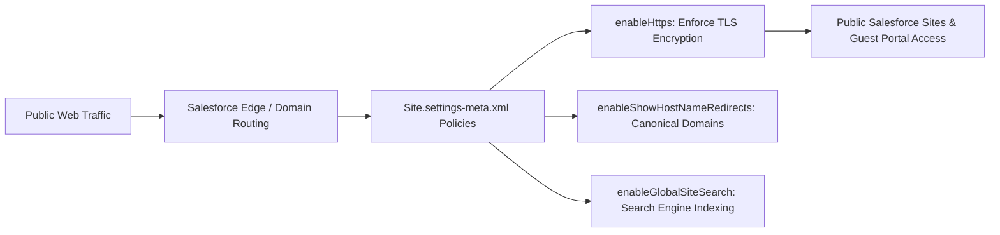

## Architectural Overview

`SiteSettings` is the global settings metadata type governing **Salesforce Sites** and public-facing web endpoints. Salesforce Sites allows organizations to expose public web pages, customer intake forms, payment redirects, and lightweight portals without requiring end users to authenticate with Salesforce user licenses.

From a security architecture and compliance viewpoint, `SiteSettings` enforces critical web application standards. It governs mandatory HTTPS communication, redirection policies for custom hostnames, clickjack protection, and search engine indexing permissions for public pages. Automating `SiteSettings` in continuous integration ensures every environment enforces strict transport layer security and defense-in-depth protocols for external traffic.



## Directory and File Conventions

In SFDX source format, `SiteSettings` is stored in the `settings` directory under the filename `Site.settings-meta.xml`.

| Property | Value |
| :--- | :--- |
| **Metadata Type Name** | `Settings` (member: `Site`) or `SiteSettings` |
| **SFDX Storage Folder** | `force-app/main/default/settings/` |
| **File Name** | `Site.settings-meta.xml` |
| **Scratch Org Setting Key** | `siteSettings` |

## Key Metadata Fields

The `SiteSettings` XML schema provides key global parameters:

| Field Name | Field Type | Required | Architectural Description |
| :--- | :--- | :--- | :--- |
| `enableGlobalSiteSearch` | `boolean` | No | Allows search engine crawlers and internal site search to index public site content. |
| `enableHttps` | `boolean` | No | Enforces encrypted HTTPS connections for all public Salesforce Sites. |
| `enableShowHostNameRedirects` | `boolean` | No | Automatically redirects legacy `secure.force.com` URLs to canonical custom domains. |

> [!NOTE]
> Modern Salesforce releases mandate HTTPS across all web properties. Keeping `enableHttps` set to `true` in metadata safeguards against legacy fallback protocols in automated sandbox builds.

## Declarative XML and Package Manifest Examples

Below is a production `Site.settings-meta.xml` configuration adhering to enterprise infosec standards:

```xml title="force-app/main/default/settings/Site.settings-meta.xml"
<?xml version="1.0" encoding="UTF-8"?>
<SiteSettings xmlns="http://soap.sforce.com/2006/04/metadata">
    <enableGlobalSiteSearch>true</enableGlobalSiteSearch>
    <enableHttps>true</enableHttps>
    <enableShowHostNameRedirects>true</enableShowHostNameRedirects>
</SiteSettings>
```

### Manifest Definition (`package.xml`)

```xml title="manifest/package.xml"
<?xml version="1.0" encoding="UTF-8"?>
<Package xmlns="http://soap.sforce.com/2006/04/metadata">
    <types>
        <members>Site</members>
        <name>Settings</name>
    </types>
    <version>68.0</version>
</Package>
```

## Retrieval and Deployment

To retrieve or deploy `SiteSettings` using the CLI:

```bash
# Retrieve Site settings
sf project retrieve start --metadata "Settings:Site"

# Deploy Site settings
sf project deploy start --metadata "Settings:Site"
```

## Senior Architect Deployment Best Practices and Gotchas

1. **Custom Domain Dependencies**: When enabling host name redirects (`enableShowHostNameRedirects`), ensure custom domains (`CustomDomain` metadata) and matching SSL certificates are active in the target org to prevent broken redirections.
2. **Guest User Data Exposure**: While `SiteSettings` secures transport (HTTPS), application-level security depends on guest user profiles and sharing rules. Never grant public guest users API access or modify permissions on sensitive standard objects.
3. **SEO and Search Indexing**: If building internal-only partner intake pages or payment transaction verification pages, set `enableGlobalSiteSearch` to `false` and include `robots.txt` directives to prevent public search engines from indexing transaction confirmation URLs.
4. **Scratch Org Provisioning**: Scratch orgs do not possess full public vanity domains by default. Test public Sites using scratch org subdomains (`<org-id>.scratch.my.salesforce-sites.com`) during CI pipeline runs.

> [!TIP]
> Combine `SiteSettings` with Salesforce CDN (Content Delivery Network) for custom domains to cache static assets, minimize origin server load, and reduce page load times for international visitors.
