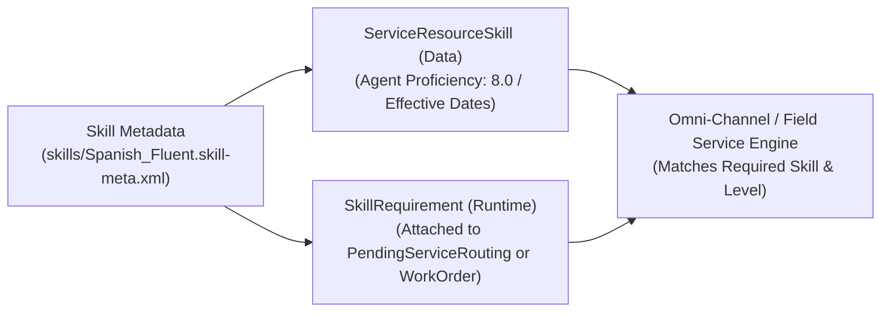

## Why the `Skill` Metadata Type Powers Intelligent Routing

When simple queue membership is too rigid—for example, when a single Case requires **Spanish Language** + **Enterprise Billing** + **AWS Certification**—creating a separate Queue for every permutation leads to "queue explosion." Instead, **`Skill`** (`skills/<Name>.skill-meta.xml`) defines discrete capabilities that are dynamically matched across:

1. **Omni-Channel Skills-Based Routing:** Matching `SkillRequirement` records created by an Omni-Channel Flow or `SkillMappingConfig` against online agents' `ServiceResourceSkill` records.
2. **Salesforce Field Service (FSL):** Matching technician certifications (`ServiceResourceSkill`) with `WorkOrder` and `WorkType` skill requirements.
3. **Salesforce Scheduler:** Matching customer appointment topics to qualified bankers, clinicians, or advisors.



---

## Key Metadata Fields on `Skill`

| Field | Type | Required | Description |
|---|---|---|---|
| `label` | `string` | Yes | Display name of the Skill in Omni Supervisor, Field Service Dispatcher Console, and Setup. |
| `description` | `string` | No | Explains the certification criteria or proficiency scale for the skill. |
| `skillType` | `string` | No | *(API v58.0+)* Categorizes the skill under a `SkillType` group. |
| `assignments` | `SkillAssignments` | No | Legacy Live Agent skill assignments (`profiles` and `users`). Omit in modern `ServiceResourceSkill` architectures. |

---

## Real-World XML Example (`skills/Enterprise_Cloud_Architecture.skill-meta.xml`)

```xml
<?xml version="1.0" encoding="UTF-8"?>
<Skill xmlns="http://soap.sforce.com/2006/04/metadata">
    <description>Certified to troubleshoot multi-region enterprise cloud infrastructure and VPN peering.</description>
    <label>Enterprise Cloud Architecture</label>
</Skill>
```

---

## Querying `Skill`, `ServiceResourceSkill`, and `SkillRequirement` via SOQL

In Apex and Omni-Channel Flows, you regularly query `Skill` to look up `SkillId` values and inspect which agents (`ServiceResource`) hold active certifications.

### 1. List All Skills Configured in the Org

```sql
SELECT Id, DeveloperName, MasterLabel, Description, LastModifiedDate
FROM Skill
ORDER BY MasterLabel ASC
```

### 2. Query Active Agents and Their Skill Proficiency Levels (`ServiceResourceSkill`)

```sql
SELECT Id, ServiceResource.Name, ServiceResource.RelatedRecord.Username,
       Skill.DeveloperName, Skill.MasterLabel, SkillLevel,
       EffectiveStartDate, EffectiveEndDate
FROM ServiceResourceSkill
WHERE ServiceResource.IsActive = true
  AND (EffectiveEndDate = null OR EffectiveEndDate >= TODAY)
ORDER BY Skill.MasterLabel, SkillLevel DESC
```

### 3. Inspect Pending Omni-Channel Skill Requirements in Queue

```sql
SELECT Id, RelatedRecordId, Skill.DeveloperName, SkillLevel, IsAdditionalSkill, SkillPriority
FROM SkillRequirement
ORDER BY CreatedDate DESC
LIMIT 50
```

---

## Senior Architect Best Practices

> [!TIP]
> **Cache `Skill` IDs in a Singleton Apex Map:** When building dynamic Skills-Based Routing in Apex (creating `PendingServiceRouting` and `SkillRequirement` records), query `[SELECT Id, DeveloperName FROM Skill]` once per transaction (or cache in Platform Cache) rather than querying inside a loop.

- **Use `ServiceResourceSkill` Instead of `<assignments>`:** Do not assign users to skills via the Metadata API `<assignments>` block inside `.skill-meta.xml`. That legacy mechanism only applies to Classic Live Agent chat; Omni-Channel Skills-Based Routing, Field Service, and Scheduler all evaluate `ServiceResourceSkill` records!
